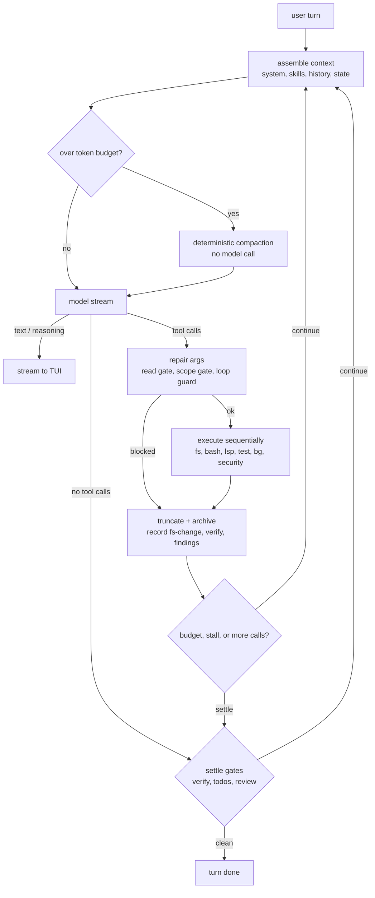

# Totality — Architecture and Implementation Specification

Status: implementation-ready specification, v1.0
Target: Linux first, Rust, local models in the 27B dense to 35B MoE class
Audience: the implementer and contributors; no prior Pi context required

---

## 0. What this is

Totality is a standalone, local-first agent harness for coding and security
work. It talks to any local inference engine that exposes an OpenAI-compatible
chat-completions endpoint. It owns its own agent loop, tools, context
management, session tree, and TUI. It does not depend on Pi, Node, or any
TypeScript runtime.

Pi is a behavioral reference. The `pi/` checkout and the extensions in
`extensions/` describe what the mechanisms should do; they are not dependencies
and their session format is not a compatibility target.

The product stance is simple: **anything the model is unreliable at is enforced
by code, not requested by prompt.** Every failure names the next action. The
harness supplies facts, measures progress, and stops loops; the model does the
work.

## Contents

- [0. What this is](#0-what-this-is)
- [1. Goals and non-goals](#1-goals-and-non-goals)
- [2. Runtime contract](#2-runtime-contract)
- [3. Agent loop](#3-agent-loop)
- [4. Context and compaction](#4-context-and-compaction)
- [5. Sessions as a tree](#5-sessions-as-a-tree)
- [6. Tools and packs](#6-tools-and-packs)
- [7. Extensibility](#7-extensibility)
- [8. Security model](#8-security-model)
- [9. Interfaces: TUI, headless, ACP, and HTTP](#9-tui)
- [10. Configuration and storage](#10-configuration-and-storage)
- [11. Module layout and dependencies](#11-module-layout-and-dependencies)
- [12. Testing and verification](#12-testing-and-verification)
- [13. Milestones](#13-milestones)
- [14. Decision log](#14-decision-log)
- [15. Open items](#15-open-items)

---

## 1. Goals and non-goals

### Goals

- One static binary with a polished TUI and a headless mode.
- Any OpenAI-compatible local endpoint: llama.cpp, Ollama, vLLM, LM Studio,
  and future engines. No engine-specific client code.
- Coding and security as equal first-class packs, both active in the default
  profile.
- A small, static built-in tool surface. No codemode, no tool search, no
  deferred tools.
- Deterministic context management: no model-written summaries.
- Session trees with `/tree`, checkout, and fork. Branch-aware state.
- Extensibility through profiles, skills, workflows, and external tools in any
  language. No plugin ABI and no embedded scripting in v1.
- A local trust posture suitable for sensitive security work: no telemetry,
  localhost default, explicit trust for project-local executable config.
- Community-friendly model handling: model quirks live in TOML profiles, not
  code paths for specific model names.

### Non-goals for v1

- Cloud providers, OAuth, subscription auth, or a hosted model catalog.
- Downloading GGUFs, choosing quantizations, or launching inference servers.
- Subagents or multi-agent orchestration.
- codemode, tool search, deferred tool loading.
- Windows support.
- Pi extension or session compatibility.
- A VM or container runtime. `--sandbox` provides OS-level isolation for
  `bash` and `bg` (bubblewrap, with a Landlock fallback); stronger isolation
  remains the user's responsibility and is documented separately.
- Lua, Rhai, WASM, or any runtime scripting for loop hooks.
- Model training or fine-tuning.

---

## 2. Runtime contract

### 2.1 Provider

One provider: `OpenAiCompatProvider`.

- `POST {base_url}/v1/chat/completions`, `stream: true`.
- Standard OpenAI request body: `model`, `messages`, `stream`, `temperature`,
  `top_p`, `max_tokens`, `stop`, `tools`, `tool_choice`,
  `stream_options: { include_usage: true }`.
- Optional `extra_body` from the model profile for server-specific fields such
  as `chat_template_kwargs`.
- `Authorization: Bearer <key>` only when a key is configured.
- No engine-specific request shapes. If an engine is not OpenAI-compatible, it
  is out of scope for v1.

Streaming:

- SSE frames: `data: {...}`, `data: [DONE]`, comments, CRLF, multi-line data,
  frames split across chunks, multiple frames per chunk.
- Accumulate tool calls in one state machine (`provider/accum.rs`): each call
  is a slot that is `Open` while fragments for its stream index arrive and
  `Closed` when the stream ends or a new whole call takes over the index (a
  name plus arguments while the open arguments are already a complete JSON
  object, or a different engine id). Handles SGLang fragments, vLLM whole
  calls, Ollama calls without `id` or `index`, and object-valued `arguments`.
- JSON is validated at close. When `finish_reason` is `length` (or
  `max_tokens`) and a call's arguments are empty or incomplete, the turn fails
  with `tool_call_truncated` and the call is never executed.
- An in-stream `error` object (`{"error":{...}}` or `{"error":"..."}`) aborts
  the turn with the server's message, even after an HTTP 200.
- A server that ignores `stream: true` and answers `application/json` is
  emitted as the same events, so streamed and non-streamed completions fold
  into one normalized `Completion` (`fold_stream`).
- Parse `usage` and llama.cpp `timings` from any chunk; reports are merged and
  surfaced once per completion.
- Parse reasoning from the configured `reasoning_field`, then
  `reasoning_content`, `reasoning`, and `thinking`. Inline `<think>` blocks and gpt-oss
  `<|channel|>analysis` messages join the same stream, and reasoning markup is
  stripped from assistant content at context assembly. `usage` may carry
  `reasoning_tokens` (reported, else estimated). A per-profile
  `thinking = auto|on|off` policy merges `thinking_control` into `extra_body`
  when thinking is off. A model profile decides
  whether reasoning is shown, kept in context, or stripped after the turn.
- `finish_reason`: `stop`, `length`, `tool_calls`, `content_filter`.

Tool-call ids:

- The session never stores an engine id. `agent/calls.rs` (`CallLedger`)
  assigns `call_0001`, `call_0002`, ... in arrival order, continuing after the
  highest internal id anywhere in the session tree, so ids are unique and
  sortable across turns, branches and compaction. The engine id is mapped to
  the internal id for the current request only.
- Before each request the replayed history must have exactly one result per
  call and one call per result; otherwise the turn fails with a typed error
  (`tool_result_missing`, `tool_result_duplicate`, `tool_result_orphan`,
  `tool_call_duplicate`) and nothing is sent.
- Ids are rendered per model at the wire: Mistral-family models
  (`mistral_common` tokenizers) get nine alphanumerics (`call_0007` →
  `000000007`; ids an older session stored are hashed to `z` + 8 characters).
  Other models receive the internal id unchanged. Older session files replay
  unchanged.

### 2.2 Optional probes

Probes improve accuracy but are never required.

| Probe | Engine | Use |
|---|---|---|
| `GET /v1/models` | all | model list, auto-select when exactly one; `/login` validation |
| `GET /props` | llama.cpp | `n_ctx`, chat template, slots |
| `POST /tokenize` | llama.cpp, vLLM | exact token counts |
| `GET /api/show` | Ollama | context length, model metadata |

A missing endpoint or model never blocks the TUI. Startup probes with a short
timeout; if no model resolves, the core is built in a logged-out state, the
session records a warning, and `/login` later validates and applies the
connection. Headless `--print` rejects the logged-out state. When a model is
already selected, `[model] start_command` runs in the background: the TUI opens
first and a turn waits on a startup gate for the endpoint, so a slow `ssh` or a
failed command cannot hold the launch. A command that exits non-zero is
reported at once instead of waiting out the 30-second retry window.

Fallbacks: `context_window` from config (default 32768), and a calibrated
characters-per-token ratio. Calibration is corrected from `usage.prompt_tokens`
after each request.

### 2.3 Capabilities

Capabilities are detected and cached per `(base_url, model)`:

- `models`, `props`, `tokenize`, `usage`
- `reasoning`
- `native_tools`
- `constrained_tools` (`response_format` JSON schema, GBNF grammar, or guided
  decoding) and its engine dialect: `structured_outputs` on vLLM, GBNF on
  llama.cpp, `response_format` on SGLang/Ollama/LM Studio, KoboldCpp's
  `json_to_grammar`, and `none` on MLX/TabbyAPI. One schema subset is validated
  before sending (unsupported keywords are rejected by name) and every
  structured reply is validated again after parsing. A strict format is
  refused with `tools[]` on engines that do not document both.

A missing capability degrades behavior, never fails the turn. Two compatibility
fallbacks are explicit:

- If the server rejects `stream_options`, retry once without it and estimate
  usage from the stream.
- If the server rejects `tools`, fail the turn with a prescriptive message
  naming the engine flag to enable tool calling (`--jinja` on llama.cpp,
  `--enable-auto-tool-choice` and a tool-call parser on vLLM, or the equivalent).
  The harness does not silently drop tools and become a chat client.

### 2.4 Model profiles

Model quirks are TOML, not Rust branches.

```toml
[model_profile.qwen3]
match = ["qwen3", "qwen3.5"]
context_window = 65536
strip_reasoning = true
reasoning_field = "reasoning_content"
tool_mode = "native"              # native | repair | auto
parallel_tool_calls = false
stop = ["<|im_end|>"]
extra_body = { chat_template_kwargs = { enable_thinking = true } }

[model_profile.gemma3]
context_window = 32768
strip_reasoning = true
tool_mode = "repair"
```

`model_profile = "auto"` matches by model-name prefix if a profile declares
`match = ["qwen3", "qwen3.5"]`; otherwise the `default` profile is used. A
user-defined profile always beats a bundled preset.

Per-model samplers (`temperature`, `top_p`, `min_p`, `repeat_penalty`,
`dry_multiplier`, `dry_base`, `xtc_probability`, `seed`) override the global
`[model]` fields one by one. They are lowered to the engine's own key names
(`repeat_penalty` vs `repetition_penalty`); fields the engine does not accept
are omitted, never sent as unknown keys, and `tot doctor` warns about each
omission. Bundled presets: `qwen-coding`, `gemma-chat`, `glm-agent`.

### 2.5 Errors and timeouts

- Connect timeout 5 s; first token 120 s; stream idle 120 s; total request
  timeout 15 min, all configurable.
- The provider still retries a connection failure once before any token. On
  top of that, the loop sends the request again when a call fails for a
  transient reason: a connection failure, a dropped or stalled stream, a 5xx
  except 501/505, 408/504, or 429 (its own `rate_limited` class). Up to
  `[model] retries` (default 3), with jittered 1x/4x/15x backoff of
  `retry_backoff_ms` (default 1000), honoring `Retry-After` while the total
  wait stays within `retry_deadline_secs` (default 120). Each retry is a
  notice, the partial reply is logged as a `model-retry` entry and never
  replayed, and retries do not count as model calls. Ctrl+C interrupts the
  backoff, and the final error says "gave up after N attempts". A call that
  ran out the whole-request timeout is not retried. When a reply failed after
  streaming text, a `discard` event (also in `--json` and SSE) tells
  frontends to drop that text; piped `tot -p` output holds each call's text
  until the call completes. `retries = 0` restores the old behavior.
- Error classes: `connection`, `auth`, `model_not_found`, `context_too_small`,
  `bad_request`, `rate_limited`, `server`, `cancelled`, `parse`.
- Errors shown to the model and the user are prescriptive: what failed, what
  the harness tried, and the next action. No stack traces in tool results.

---

## 3. Agent loop

### 3.1 State machine



States: `Idle`, `AssembleContext`, `Compact`, `StreamModel`, `ToolBatch`,
`PostTool`, `SettleGates`, `Done`, `Cancelled`, `Error`.

### 3.2 Turn flow

1. Append the user entry to the session branch.
2. Assemble context from the active branch, including the cached repository
   brief in the system prompt. The stable profile prompt, tool index, and
   project instructions come first; volatile session facts (working directory,
   profile name) sit at the tail so the engine can reuse its prefix cache.
3. If the prompt budget is exceeded, write a compaction entry and rebuild. A
   `cache-boundary` entry records the reused prefix and the suffix that must
   re-prefill.
4. Send the model request with the profile's tool list in a stable order.
5. Stream text, reasoning, and tool calls. Emit UI events.
6. If there are no tool calls, run settle gates.
7. For each tool call, in order:
   - parse and repair arguments;
   - run guards;
   - execute with a timeout;
   - cap, archive, and append the result;
   - update budgets, stall, and verify state.
8. If the checkpoint allows and the model asked for tools, go to 2. A
   productive checkpoint renews its allowance instead of ending the turn.
9. Settle gates may inject a synthetic message and continue. Caps apply.
10. Mark the turn done; flush and fsync the session.

A guard block appends an `is_error` tool result with the guard code rather than
skipping the call. Every tool call in a batch gets a result, so the provider
context stays valid.

### 3.3 Tool argument repair

Repair runs before JSON Schema validation. It is deliberately boring and
observable.

- Parse `function.arguments` as JSON; if it is a JSON string containing an
  object, parse twice.
- Drop `null` values; a null optional means "not provided".
- Coerce stringified numbers and booleans, whole floats to integers, and
  scalars to strings where the schema expects a string.
- Recover arrays sent as a JSON-encoded string or a bulleted/numbered list.
- Unwrap single-element arrays where the schema expects a scalar.
- Map alias keys per tool, from the names other harnesses train models on:
  `file_path`/`file`/`filepath` to `path`, `cmd` to `command`,
  `old_string`/`oldText` to `edit.old` or `patch.anchor`, `new_string`/`newText`
  to `edit.new` or `patch.replacement`, `query`/`regex` to `grep.pattern`, and
  similar. An alias applies only when the tool declares the canonical key, and
  never overwrites a canonical key the model also sent.
- Fold enum values: case, surrounding space, and `_` vs `-` are ignored, and a
  few synonyms are accepted (`complete` for `todo` `done`, `kill` for `bg`
  `stop`).
- Infer an omitted `action` only when unambiguous (`todo` with `tasks` is
  `plan`, `bg` with `command` is `start`).
- Apply defaults: `bash.timeout`, `grep.max_matches`, `recall` range. `read`
  applies its own page size so an explicit `end` is never clipped.
- Drop undeclared keys and say so: the result carries
  `note: ignored unknown argument(s) ...; <tool> accepts ...`, and a
  `missing_argument` error names the dropped keys that likely caused it.
- Generate a synthetic `call_<n>` id when the provider omits one.
- Reject no-op edits and interactive-only commands with the exact call shape to
  use instead.
- Resolve tool names before any gate runs: strip `functions.` / `default_api:`
  prefixes and case drift, and route unambiguous foreign names (`read_file`,
  `str_replace`, `shell`, `run_command`, ...) to the active tool with a note
  naming the canonical tool. Gates see the canonical name, so routing never
  bypasses the read or scope gates.
- Reject any other unknown tool with
  `unknown tool "<name>"; did you mean <nearest>? active tools: ...`.
- On failure, return `is_error: true` with a prescriptive message, never a
  schema dump.

### 3.4 Guards

| Guard | Behavior |
|---|---|
| Permission policy | Evaluated first for every repaired call (`agent/authorize.rs`, `policy/`). Ordered `[permissions]` rules match on tool glob, path glob, command regex, and network; the last matching rule wins, except that a `deny` holds against any later `allow`/`ask` that is not strictly more specific. No match falls back to the mode: `ask`, `accept-edits`, `plan`, `dont-ask`, or `yolo` (flag only). A deny or plan-mode refusal returns `DENIED`/`plan_mode` with the rule id and the turn continues; an `ask` is resolved after the other gates pass, and an approval covers exactly that command or path for the session. See 8.13. |
| Read-before-edit | `edit`/`patch` on an existing file require a prior `read` with a matching stat stamp (`mtime`, size). `write` also requires full-line coverage of the existing file, or an explicit `overwrite: true`; a result capped by the result or batch limit marks coverage incomplete. A changed file requires a re-read. Creation is allowed. A successful `edit`/`patch`/`write` re-stamps only the file it wrote, so consecutive edits need no re-read while any outside change still does. |
| Scope gate | Security-sensitive commands are checked against the user-set engagement scope. No scope blocks with `SEC_SCOPE` and the `/sec scope add` call. Best-effort, not a sandbox. |
| Sandbox | When `--sandbox` is set, `bash` and `bg` run in a bubblewrap namespace (or the Landlock fallback): read-only root, hidden `$HOME`, private `/tmp`, no network, and `.git` read-only in `workspace-write`. Startup fails closed when no backend exists; a per-command wrap failure returns `SANDBOX_UNAVAILABLE`. Commands never fall back to an unsandboxed run. |
| Loop guard | Signature is tool name plus canonical arguments. Four identical calls in a row, or an exact 2-8 call cycle repeated four times, blocks the call and ends the turn with a recovery instruction and the `stalled` status (exit code 2 from `tot -p`, never a successful workflow step). A file change or a passing verification clears the history, so long multi-step work does not trip it. No automatic session replacement in v1. |
| Interactive command guard | Blocks `vim`, `less`, `top`, `htop`, `watch`, `nano`, `ssh` without a command, and similar TTY-only invocations. |
| Budget checkpoint | Tool calls, model calls, and wall clock are checked at 120 calls, 40 model calls, and 30 minutes. A checkpoint that finds a new result, a file change, or a passing verify within the last `stall_calls` calls renews the allowance and the turn continues. A checkpoint with no recent progress ends the turn and reports why. |
| Stall | Twelve consecutive calls with no new result fingerprint, no file change, and no successful verify. Ends the turn with the last known state. |
| Todo gate | After two mutations or edits touching two files, the run is multi-step and requires a plan. The final task requires a fresh passing verify when verification is configured. |
| Verify gate | Successful mutations newer than the last passing verify are unverified. Continue up to two times with a verify instruction, then record the unverified state and allow settle. |
| Review nudge | One continuation per run after mutations, asking for `review`. Never fights verify or todo gates. |

Guards are inert when their required tool is absent from the active profile.

### 3.5 Execution and cancellation

- Tools execute sequentially. Parallel read-only tools are a later optimization
  only if measurements justify it.
- Every tool has a timeout. Background-shell processes are supervised in
  process groups; cancellation sends SIGTERM, then SIGKILL after 2 s.
- If a turn is cancelled mid-batch, the harness appends an `is_error` tool
  result with code `cancelled` for every unresolved call. The branch remains a
  valid provider context instead of ending on an assistant message with
  unanswered tool calls.
- Ctrl+C cancels the model request and the running tool, appends a cancellable
  error entry if useful, and returns the TUI to idle. The session remains
  consistent and resumable.
- The model loop checks tool, model, and wall-clock checkpoints. A productive
  run renews each allowance; only a checkpoint with no recent progress, the
  loop guard, or the stall guard ends the turn.

### 3.6 Settlement

`SettleGates` returns one of:

- `Done`: the turn ends.
- `Continue { message }`: inject a synthetic user/system message and run again.
- `Block { reason }`: append an error entry and end the turn.

At most two settle continuations per turn, shared by verify and todo gates.
The review nudge is one-shot and does not count against the verify cap.

With `[gates] auto_settle` (default true), the harness runs the checks itself
when the model settles after changing files: `verify` while attempts remain,
then `review`, through the same permission rules and `pre_tool`/`post_tool`
hooks as a model call. It records the usual `verify-result` entry plus a
`review-result` entry. Clean results settle on the answer already written, with
a `[harness] verify passed, review clean` notice; a failed verify or a flagged
review continues once with a user-role message carrying the results, so no
orphan tool result enters the context path. `auto_settle = false` keeps the
model-relayed gate messages.

One step before the todo gate — the second mutation, or the first edit of a
second file, with no plan — the successful mutation's tool result ends with one
line saying the next edit needs a plan. It appears once per turn; the gate
itself is unchanged.

### 3.7 Output recovery

Local servers often lack a reasoning or tool parser, and small models loop.
`agent/output.rs` repairs what can be repaired deterministically; anything
else becomes a harness message (`[totality] <kind>: ...`) and the loop
continues. Nudges are capped at three per turn.

| Symptom | Handling |
|---|---|
| `<think>` / `<thinking>` in content | Split out while streaming (tags may straddle deltas) and stored as reasoning; text before a lone `</think>` too. |
| Tool calls written as text | With `tool_mode` `repair` or `auto`, parsed into native calls before gates run (formats in `docs/model-setup.md`). Fenced/bare JSON must name an active tool and end the reply. |
| Exact repetition | The stream is checked as it grows; a tail of one unit repeated at least 5 times and 600 bytes stops generation, keeps one copy, and nudges. Repeated loops end the turn as `stalled`. |
| `finish_reason = length` | A cut tool call (arguments not valid JSON) does not run; the model is told to send smaller calls. Cut prose is continued. A reply that spent the budget thinking is told to act. |
| Empty reply | One nudge to call a tool or answer. |
| Silent prompt truncation | The engine's `truncated` flag and context-shift count are proof and end the turn. Arithmetic signals need a second witness: `prompt_tokens + cached_tokens` covering the prompt means an uncached-only report; `/tokenize` decides between a cut prompt (it exceeds the window) and a wrong report (it fits); a count under 512 tokens is a broken usage field; impossible characters per token with a plausible count is a confirmed cut; a plain shortfall must repeat on the next call. A wrong report keeps the reply, warns once, stops calibrating from usage on that endpoint, and is recorded for `tot doctor`, which reports it without sending a chat completion. |

---

## 4. Context and compaction

### 4.1 Budget

```
usable_prompt = context_window - max_output_tokens - safety_margin
```

- `max_output_tokens` defaults to 4096 and is capped at a quarter of the
  window, so a small server window always leaves room for the prompt. The
  request's `max_tokens` uses the capped value.
- `safety_margin` is 5% of the context window, minimum 512 tokens.
- Tool schemas, system prompt, skills index, and state blocks count toward the
  prompt. The serialized `tools` array is measured once when the core is built:
  exact `/tokenize` tokens when the engine exposes it, otherwise JSON density
  (2.6 chars/token) rather than the prose ratio.
- Compaction triggers at 80% of `usable_prompt`, or when the provider returns a
  context-length error.

### 4.2 Token accounting

- If `/tokenize` is available, use it to calibrate a characters-per-token ratio
  on a representative sample, and periodically re-calibrate. The ratio applies
  to prose and messages; tool schemas keep their own fixed JSON estimate.
- After each model call, use `usage.prompt_tokens` to correct the estimate.
- If no usage is available, estimate from characters with the calibrated ratio.
- Every entry stores an optional `tokens` estimate for the tree view and budget
  accounting.
- `usage.cached_tokens` (`prompt_tokens_details.cached_tokens`, or llama.cpp
  `timings.cache_n`) is reported per call. The TUI header shows `cache
  <cached>/<prompt>`; `--json` usage events carry `cached_tokens` and
  `cache_percent`. Two consecutive calls under 70% emit a notice naming the
  likely invalidator: a compaction, a rewritten system message, a changed
  tool list, or server-side eviction.
- The request prefix (leading system block plus serialized tools) is hashed
  with SHA-256 and recorded once per core build as a `prompt-prefix` entry, so
  a changed prefix is visible next to the turn where it changed.

### 4.3 Tool result caps and archive

- One tool result may occupy 4% of the usable prompt in characters (at 3.5
  characters per token), clamped to 2500..16000; one batch may occupy 12%,
  clamped to 8000..40000. Small windows therefore keep the original
  2500/8000. `[budgets] result_cap_chars` and `batch_cap_chars` override
  either.
- `read`, `grep`, and `glob` size their own output within the cap in whole
  lines or entries and report the real range: `[lines a-b of n; next
  start=c]`, or `N of M matches shown`. A `read`'s recorded coverage is
  exactly the lines shown. The loop's blind cut is only a fallback, at a
  line boundary.
- Larger output is written to an artifact under the session's artifact
  directory. The tool result contains a short preview plus `[out-N]` and the
  artifact size. Command tools (`bash`, `bg`, `test`, `verify`) preview the
  first and the last lines, where errors and summaries land, and name the
  omitted range: `… 380 lines omitted (12-391); recall out-3 12-131 …`.
  Other tools preview the start, cut at a line boundary, and name the first
  line that was left out: `(truncated after line 41 of 380; recall out-3
  42-161 …)`.
- `recall` reads an artifact range, capped at 4000 characters per call.
- Artifacts are user-readable files with `0700` directories. Retention is
  configurable; default is 30 days.

### 4.4 Deterministic compaction

No model call. The summary is built from session entries.

Sections, omitted when empty:

```
[totality] deterministic compaction

## Active thread T{n} - {title}
objective: ...
constraints: a; b
files: a, b
done: ...
open: ...
facts: ...

## Repo
changed: path, path
verify: passed|failed|not run (n entries ago)

## Findings
3 open (1 high, 2 medium)

## Last instruction (verbatim)
... (max 600 chars)

## Last actions
bash(cargo test) -> 12 passed
edit(src/parser.rs) -> +18 -4
```

Budget target: `clamp(chars_for(usable_prompt) / 3, 1200, 4500)` characters, so a
small window gets a proportionally small summary. A hard postcondition keeps
the summary at or under 40% of the usable prompt.

Trim in this order until under the target:

1. last actions;
2. facts;
3. done/open lists (keep the first three);
4. last instruction to 300 characters.

If even that exceeds 40%, drop `## Repo`, `## Findings`, `## Last actions`, and
the optional lists, keeping only the objective, open tasks, and last
instruction.

Never trim the active objective or title.

Compaction runs whenever the estimate crosses the threshold again after new
work. If the estimate is still over the threshold immediately after a
compaction, the turn ends with a `budget_context` diagnostic naming the static
overhead instead of compacting the same bytes again.

A compaction entry is a node on the branch. Context assembly starts after the
latest compaction on the path. The compaction entry itself is not a message;
its summary becomes the first system message.

An automatic compaction keeps the most recent exchange verbatim: the entry's
`keep_from` names the first kept entry, and assembly replays the summary, then
the kept entries, then everything after the compaction. The kept range fits
20% of the usable prompt, starts on a user or assistant entry so every tool
result travels with its call, comes only from after the previous compaction,
and never covers the whole context. The summary then omits what the range
shows (its actions, and the last instruction when it is inside the range). If
the kept range leaves the context over the threshold, the loop compacts again
without it before reporting `budget_context`. Compactions after a provider
context error, `/compact`, and `thread split` keep nothing.

Messages the harness writes in the user role (gate continuations, recovery
nudges) start with `[totality]` and are never taken as the last
instruction or the objective.

### 4.5 Threads

`thread split` closes the current thread, records a brief, and at settle writes
a compaction entry with `reason: "thread_split"`, then appends a user entry with
the kickoff text. This gives the model a fresh context without a new session,
new process, or second model. It is not a subagent.

The kickoff names the thread, objective, constraints, files, and the first open
step. The old branch remains in the tree and on disk.

### 4.6 State block

After a compaction, inject one short state block: changed files, last verify,
active thread, open findings count, and the current budget. This prevents the
model from re-reading half the repository.

Assembly attaches the block to the last message of each request, at assembly
time; it is not stored, and it is not part of the system message. A change in
changed files, verify status, or the budget band therefore costs only the tail
instead of making the engine re-evaluate the whole conversation. The budget is
reported in bands (under 50%, over 50%, over 65% of the usable prompt), not as
an exact percentage.

Hook context follows the prefix rule too. `session_start` and `pre_compact`
context joins the leading system message, written once; `user_prompt` and
`stop` context is rendered in place on the user or tool message it belongs to;
`pre_tool`/`post_tool` context lives only in the tool result.

---

## 5. Sessions as a tree

### 5.1 File format

One JSONL file per session tree. Append-only. Every line is one entry.

```json
{"v":1,"seq":0,"id":"s0","parent":null,"ts":"2026-11-07T20:00:00Z","type":"session","data":{"cwd":"/home/user/src/app","endpoint":"http://127.0.0.1:8080","model":"local-model","profile":"full","app":"0.2.0"}}
{"v":1,"seq":1,"id":"e1","parent":null,"ts":"...","type":"user","data":{"content":"Fix the parser bug"}}
{"v":1,"seq":2,"id":"e2","parent":"e1","ts":"...","type":"assistant","data":{"content":"I will inspect it.","tool_calls":[{"id":"call_1","name":"read","arguments":{"path":"src/parser.rs"}}],"usage":{"prompt_tokens":512,"completion_tokens":18}}}
{"v":1,"seq":3,"id":"e3","parent":"e2","ts":"...","type":"tool_result","data":{"call_id":"call_1","content":"...","is_error":false}}
{"v":1,"seq":4,"id":"e4","parent":"e3","ts":"...","type":"assistant","data":{"content":"The bug is ..."}}
{"v":1,"seq":5,"id":"c1","parent":null,"ts":"...","type":"checkout","data":{"target":"e3","reason":"fork"}}
{"v":1,"seq":6,"id":"e5","parent":"e3","ts":"...","type":"user","data":{"content":"Try another approach"}}
{"v":1,"seq":7,"id":"e6","parent":"e5","ts":"...","type":"assistant","data":{"content":"I will check the lexer ..."}}
```

Entry fields:

- `v`: format version.
- `seq`: monotonic integer within the file.
- `id`: `e<seq>` for entries, `c<seq>` for checkouts, `s0` for the header.
- `parent`: entry id, or `null` for the first user entry.
- `ts`: RFC 3339 UTC.
- `provenance`: optional source tag (`user`, `tool:<name>`, `skill`, `external`,
  `repo`). Absent on old entries and on harness-internal entries.
- `type` and `data`.

### 5.2 Entry types

| Type | Data |
|---|---|
| `session` | cwd, endpoint, model, profile, app version, redact, context?, permissions? (`mode`, `rules_hash`, `rules`) |
| `user` | content |
| `assistant` | content, reasoning?, tool_calls?, usage?, stop_reason? |
| `tool_result` | call_id, content, is_error, details?, artifact? |
| `compaction` | summary, tokens_before, reason, thread_id? |
| `checkout` | target, reason (`tree`, `fork`, `resume`) |
| `custom` | kind plus payload (`fs-change`, `hunk-review`, `rewind`, `verify-config`, `verify-result`, `todo-state`, `finding`, `thread-state`, `guard-trip`, `profile-change`, `model-change`, `prompt-prefix`, `cache-boundary`, `cache-cold`, `permissions`, `permission-mode`, `plan`, `hook-invocation`, `hook-context`, `provenance-warning`, `provenance-approval`) |
| `error` | code, message, recoverable |

An assistant entry with `tool_calls` is a batch. The tool results that answer it
are its children, appended in call order; the first result's `parent` is the
assistant entry, and each later result is parented to the previous result.
Context assembly emits the assistant message with all of its `tool_calls`
followed by the matching `tool` messages. A batch is a unit: checkout
resolution never stops between an assistant entry with tool calls and its last
result.

`checkout` entries are markers, not branch nodes: `parent` is always `null`.
They are excluded from context and from the tree structure.

### 5.3 Active leaf and context path

- `active_leaf` is the last `checkout.target` if the last entry is a checkout,
  otherwise the id of the last non-checkout entry.
- Context path: walk `parent` from `active_leaf` to the root, reverse, then take
  entries after the latest `compaction` on that path.
- `checkout` never changes history. It selects a point. The next user message
  becomes a child of that point, creating a new branch.
- Branch-aware state (todos, verify freshness, thread ledger, guard strikes) is
  recomputed from the path after every checkout.
- Findings are engagement-global, not branch-aware. A finding records the
  session and entry that produced it.

Checkout resolution:

- A checkout target must be a completed step boundary: a user entry, the last
  `tool_result` of a batch, an assistant entry without tool calls, a
  compaction, or a custom entry.
- Selecting an assistant entry with tool calls, or an earlier result in its
  batch, resolves to the last completed `tool_result` in that batch. The UI
  moves the selection there rather than starting a branch mid-batch, because an
  assistant message with unresolved tool calls is not a valid provider context.
- A batch missing one or more results is incomplete. It is not a checkout
  target; the UI reports `step incomplete; choose the last completed result`.

### 5.4 Tree UI

`/tree` opens a modal with a flattened depth-first tree:

```
e1  U  Fix the parser bug                          20:10
`- e2  A  I will inspect it. [read]                20:11
   `- e3  R  read src/parser.rs: 142 lines         20:12
      |- e4  A  Found it. The bug is ...           20:13
      `- e5  U  Try another approach               20:20
         `- e6  A  I will check the lexer ...      20:21  *
```

- `*` marks the active leaf; vertical and corner glyphs mark branch points.
- Role icons: `U` user, `A` assistant, `R` tool result, `C` compaction, `E`
  error. A branch point is drawn from the tree structure, not a role.
- Selecting an assistant row that carries tool calls moves the checkout to the
  last result of that batch.
- Each row shows a one-line preview, timestamp, and token estimate.
- Keys: `j`/`k` move, `PgUp`/`PgDn` page, `Enter` checkout, `f` fork from the
  selected entry, `n` new branch from the selected entry, `Esc` close.
- `f` and `n` both checkout the selected entry and focus the input. `f` is the
  muscle-memory name; `n` is the explicit "new branch" name.
- Checkout is non-destructive and needs no confirmation. The old branch remains
  in the file and in the tree.
- The footer names the keys and the current branch point.

`/fork` without a tree selection checkouts the most recent assistant entry,
resolving through its tool batch to the last result. `/tree` is a view; it never
deletes entries.

### 5.5 Rewind

`/rewind [turns] [force]` and `tot --rewind <session>:<entry>` move the active
leaf to an earlier entry **and** put the working tree back to the state it had
at that entry. `/rewind` defaults to one turn: the entry before the last user
message, so the last turn's edits are reverted and its conversation is
abandoned. `turns = 2` reaches before the second-to-last user message, and so
on; the session header is a valid target for a full reset.

The plan is built from the active branch's `fs-change` entries, the same data
`undo` uses:

- Changes after the target are replayed in reverse. The last write for a file
  is its oldest post-target snapshot, which is the content it had at the
  target; a file the reverted changes created is deleted.
- A change an earlier `undo` reverted is ignored, exactly as undo ignores it.
  An `undo` after the target that reverted a change made at or before the
  target cannot be reconstructed (the harness never snapshots what an undo
  restores) and refuses, naming the file.
- Files with no `fs-change` entry are never touched. Changes made through
  `bash` have no snapshot and stay as they are.
- Before writing, each file is checked against the newest change's
  `after_sha256`. A mismatch means the file changed outside the harness; the
  rewind writes nothing, moves no leaf, and names every conflicting file.
  `force` backs those files up next to the originals as
  `<name>.tot-rewind-<nanos>.bak` before restoring them.
- After the files, the leaf moves with a `checkout` marker (`reason =
  "rewind"`) and a `rewind` custom entry records the target, restored and
  deleted paths, backups, and the reverted `fs-change` seqs. The abandoned
  branch is untouched and remains visible in `/tree`.
- Restored bytes are re-stamped as harness-written, so the model does not have
  to read a file again before editing it.

A session with no harness file changes after the target is a pure checkout:
only the marker and the `rewind` entry are appended.

### 5.6 Storage

```
~/.local/share/totality/
  sessions/
    <project-id>/
      <session-id>.jsonl
      <session-id>.jsonl.lock
      artifacts/
        <session-id>/
          out-1.txt
  engagements/
    <engagement>/
      scope.toml
      findings.jsonl
      evidence.jsonl
      evidence/
        e1.txt
      surface.json
```

- Evidence artifacts are append-only and `0600`; each ledger entry carries the
  SHA-256 of the artifact. The surface inventory is rewritten atomically after
  each command that produces observations.

- `project-id` is the first 12 hex characters of SHA-256 over the canonical
  working directory.
- `session-id` is `YYYYMMDD-HHMMSS-<pid>` or a short random suffix.
- One advisory lock per session file. A second process refuses to write and
  names the lock holder.
- Flush each entry to the file. `fsync` once at turn end; compactions inside a turn are covered by that fsync.
- On load, ignore a malformed final line, drop orphan entries with a warning,
  and validate that every `parent` exists.
- Export: `/export [path]` writes Markdown for the active branch. Findings have
  their own report.

### 5.7 Resume and switching

- `tot --continue` loads the most recent session for the project.
- `tot --resume <session-id>` loads a specific session.
- `/sessions` lists sessions with first-user-message previews and lets the user
  switch. Switching replaces the in-memory app state; it does not merge.
- On resume, show the active branch, model, endpoint, and profile. If the
  current endpoint or model differs from the header, warn but allow.
- `--no-session` disables persistence entirely (no file, no artifacts).

---

## 6. Tools and packs

### 6.1 Built-in tool surface

Twenty-seven tools. Static per model call. The default `coding` profile includes
core and coding; `full` adds the security pack.

| Pack | Tool | Purpose |
|---|---|---|
| Core | `read` | Read a file with line numbers; `paths` for up to six files or ranges, `symbol` for one declaration |
| Core | `write` | Create or replace a file |
| Core | `edit` | Exact-text replacement |
| Core | `patch` | Exact-anchor edit by default; hash mode takes line anchors with recovery diagnostics |
| Core | `undo` | Revert the last harness change to a file, one step per call |
| Core | `bash` | Non-interactive command with timeout |
| Core | `grep` | Regex search with context, gitignore-aware (hidden paths only when named) |
| Core | `glob` | File discovery |
| Core | `todo` | Plan and task state, verify-gated |
| Core | `verify` | Run project verification steps |
| Core | `recall` | Read archived tool output |
| Core | `thread` | Split, note, close, status |
| Core | `bg` | Background process start/status/logs/stop |
| Coding | `lsp` | outline, definition, references, diagnostics, hover |
| Coding | `repo_map` | Cached file and symbol outline |
| Coding | `test` | One file or one test; first failure only |
| Coding | `review` | Working-tree stats, risks, hunks |
| Coding | `git` | status, diff, log, blame, stage, commit (preview gate), branch, worktree, undo |
| Coding | `pr` | Draft PR (preview and verify gates), CI checks, review, comment via `gh` |
| Security | `surface` | Read hosts, ports, services, URLs, technologies |
| Security | `evidence` | List, show, verify the evidence chain |
| Security | `detect` | Validate/run Sigma-subset rules, map hits to findings |
| Security | `attack_path` | Ranked graph paths, choke points, node detail |
| Security | `finding` | Engagement findings ledger, report, and PoC replay |
| Security | `iocs` | Extract and defang indicators |
| Opt-in | `fetch` | GET a public http(s) URL as readable text; never selected by a pack |

Tool descriptions stay under roughly 200 characters. Schemas are flat objects
with the minimum required fields. Every error is a recovery instruction with a
code and, where useful, the exact call shape.

`fetch` is off by default: no profile includes it, and it joins one only when
the profile's `tools` names it or `--tools +fetch` adds it.

`short_tool_schemas` accepts `true`, `false`, or `"auto"`. `"auto"` sends the
short form when the system prompt plus the full schemas would exceed 20% of the
usable prompt; the choice is made once per session and model so the prefix
stays byte-stable. The default stays the full form, because the `tot eval`
tool-call and edit suites have not been run against real models for the short
form. `tot doctor` prints both sizes.

### 6.2 Tool contracts

- Internal result: `{ content, is_error, details }`.
- `content` is text, capped. `details` is structured but never sent to the
  model unless summarized.
- `read` returns line numbers and caps at 150 lines by default, 800 maximum.
  `paths` takes up to six entries, each optionally `path:start-end`, and
  splits the result budget between them in whole lines; every file prints
  under its own header with its own trailer. `symbol` returns one
  declaration's whole extent, doc comments and attributes included: the range
  comes from a language server already running (never started for this),
  otherwise from the `repo_map` scanner plus brace or indentation matching,
  and the result says which. `Type::method` and `Class.method` select inside a
  container; an ambiguous name lists candidates, and an unknown name lists the
  nearest declarations. Binary files are detected and refused with a message.
  With `edit_mode = "hash"` in the model profile it also prints a
  `[path#snapshot]` header and an 8-hex content hash before each line; text
  mode output is unchanged.
- In hash edit mode, `patch` takes `path#snapshot` and an `ops` array of
  `PUT` (replace a range with text), `CUT` (delete a range), `REM` (delete one
  line), and `MV` (move a block after another anchored line). Line numbers are
  original read coordinates. The snapshot and every referenced line hash are
  checked before a single atomic write; any mismatch returns `STALE_ANCHOR`
  with fresh anchors and writes nothing. A successful patch returns fresh
  anchors for the changed lines, and untouched lines keep their bytes and line
  endings. Text-mode `patch` and `edit` are unchanged.
- `write` and `edit` are atomic (temp file plus rename) and record `fs-change`.
- `edit` preflight handles: multiple matches (list line numbers), whitespace-
  only match (show the verbatim excerpt), and no match (show the closest
  window). It never blocks an edit that would succeed. When the exact text is
  absent, `edit` and `patch` try lossless fallbacks in order: LF text against a
  CRLF file, a `read` line-number gutter copied into the text, and trailing
  whitespace drift on whole lines when exactly one window fits. The result says
  which fallback matched. Indentation is never normalized.
- `grep` searches an invalid regex as literal text and says so, instead of
  failing the call.
- `undo` reverts the harness's own changes without git. Before `edit`,
  `patch`, or `write` change a file, its previous text goes to the session
  artifact store; the change's `fs-change` entry records the snapshot id (or
  `created` for a new file) and a SHA-256 of what was written. Undo walks the
  active branch's `fs-change` entries, skipping ones an earlier undo reverted,
  so it follows `/tree` and survives resume. It restores the snapshot (or
  deletes a file the change created) only when the file's current hash equals
  the recorded one, so edits by the user, a formatter, or `bash` are never
  discarded; content hashing, unlike stat stamps, keeps chained undos working.
  Undo records its own `fs-change`, so verify and review gates see it. Previous
  files over 4 MB or not UTF-8 are not snapshotted and undo says why. Changes
  made through `bash` are not tracked.
- `bash` uses `bash -lc`, captures stdout/stderr separately, caps output, and
  kills the process group on timeout. Interactive-only commands are blocked.
- `bg` starts a process in its own group, captures output to an artifact, and
  exposes `status`, `logs`, and `stop`. At most four live processes per session.
- `todo` uses an adaptive gate: free for two mutations or two files, then a plan
  is required. `plan` auto-starts task 1. `done` accepts a note or harness-
  derived evidence. The final task requires a fresh passing `verify` when
  verification is configured.
- `verify` runs configured steps sequentially without a shell, caps combined
  output at 1 MiB, and returns a compact pass/fail summary. It records
  `verify-result`. With no steps configured, `tot verify [--init]` shows or
  saves the steps detected from manifest files, and `/verify [accept]` does
  the same in the TUI; nothing from the repository runs before the user
  accepts. Accepted steps live in `verify-steps.json` in the user data
  directory, keyed by project, so they load without `--trust`. `tot doctor`
  reports what is configured or detected.
- `fetch` GETs one public http(s) URL and returns readable text: HTML is
  converted (scripts, navigation, and page chrome dropped; code blocks
  fenced), while text, Markdown, and JSON pass through. The body is capped at
  2 MB and 20 s, and pages by character offset within the result budget. It
  refuses loopback, private, link-local, CGNAT, and metadata addresses on
  every hop, unless `[fetch] allow_private` names the host. Results carry
  external provenance.
- `recall` reads an archived artifact range and names the artifact in the
  result.
- `thread` has `split`, `note`, `close`, `status`; `split` requires a title or
  objective and ends the turn after the compaction.
- `lsp` starts the relevant language server over stdio JSON-RPC. One client per
  `(server, root)`. Initialize waits 15 s; a cold rust-analyzer that is still
  indexing returns "retry" rather than a kill. Diagnostics wait for the first
  `publishDiagnostics` after `didOpen`/`didChange`, or 2.5 s. Clients are
  disposed after 10 minutes idle or on session shutdown.
- `repo_map` walks the tree with gitignore rules, caches per-file symbols by
  mtime and size, and returns a character-budgeted map. It skips binary files,
  files above 256 KB, and build/vendor directories. A compact map is injected
  into the system prompt at startup.
- `write`, `edit`, and `patch` snapshot diagnostics through the shared LSP
  service before a mutation when `[lsp] gate` is not `off`. Only new
  severity-error diagnostics count: `warn` appends them, `block` restores the
  pre-edit bytes and returns `EDIT_REGRESSION` with a fix hint. Pre-existing
  errors are suppressed, and a clean, cold, or non-project edit adds no text.
  The check never starts a cold server and caps its warm wait at 250 ms.
- `test` detects vitest, jest, go, cargo, pytest, Python unittest, or an npm
  test script. It runs one file or one test and returns only the first failure,
  capped at 2500 characters. Parsers strip ANSI and progress noise.
- `review` reads `git status --porcelain=v1 -z`, numstat, and the diff. It scans
  added lines for secrets, debug statements, TODOs, lockfiles, config files,
  deletion-heavy changes, binary files, and source changes without tests. The
  diff is capped and truncation names the follow-up call. Every read is scoped
  to the session root: a workspace without a `.git` of its own reports only the
  files under it, never the enclosing repository's changes or `../` paths.
- `finding` supports `add`, `update`, `list`, `report`, `verify`. Severities:
  critical, high, medium, low, info. Statuses: open, fixed, accepted,
  false-positive. `add` requires title, severity, target, and evidence.
  Evidence can reference a session entry, an artifact, inline text, or an
  engagement evidence id. `add` auto-links the last tool's evidence entry when
  one exists. `add`, `update`, and `verify` accept `poc_steps` and a model
  `confidence`; the stored confidence is raised to the evidence floor (0.6
  with steps, 0.8 with a verifiable assertion). Caps: 50 findings, 2000 chars
  of evidence, 1000 chars of impact/remediation.
- `finding verify` replays a step graph locally. Actions are `shell` (`bash -c`
  in an isolated run directory), `http` (redirects disabled; host must be in
  engagement scope), and `note`. Assertions are `exit-zero`, `http-status`,
  `body-contains`, `body-matches`, and `file-exists`. A run is `reproduced`
  only when every assertion passes. `not_reproduced` is a rejection but does not
  change the finding status; `error` and `skipped` are inconclusive and never
  suppress. Steps run with a cleared environment, a per-step timeout, a
  process-group kill, and one evidence entry per executed step. `minimize:true`
  applies ddmin over steps, bounded by `max_oracle_calls`; exploit/verify steps
  and steps with a non-`exit-zero` assertion are anchors and are kept.
- `evidence` lists, shows, and verifies engagement evidence entries. Each entry
  stores tool, target, command, start/finish time, duration, exit code, error
  flags, artifact path, byte count, and SHA-256. Verification recomputes the
  hash from the artifact.
- `surface` is read-only. `bash`, `bg`, and external tool output is parsed after
  each run; nmap XML/grepable/normal output, URLs, HTTP headers, and TLS
  fingerprints merge into one engagement inventory. Assets outside a configured
  scope are not stored; identities and credentials are references, with
  credentials hashed.
- `detect` validates and runs a Sigma subset: mapping/list selections, field
  modifiers `contains`, `startswith`, `endswith`, `re`, `exists`, `all`,
  `cased`, and conditions with `and`, `or`, `not`, parentheses, and quantified
  `of` selectors. JSONL records and plain-text lines are supported. Hits create
  findings by default and always append a detection evidence entry.
- `attack_path` builds a directed graph (`identity`/`credential` -> `asset` ->
  `service` -> `technology`) from the surface, findings, and evidence. It
  returns summaries, ranked simple paths, betweenness choke points, and node
  views, never a raw graph dump.
- `iocs` extracts URLs, domains, IPv4/IPv6, SHA-256/SHA-1/MD5, emails, and CVEs.
  Output is defanged by default. File scans cap at 2,000,000 characters.

### 6.2a Git and pull requests

`git` and `pr` (coding pack) replace improvised `git`/`gh` in `bash`:

- The session root is the boundary. When it sits inside a larger work tree (a
  workspace with no `.git` of its own), `status`, `diff`, `log`, `blame` and
  `commit_message` are scoped to it and paths that leave it are dropped or
  refused; `stage`, `unstage`, `commit`, `undo`, and `branch`/`worktree`
  creation, switching or removal return `GIT_REPO_OUTSIDE_ROOT`, `/commit`
  refuses for the same reason, and nothing changes. `branch list` and
  `worktree list` stay read-only, and starting the session at the work-tree
  root restores the full surface.
- Read-only actions (`status`, `diff`, `log`, `blame`, `commit_message`, `pr
  checks`, `pr review`) run directly. With `--sandbox read-only` they are all
  `git` can do.
- `stage` takes paths inside the workspace and refuses credential-shaped files
  (`.env`, `*.pem`, `*.key`, token files).
- `commit` commits only what is staged and never passes `--no-verify`. It
  refuses an empty stage, a subject over `[git] subject_max`, a body that lists
  files instead of a reason, and staged lines that add a secret-shaped value.
  Under `[git] commit = "ask"` (default) it records a preview and the user runs
  `/commit confirm`; the commit happens only while the staged diff and HEAD
  still match the preview.
- `commit_message` reads the last 20 subjects, reports the dominant style
  (Conventional Commits, `area:` prefix, or sentence case) and drafts a
  deterministic subject; the model writes the final message. No generated-by
  trailer is added.
- `branch switch` refuses dirty tracked files unless `stash: true`;
  `worktree add` removes the directory it created when `git worktree add`
  fails, and `worktree remove` never forces.
- `undo` soft-resets the latest commit the harness made, only while HEAD is
  still that commit.
- `pr draft` refuses on the base branch, with uncommitted changes, with no
  commits ahead, or without a passing verify that covers the commits: verify
  records the content tree it ran against, and HEAD must hold exactly that
  content, so edits made through `bash` count too (unless `override_verify`
  gives a reason, which goes into the body). The body
  lists the summary, linked issue, commits, diff stat and verification, with
  secrets, the workspace path and home directories removed. `/pr confirm`
  pushes only that branch, by explicit refspec, to the branch's existing
  remote (never `--force`, never a new remote) and creates a draft PR. There is no merge action.
- In `bash` and `bg`, `git reset --hard`, `git clean -f`, `git push --force`
  (and `+ref`, `:ref`, `--delete`), `git rebase`, `filter-branch` and
  `git tag -d` are refused with `GIT_DESTRUCTIVE`.

### 6.2b Hunk review

`review = "always" | "multi_file" | "off"` (default `multi_file`) decides
whether file mutations wait for the user. The agent loop decides per assistant
batch: `always` activates on a batch with any mutation, `multi_file` when the
turn's files (already changed plus this batch) reach two, `off` never.

With an interactive frontend installed (`Core::reviewer`), active batches run
`edit`, `patch`, and `write` inside a capture scope. The tools compute their
before/after text exactly as usual and call the shared `mutation_write` seam,
which records a `PendingWrite` instead of touching the disk. Post-mutation LSP
diagnostics are skipped for a captured batch because the file has not changed
yet; the read tracker is re-stamped after the accepted hunks land.

At the batch's last mutation the loop:

1. Splits each proposal with `TextDiff::from_lines` into hunks: file, old line
   range, added/removed counts, and a one-line rationale. This is the same diff
   engine the tool results use, not a second one; applying a hunk walks those
   ops.
2. Asks the `HunkReviewer` trait for one `Accept`/`Reject`/`Edit(text)` per
   hunk. The TUI implements it with a modal (`a`, `r`, `e`, `A`, `R`, Enter,
   Esc = reject all). A test can implement the trait with a script.
3. Validates every proposal's current bytes against the before-text. A file
   that changed while the review was open aborts the whole set before any
   write.
4. Applies accepted hunks atomically: every file is written, and a failed
   write restores the ones already written and removes files it created. No
   hunk accepted leaves the tree byte-identical.
5. Appends the tool results (partial applications name the rejected file and
   line ranges; a fully rejected call returns `HUNK_REJECTED`), the `fs-change`
   entries with the final hash, and a `hunk-review` custom entry recording the
   mode, hunk/applied/rejected counts, files, and rejected ranges. Undo uses
   the same snapshot the tool captured before the review, so it still works.

Without a reviewer (`--print`, ACP, workflows), no capture is installed: the
turn writes immediately, exactly as before the feature, and no review entry is
recorded. This is the documented non-blocking auto-accept.

### 6.3 Hard limits

| Item | Limit |
|---|---|
| `read` | 4 MB file, 800 lines per call |
| `write` | 256 KB content |
| `edit` / `patch` | 256 KB file, 200 diff lines returned |
| `undo` | 4 MB snapshot; snapshots live as long as session artifacts |
| `bash` | 600 s maximum, 1 MiB captured plus the last 256 KiB per stream, 64 KB preview (start and end) |
| `grep` | 200 matches, 5 lines of context |
| `glob` | 200 paths |
| `bg` | 4 live processes, 16 MB log per process |
| `verify` | 1 MiB combined output, 1400-char failure excerpt |
| `recall` | 4000 chars per call |
| `lsp` | 200 outline symbols, 20 references, 5 definitions, 40 diagnostics, 25 hover lines |
| `repo_map` | 5000 files, 24 symbols per file, 8000 chars per call |
| post-edit diagnostics | 8 entries, 1200 chars |
| `test` | 600 s maximum, 2500-char result |
| `review` | 400 diff lines default, 12 findings |
| `git` | commit subject 72 chars (`[git] subject_max`), 20 subjects for style, 200 log entries |
| `finding` | 50 per engagement, 2000-char evidence, 50 PoC steps |
| `evidence` | 20,000 entries, 4 MiB per artifact |
| `surface` | 10,000 assets |
| `detect` | 300 rule files, 500 files / 250k lines per run, 500 hits |
| `attack_path` | 400 nodes for full betweenness; 5000 simple paths |
| `iocs` | 100 per category, 2,000,000 input chars |
| tool result | 4% of the usable prompt (2500..16000 chars) per result, 12% (8000..40000) per batch; `[budgets]` can override |
| `AGENTS.md` | 32 KiB total, 12 KiB per file; chain from repo root to cwd |
| compaction | `clamp(usable prompt / 3, 1200, 4500)` chars, max 40% of usable |

Limits are constants or config values, not model-controlled.

### 6.4 Packs and profiles

```toml
[profile.full]
packs = ["core", "coding", "security"]
model_profile = "auto"

[profile.coding]
packs = ["core", "coding"]

[profile.security]
packs = ["core", "security"]

[profile.minimal]
tools = ["read", "bash", "verify"]
```

- `coding` is the default; `full` adds security. Coding and security are equal
  capabilities, not primary/plugin: the default keeps shell/file use broad while
  security tooling, posture, and skills stay opt-in.
- A profile may list packs, explicit tools, or both. Explicit tools are added
  to the pack result.
- External tools are attached to a profile or workflow. They never auto-join
  the default schema.
- Tool lists are static for a model call. The set may change between calls only
  when a profile changes or an external workflow starts; `todo` stays visible
  in `full` and `coding` and its gate blocks edits rather than hiding the tool.
- A model profile may set `edit_mode = "hash"` (default `"text"`); it changes
  only `read` annotations and `patch` operations, and leaves exact-text `edit`
  and text-mode `patch` byte-identical.
- The active tool list is sent to the model and shown in `/tools`.

### 6.5 Tool result presentation

```
[tool] bash - cargo test
PASS  cargo  42 passed (3.1s)
...
(truncated after line 41 of 380; recall out-3 42-161 · full artifact 16229 bytes)
```

Every result starts with one header line. Success is plain; failure is an error
with a code and next action. The TUI renders the header as a card and the body
as styled text.

---

## 7. Extensibility

The rule: users add **tools, workflows, and lifecycle hooks**, not arbitrary
loop code. Hooks observe and veto at fixed points; they cannot change tools,
scope, policy, or the endpoint. Anything else is changed by forking the crate.

### 7.1 Profiles

TOML files in `~/.config/totality/profiles/` or `.harness/profiles/`
(project profiles require `--trust`). A profile selects packs/tools, a model
profile, budgets, prompt additions, and UI defaults.

### 7.2 Skills

A skill is a directory with `SKILL.md`: YAML frontmatter and Markdown, following
the Agent Skills specification. The native `when` field and the `shadow: true`
override marker are extensions; unknown frontmatter is preserved.

```markdown
---
name: security-red
description: Authorized offensive security workflow
when: engagement scope is set and the task is active testing
allowed-tools: read grep bash
---

... instructions ...
```

- Global native skills live in `~/.config/totality/skills/<name>/SKILL.md`.
- Standard roots also load: `~/.claude/skills`, `~/.agents/skills`,
  `.claude/skills`, `.agents/skills`.
- Project skills live in `.harness/skills/`, `.claude/skills/`, or
  `.agents/skills/` and require trust.
- Precedence, lowest first: bundled, `~/.claude/skills`, `~/.agents/skills`,
  `~/.config/totality/skills`, project `.claude/skills`, project
  `.agents/skills`, `.harness/skills`. Native beats standard at the same level;
  every collision is recorded as a shadow. `tot skill lint --all` fails a
  duplicate unless the winner sets `shadow: true`.
- `name` is 1-64 lowercase letters, digits, or hyphens; `description` is at most
  1,024 characters. Discovery reads only name, description, and `when`; the
  body loads on activation and a reference only when named.
- `allowed-tools` is intersected with the active profile. It can never add a
  tool the profile did not select.
- The harness injects a compact index (name, description, when) into the system
  prompt, capped at 200 characters per entry (clipped on a word boundary) and
  2400 characters in total; past that the remaining skills are listed by name
  on one bounded line and stay loadable through the `skill` tool. Shared
  `~/.claude` and `~/.agents` skills sort behind bundled, native, and project
  skills. `[skills] index = "full" | "names" | "off"` chooses how much the
  prompt carries. Full text loads on `/skill <name>`, when the `skill` tool
  loads it, or when a workflow names it. `tot context` reports the index size
  and names the skills whose entry was clipped.
- Skills are instructions, not executable code. A script shipped in a skill
  directory is never run automatically; `bash`/`bg` targeting one requires
  per-execution approval with the command shown.
- `tot skill add|update|remove|list` installs into the global native directory
  with `skills.lock` (source, requested and resolved ref, per-file SHA-256,
  install time). Replaced and removed copies move to `skills-trash/`; nothing is
  deleted. `--frozen` fails on digest drift.
- `tot skill lint [name|--all]` and `tot skill eval --fixtures <dir>` share the
  loader's validator. Lint errors: bad name, long description, body over 500
  lines, missing/unreadable/oversize reference, grant-shaped frontmatter, and
  duplicate names. Warnings: body over 300 lines, more than ten references,
  home paths, secret shapes, and an index entry that the 200-character cap
  would clip. Eval runs a deterministic fake provider and
  reports trigger precision/recall, average loaded tokens, and false-load cost;
  a skip fixture that loads exits 1.

### 7.3 Workflows

A workflow is a playbook plus a profile and tool allowlist. Optional `[[step]]`
tables add a deterministic state machine; there is no step scripting.

```toml
name = "recon"
description = "Passive and active reconnaissance with scope checks"
profile = "security"
prompt = "prompts/recon.md"
skills = ["security-red"]
tools = ["read", "grep", "glob", "bash", "bg", "finding", "iocs"]
```

`/workflow recon` starts a new branch with the workflow prompt as the first user
message and the profile applied. The model follows the playbook; code still
enforces the gates.

A step workflow drops the top-level prompt and declares its own:

```toml
[[step]]
id = "reproduce"
prompt = "Reproduce the failure."
require = { tool = "bash", exit = 0 }
retry = 1

[[step]]
id = "test"
prompt = "Fix it and run the suite."
when = "changed_files > 0"
require = { verify = "pass" }

[[step]]
id = "push"
run = "approval"
message = "Push the branch?"
```

- `tot workflow run <name>` executes steps in order in one session; `/workflow`
  refuses step workflows because the TUI owns one turn at a time.
- Conditions read only `changed_files`, `open_tasks`, `last_exit`,
  `steps_completed`, and `last_verify`, through `<fact> <op> <value>` clauses
  joined by `and`. An unknown fact or operator is a configuration error.
- Requirements are `tool` (with an optional `exit`), `verify`, or `artifact`.
  A failed turn or unmet requirement consumes one of the `retry + 1` attempts
  in an invocation; the last failure ends the run with
  `workflow_step_failed` and prints the step and reason. A crash leaves the
  step pending and resume continues its remaining budget.
- An approval step blocks on stdin, records accept/deny in the journal, and
  cannot be retried. Denial ends the run with `workflow_approval_denied`.
- Declared artifacts are relative, non-empty files checked after their step
  and again before success; `..`, absolute paths, and symlinks that leave the
  working directory are rejected.
- Prompt files must stay inside the workflow directory.
- The journal carries a step fingerprint and is written atomically with `0600`
  permissions under `<data>/sessions/<project>/workflows/<name>.json`.
  `--resume` skips unchanged completed or skipped steps, reruns a changed step,
  and reopens the recorded session. `--no-session` keeps the journal in memory.
- A step cannot select tools, skills, or a profile. The engine evaluates no
  code, and the turn inside a step still goes through every gate.
- `tot workflow run` loads the workflow's named skills into the first prompt
  step after validating them.

`tot workflow list` prints bundled, global, and trusted project workflows.

### 7.4 External tools

Any language, one manifest, one JSON request, one JSON response.

```toml
name = "semgrep"
description = "Run semgrep and return JSON findings"
command = "semgrep"
args = ["--json", "--config", "auto", "{target}"]
input_schema = "semgrep.schema.json"
timeout_secs = 120
shell = false
scope_gate = false

[env]
SEMGREP_SEND_METRICS = "off"
```

- Placeholders in `args` are substituted from validated arguments. No shell
  unless `shell = true` is explicit.
- The harness sends one JSON object on stdin:
  `{"tool": "...", "args": {...}, "cwd": "...", "session_id": "..."}`.
- The tool writes one JSON object on stdout:
  `{"content": "...", "is_error": false, "details": {...}}`.
- If stdout is not JSON, it is treated as text content and the exit code
  decides `is_error`.
- Stderr is captured for the error message. Timeout kills the process group.
- Streaming is not supported; long-running tools use `bg`.
- Global tool manifests are trusted. Project manifests require `--trust`.
- External tools are attached to profiles/workflows; they do not auto-join the
  default tool list.

### 7.5 Themes

Theme files are TOML with semantic tokens. Users can add themes to
`~/.config/totality/themes/`. See section 9.

### 7.6 Rust library

The crate has a `lib.rs` and exposes `Harness`, `Provider`, `Tool`, `Stage`, and
`SessionStore` for embedding and forking. No API stability promise before 1.0.
Feature flags: `coding`, `security`, `lsp`. The binary is a thin wrapper.

### 7.7 Lifecycle hooks

`[hooks.<name>]` declares one `event`, one `command` argv, an optional
`timeout_secs`, and `on_error = "block" | "warn"`. Events: `session_start`,
`user_prompt`, `pre_tool`, `post_tool`, `pre_compact`, `stop`.

- The command is spawned directly (no shell), with one JSON object on stdin and
  one expected on stdout. `decision` (`allow`/`block`), `reason`, and `context`
  are the only honored fields.
- `pre_tool` fails closed: the default `on_error` is `block`, and a missing
  binary, non-zero exit, timeout, or malformed output is visible and blocks.
  Every other event defaults to `warn`, which keeps the failure visible without
  blocking.
- Exit 2 is an explicit veto; stderr's first line is the reason.
- Output is capped and archived as an artifact when large. Every invocation is
  recorded as a `hook-invocation` custom entry with duration, outcome, and
  reason.
- `pre_tool` runs inside `authorize::decide` (§8.14), after the permission
  policy and before the harness gates: a call the policy denies never reaches
  a hook, and a hook block denies even a rule-allowed call before anyone is
  asked. Hooks cannot enable a denied tool or change scope, the tool list, the
  endpoint, or the permission mode. `stop` runs when
  the turn loop ends and is advisory because the turn has already stopped.
- `tot hooks list` and `tot hooks test <name>` exercise hooks without a model
  turn. See `docs/hooks.md`.

### 7.8 Explicitly not extensible at runtime

- No plugin ABI.
- No Lua/Rhai/WASM hooks. Lifecycle hooks are external commands with a fixed
  JSON contract; there is no embedded scripting runtime.
- No dynamic tool loading outside the manifest protocol.
- No model-driven tool activation or tool search.

These are deliberate. The external-tool protocol and workflows cover the common
"hack it for myself" cases without a second API to maintain.

---

## 8. Security model

Security is a first-class pack and a first-class posture.

### 8.1 Threat model

- The user runs the harness locally with their own privileges.
- The model is untrusted. Repository content, tool output, and external tool
  output can contain prompt injection.
- Project-local configuration and manifests can be malicious if cloned from an
  untrusted repository.
- Session logs and artifacts can contain sensitive client data.
- The inference endpoint may be local or remote; localhost is the default.

### 8.2 Authorization

- The security pack is for authorized testing, labs, CTFs, and defensive work.
- Scope is set only by the user through `/sec scope add|remove|clear`. There is
  no model tool for scope. Project files cannot grant scope.
- The bundled red/blue skills state the authorization boundary. The harness
  does not provide exploit payloads, persistence, credential dumping, evasion,
  or denial-of-service tooling.
- The scope gate is a speed bump, not a sandbox. Target extraction is
  best-effort; unlisted tools and obfuscation can bypass it. The rules of
  engagement remain the real control. `--sandbox` (8.12) is the process
  boundary for `bash` and `bg`.

### 8.3 Scope gate

- Applies to `bash`, `bg`, and external tools with `scope_gate = true`.
- Tool list includes nmap, masscan, sqlmap, nikto, nuclei, ffuf, gobuster,
  feroxbuster, dirb, dirsearch, hydra, medusa, msfconsole, msfvenom,
  meterpreter, responder, impacket-*, crackmapexec, netexec, bloodhound,
  certipy, rubeus, chisel, ligolo, and pangolin.
- No scope blocks with `SEC_SCOPE` and the exact `/sec scope` call to make.
- All extracted targets in scope allows; any target out of scope blocks and
  names the target.
- `--help` and `--version` are allowed.

### 8.4 Findings, evidence, and reports

- Findings live in `engagements/<name>/findings.jsonl`. A finding records id,
  title, severity, status, target, evidence, impact, remediation, created/updated
  time, session id, entry id, an optional evidence reference, optional
  `poc_steps`, the latest `verification`, and a confidence value.
- `finding verify` runs the step graph in `engagements/<name>/poc/` and stores a
  `Verification`: status (`reproduced`, `not_reproduced`, `error`, `skipped`),
  verdict (`confirmed`, `rejected`, `inconclusive`), per-command argv/exit/
  duration/excerpts, assertions, and evidence ids. The run directory is removed
  after the evidence entries are written. Verification never changes lifecycle
  status; a rejected replay is not an automatic false positive.
- `/sec report` writes Markdown grouped by severity, with evidence, impact, and
  remediation. `/sec` shows scope, finding counts, evidence count, and surface
  size. Engagement directories are `0700`; files are `0600`.
- `bash`, `bg`, and external tool runs append an immutable evidence entry when
  an engagement is active. Entries are stored in
  `engagements/<name>/evidence.jsonl`; output goes to
  `engagements/<name>/evidence/eN.txt`.
- An entry records id, tool, session/entry ids, target, command, start/finish
  time, duration, exit code, timeout/cancel flags, error flag, artifact path,
  byte count, and SHA-256. `evidence verify` recomputes the digest.
- The output is the tool result content (already capped by the tool), not a
  second copy of a model-facing preview rule.
- `finding add` auto-links the last tool result's evidence entry when available;
  `evidence_id=eN` links explicitly after checking the id exists. Reports render
  the evidence id, artifact, session, and entry.
- A missing or failed evidence write never fails the command, but it is logged.

### 8.5 Attack-surface map

- `bash`, `bg`, and external tool output is parsed after each run. Supported
  inputs: nmap XML, grepable, and normal output; URLs; HTTP `Server`/
  `X-Powered-By`/`X-Generator` headers; TLS version/cipher fingerprints; and
  conservative identity/credential markers.
- The inventory is one `surface.json` per engagement. It merges hosts, aliases,
  ports, protocols, services, products, versions, TLS flags, URLs, technologies,
  identities, hashed credential references, and evidence ids.
- With a configured scope, assets outside scope are dropped. Without a scope,
  observations are stored but marked out of scope. `surface` is read-only and
  can list or show entries.
- Credentials are stored as `cred:<sha256 prefix>`; URL userinfo is stripped
  before a URL is stored.

### 8.6 Detection-as-code

- `detect` implements a deterministic Sigma subset. Supported selections are
  mappings (all fields match), lists of mappings (any mapping matches), keyword
  lists, and single strings. Field modifiers: `contains`, `startswith`,
  `endswith`, `re`, `exists`, `all`, `cased`.
- Conditions support `and`, `or`, `not`, parentheses, `1 of pattern*`,
  `all of pattern*`, `any of pattern*`, and `them`. Unsupported syntax is
  reported by `detect validate`, never guessed.
- Targets are JSONL records or plain-text lines. A plain line is matched as
  `{"message": line}` plus the raw line for keyword selections.
- Hits create findings by default (`finding=false` disables) and always append
  a detection evidence entry. Findings dedupe by title and target.

### 8.7 Attack-path graph

- Nodes: assets, services, technologies, identities, and hashed credentials.
  Edges: identity/credential -> asset, asset -> service, service -> technology.
- Findings add risk to the matching asset and, when a port is present or
  implied by an HTTP(S) URL, the service. Evidence targets add asset nodes.
- `attack_path` exposes summary, ranked simple paths, betweenness choke points,
  and node views. It never returns the raw graph.
- Paths are ranked by summed node risk, then hop count. Betweenness is computed
  in code over the undirected projection; above 400 nodes it falls back to
  degree ranking.

### 8.8 IOC extraction

`iocs` extracts and defangs indicators. Limits: 100 per category, 2,000,000
input characters. Missing input and unreadable files return prescriptive errors.

### 8.9 Trust model

- Global config (`~/.config/totality/`), `~/.claude/skills/`, and
  `~/.agents/skills/` are trusted because the user wrote them.
- Project `.harness/` config, profiles, skills, workflows, tools, and verify
  steps, plus project `.claude/skills/` and `.agents/skills/`, are ignored
  unless `--trust` is set or the TUI `/trust` confirmation is accepted. Trust
  is per session and shown in the status bar.
- `AGENTS.md` is read as untrusted project instructions from the chain between
  the git repository root and the working directory, nearest last, each under a
  source-path header. The chain is capped at 32 KiB total and 12 KiB per file
  with deterministic truncation and a warning. Symlinks that resolve outside
  the repository are refused. `tot context --show` prints path, bytes, SHA-256,
  and loaded/skipped/truncated for each file; `--no-agents-md` and
  `TOT_AGENTS_MD=0` disable the chain. It cannot change scope, tools, gates, or
  the endpoint.
- A trusted project still cannot grant security scope.
- Model input from repository files and tool output is delimited and labeled as
  untrusted data in the system prompt. This reduces, but does not eliminate,
  prompt injection. Section 8.13 adds a dispatch-time warning and approval
  gate on top of the label.

### 8.10 Data handling

- No telemetry, no analytics, no phone-home.
- Endpoint defaults to `http://127.0.0.1:8080`. A non-local endpoint is allowed
  only when explicitly configured, with a warning.
- Session entries, archived tool artifacts, evidence, finding text, and
  exported reports pass through `security::redact` before they reach disk.
  Provider tokens, private key blocks, bearer and high-entropy `Authorization`
  values, secret-like `.env` assignments (upper-case names; unquoted code
  expressions are skipped), and the exact values of `*TOKEN*`, `*SECRET*`,
  `*KEY*`, and `*PASSWORD*` environment variables become
  `[REDACTED:<kind>:<first4>...<hash8>]`. Evidence keeps `sha256` over the raw
  output and `stored_sha256` over the redacted artifact. `--no-redact` is the
  explicit opt-out and is recorded in the session header.
- Redaction is a persistence transform only. `Session::append` writes a
  redacted copy to disk and keeps the raw entry in the in-memory tree that
  prompts are built from. `ArtifactStore` writes the redacted file and keeps a
  bounded in-memory copy of the raw text, so `recall` and `undo` read the
  original in the live process. A placeholder in model-visible text gets
  written back into files, so it must never come from the live path. After a
  resume, replayed results that contain placeholders get a note, and
  `tools::write::atomic_write` (shared by `write`, `edit`, `patch`, and
  `undo`) refuses content that adds a placeholder the file does not already
  hold. `Session::export_markdown` redacts a clone of each entry before
  rendering, since the tree it reads is raw. `--no-session`
  disables session and artifact writes for sensitive engagements. It does not
  delete or disable an engagement file the user explicitly created; findings
  are separate, user-owned data.
- Diagnostic logs are metadata only: timings, tool names, token counts, error
  codes. Prompts and tool output are not logged unless `TOT_DEBUG_CONTENT=1` is
  set, which prints a warning.
- API keys are read from config or `TOT_API_KEY`, never logged, and redacted in
  error messages.
- Artifact retention defaults to 30 days; `--keep-artifacts` and
  `--clean-artifacts` control it.
- `--sandbox` restricts `bash` and `bg` at the OS level. Bubblewrap gives each
  command a read-only root, hidden `$HOME`, private `/tmp`, no network, and a
  read-only `.git` in `workspace-write`; the Landlock fallback has fewer
  guarantees. It fails closed; `--no-sandbox` is the explicit opt-out.
  `--path-jail` restricts only the file tools.

### 8.11 Supply chain

- `Cargo.lock` is committed. Release builds use `--locked`.
- CI runs `cargo audit` and `cargo deny` (or equivalent) and fails on new
  advisories.
- No install-time scripts in the Rust binary. Packaging instructions do not
  pipe remote scripts into a shell.
- The external tool protocol does not auto-install anything.

### 8.12 Sandbox

- `Config` carries a runtime-only `SandboxMode` (`off`, `read-only`,
  `workspace-write`) and a `sandbox_explicit` flag. `--sandbox[=MODE]` selects
  a mode; `--no-sandbox` maps to `off`. Neither value is read from TOML.
- `src/sandbox.rs` owns the engine. `Sandbox::new` resolves the workspace and
  picks a backend: bubblewrap when `bwrap` (or `TOT_BWRAP`) is executable,
  otherwise Landlock. If neither is usable the constructor returns a
  fail-closed error, and `detect` exposes the same check to the CLI.
- Bubblewrap wraps `bash -lc` with `--unshare-all`, `--cap-drop ALL`, a
  read-only `/`, private tmpfs mounts for `/tmp`, `/home`, and `/root`, the
  workspace re-bound read-only or writable, `.git` re-bound read-only in
  `workspace-write`, `--clearenv` plus an allowlisted environment,
  `HOME=/nonexistent`, `TMPDIR=/tmp`, and a classic-BPF seccomp filter passed
  through `--seccomp`. The filter returns `EPERM` for mount, namespace, module,
  keyring, BPF, perf, ptrace, and `process_vm_*` syscalls.
- The Landlock fallback builds a ruleset with read/execute on `/`, write rights
  under the workspace (`workspace-write`) and `TMPDIR`, and TCP bind/connect
  handled with no allow rule. It is applied in `pre_exec` under
  `no_new_privs`. ABI 4 or newer is required for the network deny; older
  kernels fail closed. Landlock cannot hide `$HOME`, cannot protect `.git`, and
  does not cover UDP or the host `TMPDIR` being a real directory.
- `shell_command(command, cwd, sandbox)` in `src/tools/bash.rs` is the single
  command builder for `bash` and `bg`. A wrap failure returns
  `SANDBOX_UNAVAILABLE`; there is no unsandboxed fallback. Process-group and
  timeout behavior is unchanged because `wrap` sets `process_group(0)`.
- The workspace is canonicalized at construction, and a tool `cwd` outside it
  is rejected. A workspace equal to `/` is rejected in `workspace-write`
  because re-binding it would expose the whole filesystem.

### 8.13 Instruction provenance

- Every session entry that carries external content has a `provenance` tag:
  `user`, `tool:<name>`, `skill`, `external`, or `repo`. Tags are written to the
  JSONL entry and surfaced as `provenance` events in `--json` output.
- `src/provenance.rs` scans untrusted tool results with a conservative
  instruction-pattern detector ("ignore previous instructions", "run this
  command", "send the contents of", "disable the sandbox", credential paths).
  It is plain substring matching with no model call and no rewrite; ordinary
  prose containing "ignore" does not match.
- A hit prepends a visible warning to the tool result, appends a
  `provenance-warning` custom entry, and records a pending approval in
  `Core::provenance`. The next sensitive action — network, outside-workspace
  path, external tool, or scope change — returns `provenance_approval` unless
  the user approves with `/approve` or a frontend approver allows it. Approval
  covers exactly one action.
- A tool result can never enable a tool, change the tool set, widen scope,
  change the endpoint, or change the permission mode. Hooks and provenance can
  only deny or add text; enforcement is at dispatch, not in the prompt.

### 8.14 Permission policy and plan mode

`policy/` holds the engine; `agent/authorize.rs` is the single pre-dispatch
decision point. `authorize::decide` returns `Allow`, `Ask` (exact subject plus
preview), or `Deny` (code and reason) before any other gate; a deny stops the
call at once and `authorize::confirm` resolves an ask after the harness gates
pass. Lifecycle hooks and provenance checks add their inputs inside `decide`
so the loop keeps one decision point: policy first (a deny skips the hooks),
then `pre_tool` hooks (block or add context), then provenance. A deny from any
source wins; hooks and provenance never turn an ask into an allow. A
provenance approval that something could still grant (`/approve` already
given, or a frontend approver attached) is resolved by
`authorize::confirm_provenance` after the gates, so a call that fails
`READ_FIRST` or scope never spends the approval.

- Policy comes from the global config and, only when trusted, the project
  config. Rules from both are kept, global first. Skills, workflows, and the
  model cannot change the mode or rules; workflows only select profiles.
- Each call is classified: read-only (read-only tools, allowlisted `bash`
  commands with no redirection or substitution, read-only `git` actions),
  session (`todo`, `thread`, `finding`), edit (`write`, `edit`, `patch`,
  `undo`), or exec (everything else, including MCP and external tools).
  Read-only and session calls run in every mode unless a rule says otherwise.
- `ask` asks for edits and exec; `accept-edits` runs edits unasked;
  `dont-ask` denies instead of asking; `yolo` runs everything a deny rule does
  not block. `yolo` is accepted only from `--yolo`, never from a config file,
  and is recorded in the session header plus a `permission-mode` entry.
- Asking needs a frontend: the TUI prompts, ACP defers to the client's
  permission request, and headless runs deny.
- `plan` refuses every call that is not read-only (or `todo`) with
  `plan_mode`, before rules run, so no allow rule re-enables a mutation. Every
  core build in plan mode also removes tools that can only mutate (`bash` and
  `git` stay; each call is checked) and adds `todo`. A tool removed this way
  is still refused with `plan_mode`, not `unknown_tool`. A plan-mode turn
  cannot settle without a `todo` plan; the plan is stored as a `plan` session
  entry (`proposed`, then `approved` or `discarded`).

---

## 9. Interfaces: TUI, headless, ACP, and HTTP

### 9.1 Layout

```
+ Totality  ~/src/app (main*)  full  qwen3.5-35b-a3b  12.4k/64k [###---] 19%  24 tok/s +
|                                                                                        |
|  You  20:14                                                                            |
|  Fix the parser bug                                                                    |
|                                                                                        |
|  Assistant                                                                             |
|  The bug is in the tokenizer. I will patch it.                                         |
|  + bash - cargo test - running - 0.8s ------------------------------------------------+ |
|  | ...                                                                                | |
|  +------------------------------------------------------------------------------------+ |
|                                                                                        |
+----------------------------------------------------------------------------------------+
| > type a message...                                                     Enter send     |
+----------------------------------------------------------------------------------------+
```

- Header: working directory, git branch and dirty marker, profile, model,
  context gauge, throughput.
- Transcript: user, assistant, reasoning, tool cards, errors, compaction
  notices.
- Input: multiline text area with history and slash-command completion.
- Footer: key hints, active status (streaming, cancelling, trusted/untrusted),
  and transient notifications.

### 9.2 Themes

Semantic tokens, TOML, user-overridable:

```toml
name = "default"

[colors]
bg = "#1b1b1f"
fg = "#e4e4e7"
muted = "#71717a"
border = "#3f3f46"
accent = "#7aa2f7"
accent_dim = "#3d59a1"
success = "#9ece6a"
warning = "#e0af68"
error = "#f7768e"
tool = "#bb9af7"
tool_running = "#7aa2f7"
tool_ok = "#9ece6a"
tool_error = "#f7768e"
reasoning = "#565f89"
code = "#c0caf5"
code_bg = "#24283b"
diff_add = "#9ece6a"
diff_del = "#f7768e"
diff_hunk = "#7aa2f7"
user = "#7aa2f7"
assistant = "#e4e4e7"
system = "#71717a"
selection = "#283457"
cursor = "#c0caf5"
```

- Bundled themes: `default`, `catppuccin-mocha`, `gruvbox-dark`,
  `high-contrast`, `light`. `omarchy` is an alias for `default`.
- Color values: `#rgb`, `#rrggbb`, ANSI names (`red`, `bright_blue`, ...),
  `indexed:0..255`, and `default`.
- `color_mode = "auto" | "truecolor" | "256" | "16"`. Auto detects
  `COLORTERM`/`TERM`; `NO_COLOR` disables color.
- `/theme` lists; `/theme <name>` applies for the session; `/theme save`
  persists the default. Unknown theme names return the available list.
- Status is never conveyed by color alone: labels and glyphs accompany every
  color.

### 9.3 Response rendering

- Markdown via `pulldown-cmark`, rendered to styled `ratatui` lines.
- Headings: bold, accent. Inline code: code color and background. Bold, italic,
  strikethrough, links (text plus URL when different), lists, nested lists,
  blockquotes, horizontal rules, tables.
- Fenced code blocks: bordered block, language label, lightweight syntax
  highlighting for Rust, Python, JavaScript/TypeScript, Shell, JSON, TOML, C,
  and Go. Unknown languages use the code color. Highlighting is advisory and
  must never panic on incomplete input.
- Diff fences and diff-like tool output: added lines green, removed red, hunk
  headers accent, context muted.
- Reasoning: muted block, collapsed by default, token count shown.
  `Ctrl+R` toggles.
- Tool cards: border by status, tool name, one-line argument summary, duration,
  output preview, expand key.
- Errors: red card with code, message, and next action.
- Streaming: frames are drawn at most every 16 ms. The live reply is split at
  its last settled block boundary (a blank line before a heading, paragraph,
  or fence, outside any fence); the head is rendered once and only the tail is
  re-parsed per frame. Incomplete fences and lists render as plain text until
  closed.
- Display safety (`sanitize.rs`): every string that reaches the screen has
  ANSI escapes stripped, tabs expanded, carriage returns resolved, and
  width-ambiguous format characters (emoji variation selectors, zero-width
  joiners, skin-tone modifiers, bidi controls) dropped, so ratatui's idea of
  each cell matches the terminal's and no stale characters are left behind.
- Output: frames go through one 256 KiB buffered write wrapped in
  synchronized-update markers (DEC 2026). `Ctrl+L`, a resize, or regaining
  focus clears the screen and repaints every cell.
- Wrapping: pre-wrap styled spans to the viewport width and cache per width so
  scrolling is line-accurate. Long words are broken, not clipped.
- Scroll: `PgUp`/`PgDn`, `Home`/`End`; auto-follow while streaming unless the
  user has scrolled up. A "new output" indicator appears when detached.

### 9.4 Header and status

- Working directory: home replaced with `~`, middle-truncated to fit.
- Git branch: `git rev-parse --abbrev-ref HEAD`; dirty marker from
  `git status --porcelain`; detached HEAD shown as `(detached)`. Refreshed
  every 2 seconds in a background task. Outside a repo: `no git`.
- Profile and model: profile name, model id.
- Context: `used/window` and a gauge. `used` is the estimated prompt tokens of
  the next request; during streaming, completion tokens are shown separately.
  Thresholds: normal, warning at 70%, error at 85%.
- Throughput: rolling tokens/second over the last few seconds, plus
  `cache <cached>/<prompt>` when the engine reports prefix-cache hits.
- Session: short id and trusted/untrusted marker.
- Verify: `verify: not configured` when no steps are set; the marker drops
  once steps are configured.
- At narrow widths, drop throughput, then session id, then profile; never drop
  cwd, context, or model. With no model selected, the model slot reads
  `not logged in` and the footer says the same.

### 9.5 Input and commands

- `ratatui-textarea` for multiline input, undo, word movement.
- `Enter` sends. `Ctrl+J` inserts a newline. `Esc` cancels the current stream.
- `Up`/`Down` recall history when the input is empty; otherwise they move the
  cursor within the textarea.
- `Ctrl+C` cancels the current run; a second `Ctrl+C` quits.
- `Ctrl+D` quits when the input is empty.
- `Ctrl+L` redraws the whole screen.
- Slash commands: `/help`, `/quit`, `/login`, `/model`, `/profile`, `/theme`,
  `/tree`, `/fork`, `/sessions`, `/compact`, `/tools`, `/skill`, `/workflow`,
  `/sec`, `/trust`, `/commit`, `/pr`, `/plan`, `/export`, `/clear`, `/debug`.
  `/plan` enters plan mode (or shows the plan), `/plan approve` restores the
  previous mode and tool set, `/plan exit` discards the plan. A permission
  `ask` appears in the transcript with the exact command or path and a diff
  preview; `y` allows, `n` or `Esc` denies, other keys are ignored. `/commit`
  and `/pr` show, edit, approve (`confirm`) or drop (`cancel`) what the `git`
  and `pr` tools previewed; `/commit` alone drafts a message from the staged
  diff without a model. `/login` validates and saves
  the endpoint/model/key; `/model` lists endpoint models and switches the
  session.
- Slash completion shows a filtered popup with descriptions. `Tab` completes
  the token at the cursor (`ui/complete.rs`): command names, command
  arguments (themes, profiles, skills, workflows, sessions, probed models,
  `/sec` subcommands), and filesystem paths for `@path`, `./`, `~/`, or
  `/`-containing tokens. A unique match is accepted; an ambiguous one first
  extends to the shared prefix, then shows a popup that `Tab` accepts from and
  `Shift+Tab`/`Up`/`Down` move through. Paths are listed only on `Tab`, never
  while typing. Prompt history persists per project in
  `prompt_history.jsonl` beside the sessions (not with `--no-session`).
- `@path` mentions (`agent/mentions.rs`) attach file snapshots to the user
  entry (`UserData.attachments`), read through the `read` tool so the jail,
  caps, and read stamp apply. The model sees them after the prompt; the
  transcript shows the prompt only. At most eight files, within a quarter of
  the usable prompt.
- Paste is bracketed and inserted literally. Large pastes are accepted; the
  model sees them as user content.

### 9.6 TUI architecture

- `AgentHandle` runs in a Tokio task and communicates over an `mpsc` channel of
  `AgentEvent`.
- The UI loop uses `tokio::select!` over crossterm events, agent events, a
  100 ms tick for spinner/throughput, and a git refresh task.
- The TUI never blocks on provider or tool I/O.
- Terminal restoration is guaranteed on normal exit, panic, and signal. A panic
  hook restores the terminal before printing the panic.
- On quit, cancel the agent, kill running tools, flush the session, restore the
  terminal.

### 9.7 Headless mode

`tot --print "<prompt>"` runs one turn without the TUI, streams to stdout, and
exits with the turn status. `--json` emits newline-delimited events for
scripting; `usage` events include `prompt_tokens`, `cached_tokens`, and
`cache_percent`. The same core and session code is used. This is not a second
implementation. Nobody can answer a permission `ask` headless, so it is denied
with `DENIED`; pass `--mode accept-edits`, add allow rules, or `--yolo`.
`--plan --print` runs one plan-mode turn, prints the stored plan (a `plan`
event with `--json`), and exits 0 without touching the workspace. The event
schema (`type` names and fields) lives in `src/events.rs`, an exhaustive match
on `AgentEvent` that `tot serve` shares.

### 9.8 Agent Client Protocol

`tot acp` serves ACP v1 over stdio: newline-delimited JSON-RPC 2.0 on stdin and
stdout, with logs kept in the log file. It exposes `initialize`, `session/new`,
`session/load`, `session/prompt`, and `session/cancel`, streams
`session/update`, and sends `session/request_permission` before every
non-read-only tool call.

- Each session owns one `Core` rooted at the client's absolute `cwd`; file
  tools run with the path jail on, so `..` and absolute paths outside the root
  are refused. `additionalDirectories` is refused rather than ignored.
- The permission callback is a `ToolApprover` on `Core`. It runs after the
  harness gates and can only deny. An ACP approval never widens policy, and a
  denial prevents the tool call from running. `bash` and `bg` are process
  tools, so the path jail does not confine them; the prompt and `--sandbox`
  are their boundary.
- Terminal access is not advertised; `terminal/*` and client `fs/*` requests
  return `unsupported_capability`. Prompt image and audio blocks are refused
  for the same reason.
- Stop reasons map from `TurnStatus`: done → `end_turn`, cancelled →
  `cancelled`, budget/context → `max_tokens`, stalled → `max_turn_requests`,
  blocked → `refusal`. A turn error is a JSON-RPC error (`-32000`) so a
  transient endpoint failure does not make the client drop the conversation;
  the exact status and code ride in the error data and `_meta.totality`.
- Agent text is passed through `sanitize::display` before it reaches the
  client. Streamed deltas are buffered across chunk boundaries so an escape
  sequence cannot be split into visible payload, and tool titles, arguments,
  locations, and previews are sanitized too.
- `session/new` and `session/load` run in a task so the reader stays free for
  `session/cancel` and permission replies from other sessions.
- `tests/acp.rs` drives the binary over stdio against a scripted endpoint.
- Session hosting (runtime per root, root trust policy, one turn per session,
  the turn driver) lives in `src/host.rs` and is shared with `tot serve`.

### 9.9 Local HTTP API

`tot serve` exposes hosted sessions over HTTP/1.1 on loopback (`docs/serve.md`):
`POST /v1/sessions`, `POST /v1/sessions/{id}/turns`,
`GET /v1/sessions/{id}/events` (SSE), `POST /v1/sessions/{id}/cancel`,
`GET /v1/sessions`, and `GET /v1/health`.

- Transport is `hyper` with `hyper-util` and `http-body-util`, already in the
  lock graph through `reqwest`. There is no web framework.
- A fresh 256-bit bearer token is written to a `0600` file whose path (never
  the token) is printed. It is compared in constant time (`subtle`) before
  routing, so a caller without it cannot probe for sessions. Requests with an
  `Origin` header are refused, and there are no CORS headers.
- Loopback only unless `--allow-non-loopback`, which warns. Host names are
  refused in `--bind`.
- Sessions come from `host::Host` with the path jail on, as in ACP. A second
  turn on a busy session is a typed `409 session_busy`; nothing is queued.
- SSE `event:` names and `data:` objects come from `src/events.rs`, so they
  equal the `--json` names. Frames carry increasing ids, and a bounded
  per-session buffer replays from `?after=` or `Last-Event-ID`. The `done`
  frame is published after the session is released.
- Permission: an HTTP turn cannot ask. Each session picks `permission_mode`
  (`ask` default, `accept-edits`, `dont-ask`, `yolo` behind `--allow-yolo`)
  and the mode is installed on the session's permission engine before the
  runtime is built. `authorize::decide()` is the single pre-dispatch point:
  config `[permissions]` allow/deny rules decide first, a deny wins, and an
  unanswerable `ask` is denied. Harness gates still run afterward.
- SIGINT/SIGTERM cancels running turns and waits (bounded) until their
  cancellation is written, so every session stays resumable through the
  normal session store.
- `tests/serve.rs` drives the binary over loopback against a scripted endpoint.

---

## 10. Configuration and storage

### 10.1 Paths

| Purpose | Path |
|---|---|
| Global config | `~/.config/totality/config.toml` |
| Global profiles | `~/.config/totality/profiles/` |
| Global skills | `~/.config/totality/skills/` |
| Skills lockfile | `~/.config/totality/skills.lock` |
| Skills trash | `~/.config/totality/skills-trash/` |
| Global workflows | `~/.config/totality/workflows/` |
| Global tools | `~/.config/totality/tools/` |
| Themes | `~/.config/totality/themes/` |
| Data | `~/.local/share/totality/` |
| Sessions | `~/.local/share/totality/sessions/` |
| Engagements | `~/.local/share/totality/engagements/` |
| Project config | `<cwd>/.harness/` |

### 10.2 Precedence

CLI flags > project config (if trusted) > global config > built-in defaults.

Model resolution is layered:

- The selected profile names a `model_profile` (or `auto`).
- The model profile supplies context window, tool mode, reasoning handling,
  stop sequences, and `extra_body`.
- An explicit `[model] context_window` is used only when the model profile does
  not set one.
- `--model`, `--endpoint`, and `TOT_MODEL`/`TOT_ENDPOINT` choose the endpoint and
  model name; they do not change the model profile unless `--model-profile` is
  passed. `/login` writes `endpoint`, `model`, and `api_key` to the global
  config; a trusted project config still overrides them on the next start.

Environment variables: `TOT_ENDPOINT`, `TOT_MODEL`, `TOT_API_KEY`, `TOT_PROFILE`,
`TOT_MODEL_PROFILE`, `TOT_THEME`, `TOT_NO_SESSION`, `TOT_TRUST`, `TOT_HOME`
(the home used for standard skill roots).

### 10.3 Example config

```toml
default_profile = "coding"      # overridden by --profile / TOT_PROFILE

[model]
endpoint = "http://127.0.0.1:8080"
model = ""                      # auto-select if /v1/models has one entry
api_key = ""
context_window = 32768
temperature = 0.2
top_p = 0.95
max_output_tokens = 4096
request_timeout_secs = 900
connect_timeout_secs = 5
first_token_timeout_secs = 120

[ui]
theme = "default"
color_mode = "auto"
show_reasoning = false
show_token_counts = true

[session]
dir = ""                        # default data dir
no_session = false

[budgets]
max_tool_calls = 120            # checkpoint interval; productive runs renew
max_model_calls = 40            # checkpoint interval; productive runs renew
max_wall_minutes = 30           # checkpoint interval; productive runs renew
stall_calls = 12
verify_attempts = 2

[prompt]
identity = ""                  # replaces the built-in one-line identity
instructions = ""              # appended after the built-in operating rules
file = ""                      # or a Markdown file

[profile.coding]               # the built-in default
packs = ["core", "coding"]
model_profile = "auto"

[profile.full]
packs = ["core", "coding", "security"]
model_profile = "auto"

[model_profile.default]
context_window = 32768
tool_mode = "repair"
strip_reasoning = true
```

### 10.4 Project layout

```
<repo>/.harness/           # ignored unless --trust
  config.toml
  verify.toml
  profiles/
  skills/
  workflows/
  tools/
  prompts/
```

`verify.toml` is a project file and needs `--trust`. Steps accepted through
`tot verify --init` or `/verify accept` are stored per project in
`verify-steps.json` in the user data directory, so they load without trust.

`AGENTS.md` files between the repository root and the working directory are
read as untrusted project instructions, nearest last. They are data, not
executable, and cannot change scope, tools, gates, or the endpoint. `tot context
--show` reports the chain and its hashes; `[prompt] agents_md = false`,
`--no-agents-md`, and `TOT_AGENTS_MD=0` disable loading.

### 10.5 Permissions and secrets

- Config and data directories are created with `0700`.
- Session, artifact, and engagement files are `0600`.
- API keys are never written to session logs. Persisted content passes through
  the redaction pass, and error rendering redacts `Authorization` and any
  configured key.
- `--no-session` writes no session or artifact files. An explicitly created
  engagement file under `engagements/` is independent and remains.

---

## 11. Module layout and dependencies

The crate lives at the root of this workspace. `pi/` and `extensions/` are
reference material, not part of the crate; they are ignored by the new project's
git history. The harness gets its own repository and release history.

One crate for v1. Split only when compile time or reuse demands it.

```
src/
  main.rs                 thin CLI entry
  lib.rs                  library surface for embedding and tests
  cli.rs                  clap definitions
  config.rs               config load, merge, validation
  hooks.rs                lifecycle hooks: direct spawn, JSON, timeout, records
  provenance.rs           source tags, injection detector, approval gate
  paths.rs                config/data/project paths, project id
  git.rs                  branch and dirty status
  sanitize.rs             text safe to paint or read (escapes, tabs, emoji)
  text.rs                 shared clipping, one-line, slug, byte excerpts
  provider/
    mod.rs                Provider trait and error types
    accum.rs              tool-call accumulator and normalized completion
    openai.rs             OpenAI-compatible client
    sse.rs                SSE framing and parsing
    types.rs              request/response/stream types
    probe.rs              optional capability probes
  agent/
    mod.rs                AgentHandle, events
    run.rs                turn state machine
    prompt.rs             system prompt construction
    agents_md.rs          hierarchical AGENTS.md chain, caps, manifest
    repair.rs             tool argument repair
    gates.rs              settle gates and guard orchestration
    limits.rs             run budgets and stall detection
  session/
    mod.rs                SessionStore
    entry.rs              entry types and validation
    tree.rs               parent/child index, path, active leaf
    store.rs              JSONL append/load/lock
    artifact.rs           artifact write/read/retention
  context/
    mod.rs                context assembly
    budget.rs             token accounting and calibration
    compact.rs            deterministic compaction
    archive.rs            tool result caps and recall handles
  tools/
    mod.rs                registry, schema, result types
    read.rs write.rs edit.rs patch.rs bash.rs grep.rs glob.rs
    todo.rs verify.rs recall.rs thread.rs bg.rs
    lsp.rs repo_map.rs test.rs review.rs
    surface.rs evidence.rs detect.rs attack_path.rs
    finding.rs iocs.rs
  external/
    mod.rs                manifest discovery and trust
    manifest.rs           TOML schema
    runner.rs             stdin/stdout protocol, timeout, process group
  security/
    mod.rs                security state and scope gate
    scope.rs              target extraction and CIDR/wildcard match
    findings.rs           findings ledger and reducers
    evidence.rs           evidence ledger and SHA-256 artifacts
    surface.rs            nmap/HTTP/TLS inventory and parsers
    detect.rs             Sigma-subset rules and matcher
    graph.rs              attack-path graph and queries
    report.rs             Markdown report
  ui/
    mod.rs                app state and run loop
    theme.rs              token parsing, bundled themes
    markdown.rs           Markdown to styled lines
    highlight.rs          lightweight code highlighter
    tree.rs               /tree modal
    widgets.rs            header, tool card, diff, input
    render.rs             layout and drawing
    input.rs              key handling, history, completion
    tui.rs                App state, event loop, drawing, agent events
    tui/terminal.rs       terminal setup/restore, panic hook
    tui/keys.rs           keyboard, mouse, paste, modal pickers
    tui/commands.rs       slash commands
    tui/support.rs        endpoint probing, themes, workflows, sessions
    tui/tests.rs          TUI tests, including the screen-drift check
  events.rs               --json / SSE event schema (one exhaustive match)
  host.rs                 session hosting shared by ACP and tot serve
  acp/
    mod.rs                JSON-RPC loop, capabilities, reverse requests
    session.rs            roots, turns, updates, permission callback
  serve/
    mod.rs                tot serve: bind policy, token file, accept loop, shutdown
    api.rs                routes, auth, SSE event log, HTTP permission modes
  skills/                 bundled skills (embedded) plus discovery, validation,
                          install/lockfile, lint, and eval
  workflows/
    mod.rs                workflow schema, validation, bundled set, loader
    engine.rs             steps: conditions, retries, approvals, artifacts, resume
    runner.rs             step executor over the agent loop and stdin approvals
```

Dependencies, with reasons:

- `tokio`: async runtime, processes, signals, channels.
- `reqwest` with `rustls`: HTTP/SSE without OpenSSL.
- `serde`, `serde_json`, `toml`: config, wire types, sessions.
- `clap`: CLI.
- `anyhow`, `thiserror`: application and typed errors.
- `ratatui`, `crossterm`, `ratatui-textarea`: TUI.
- `pulldown-cmark`: Markdown.
- `textwrap`, `unicode-width`: wrapping and alignment.
- `chrono`: timestamps.
- `sha2`: project id.
- `dirs`: platform config/data paths.
- `futures-util`, `bytes`, `tokio-util`: streaming and cancellation.
- `regex`, `ignore`, `globset`, `similar`: search, globbing, and diff
  rendering for the M1 tool pack.
- `nix`, `fs2`: process groups and signals, and the advisory session lock.
- `tracing`, `tracing-subscriber`: diagnostics, written to a log file, never
  telemetry.
- `hyper`, `hyper-util`, `http-body-util`: the `tot serve` HTTP/1 server; all
  three were already in the lock graph through `reqwest` (only hyper's
  `server` feature is new).
- `subtle`: constant-time token comparison; already in the graph through
  `rustls`.
- Dev: `tempfile`, `axum` (scripted SSE server), `insta` optional for snapshots.

Later: `lsp-types` for the coding pack.

Build:

- Edition 2024, MSRV 1.88 (ratatui 0.30).
- Release profile: LTO, codegen-units 1, strip symbols.
- Linux x86_64 and aarch64. Static musl builds are a packaging goal, not a v1
  requirement.
- License: MIT OR Apache-2.0.

---

## 12. Testing and verification

### 12.1 Unit tests

- SSE framing: split frames, multiple frames per chunk, CRLF, comments,
  `[DONE]`, invalid UTF-8 boundaries.
- Tool call accumulation: fragmented arguments, multiple calls, missing ids.
- Token calibration and budget thresholds.
- Tool argument repair and alias mapping.
- Edit preflight and patch anchor resolution.
- Budget/stall state machines.
- Compaction summary formatting and trim order.
- Session tree: parent/child index, active leaf, checkout, branch path,
  orphan handling, malformed final line.
- Config precedence and trust.
- Scope matching: CIDR, wildcard, target extraction.
- IOC extraction and defanging.
- Test output parsers: pytest, jest/vitest, go, cargo, ANSI, garbage.
- Repository map: declaration extraction per language, scope narrowing, cache
  invalidation, budget truncation.
- Post-edit diagnostics: compact error/warning rendering, clean batches, and a
  fake stdio language server that publishes diagnostics for an edit.
- Security: evidence hash/verify, surface parsers, Sigma conditions, graph
  paths/chokes, evidence auto-linking, and automatic surface ingestion from a
  bash result.
- Review risk scan and truncation.
- Theme parser: hex, names, indexed, invalid values.
- Markdown renderer: headings, lists, code fences, diffs, incomplete input.
- Context meter and git status parsing.

### 12.2 Integration tests

- A scripted fake OpenAI server (axum) emitting SSE fixtures. Scenarios:
  plain text, reasoning, one tool call, fragmented tool call, malformed
  arguments, usage, context-length error, cancellation mid-stream.
- Temp repository fixtures with files and a git repo.
- End-to-end turns: user -> tool call -> result -> final answer.
- Gate scenarios: unverified mutation, todo escalation, loop detection, scope
  block, read-before-edit block.
- Session tree: fork, checkout, resume, branch-aware todo/verify state.
- `--print` output and exit status.
- External tool fixture written in Python or shell: success, error, timeout,
  non-JSON stdout, hostile manifest.

### 12.3 TUI tests

- `ratatui::backend::TestBackend` at 80x24, 120x40, and 40x12.
- Screen consistency: the real crossterm output is fed to a `vt100` terminal
  emulator through 600 random steps of hostile text (escapes, tabs, emoji
  sequences, flags, CJK, bidi controls), resizes, repaints, scrolling, and
  pastes. After every frame the emulated screen must match what ratatui drew,
  no painted cell may hold text the sanitizer would rewrite, and nothing may
  query the cursor position.
- Assert header contains cwd, git branch, model, context; context gauge changes
  color at thresholds; `/tree` shows both branches and the active marker;
  theme switch changes cell styles; narrow layout drops fields in the specified
  order.
- Tool card and diff rendering assertions, not full-screen byte snapshots.
- No test may require a real model or network.

### 12.4 Manual acceptance

- Run against llama.cpp, Ollama, and vLLM with a 27B dense model and a 35B MoE
  model, thinking on and off.
- Context probe reports the real window; the meter matches usage within 5%.
- Streaming, cancel, resume, `/tree` checkout/fork, `/theme`, `/compact`.
- A long security scan runs in `bg`; logs are paged; findings cite evidence.
- A large tool result is archived and recalled by range.
- Endpoint down: prescriptive error, no panic, terminal restored.
- `NO_COLOR` and `--no-color` produce readable output.

### 12.5 CI

- `cargo fmt --check`
- `cargo clippy --all-targets -- -D warnings`
- `cargo test`
- `cargo audit` and `cargo deny` (advisory)
- Build on Linux x86_64 and aarch64.
- No cloud credentials or network-dependent tests.

---

## 13. Milestones

### M0 - Foundation

- Cargo crate, config, paths, CLI.
- OpenAI-compatible provider with streaming, reasoning, usage, probes.
- TUI shell: theme system, Markdown rendering, header/status with cwd, git
  branch, context meter, model/profile, input, transcript, cancellation.
- Session tree model, JSONL storage, `/tree` modal, checkout/fork.
- `--print` headless mode.
- Unit and TUI tests for the above.

Acceptance: a user can point `tot` at a local endpoint, chat, switch themes, see
the context meter and git branch, open `/tree`, checkout an earlier entry, send
a new message, and resume the session.

### M1 - Tool loop

- Tool registry and schemas for `read`, `write`, `edit`, `bash`, `grep`,
  `glob`.
- Streaming tool-call accumulation, argument repair, sequential execution.
- Tool cards, diff rendering, result caps.
- Cancellation and process-group cleanup.
- Integration tests with the fake provider.

### M2 - Harness mechanisms

- Read-before-edit gate, post-edit checks, verify tool and steps.
- Budgets, stall detection, loop guard, settle gates.
- Context archive, `recall`, token calibration, deterministic compaction,
  threads.
- Todo gate and branch-aware state.
- Session lock and artifact retention.

### M3 - Packs

- Coding: `repo_map`, `lsp`, `test`, `review`.
- Security: `surface`, `evidence`, `detect`, `attack_path`, `finding`, `iocs`,
  scope gate, evidence capture, report export, bundled red/blue skills.
- Background shell.
- End-to-end pack workflows.

### M4 - Extensibility

- Profiles, skills, workflows, external tool manifests, trust model.
- Model profiles, thinking handling, constrained tool decoding.
- Theme and status polish; `/tools`, `/debug`, `/export`.
- Documentation for external tools, themes, security, and model setup.

### M5 - Hardening and release

- Performance pass: render cache, context assembly, large sessions.
- Packaging: static binary, install instructions, shell completions.
- Security review, dependency audit, release checklist.
- Optional: multiple concurrent sessions, macOS builds.

---

## 14. Decision log

| Decision | Choice | Reason |
|---|---|---|
| Language | Rust, one static binary | Own the loop, distribution, process control, tests |
| Pi relationship | Reference only | No Node/TS runtime; no compatibility burden |
| Provider | OpenAI-compatible endpoint only | Any local engine works; no server management |
| Cloud | Not in v1 | Local-first posture; no auth/catalog scope |
| Packs | Coding and security equal; `coding` default, `full` opt-in | General use is coding; security stays one profile away |
| Tool surface | 23 static built-ins; no tool search | Small-model reliability and debuggability |
| Extensibility | Profiles, skills, workflows, external tools | Users add tools/workflows, not loop behavior |
| Scripting | None in v1 | Avoid a second API and loop complexity |
| Sessions | Tree in one JSONL file | `/tree`, fork, branch-aware state, easy resume |
| Context | Deterministic compaction | No model-written summaries; exact facts |
| TUI | Ratatui, semantic themes, Markdown colors | Required product surface |
| Platform | Linux first; macOS best-effort; no Windows | Focus and process/TUI simplicity |
| Security | First-class pack plus trust posture | Local models are adopted for sensitive work |
| Models | Profile-driven, no pinned names | Community support across 27B/35B class |
| Session format | Own, versioned | Pi compatibility is not a goal |
| License | MIT OR Apache-2.0 | Standard Rust ecosystem licensing |

---

## 15. Open items

These do not block implementation; defaults are specified.

- **Community model matrix.** No models are pinned. The project ships model
  profiles and a `tot probe` diagnostic. Contributors add profiles as they test
  engines and models.
- **Constrained decoding.** Native JSON-schema/GBNF support varies by engine.
  `tool_mode = auto` tries native and falls back to repair. The fallback is
  always tested.
- **`/tree` polish.** v1 is a flattened, selectable tree. A graphical branch
  graph or side-by-side diff of branches is not required.
- **Packaging.** Static musl, AUR, Nix, and a shell installer are release
  tasks, not architecture.
- **macOS.** The code avoids Linux-only APIs except process groups, git, and
  the `--sandbox` backends; on non-Linux hosts the sandbox reports that no
  backend is available and `--no-sandbox` is required. A best-effort build is
  acceptable after Linux is stable.
- **Multiple live sessions.** One active session per process in v1. Tabs or
  multiple windows are later.
- **Redaction coverage.** Secret redaction is shape-based and applies to
  disk only. Unknown credential formats, secrets split across stream chunks,
  and live `bg` log files are not guaranteed. The endpoint sees raw tool
  output by design. `--no-redact` is explicit
  and recorded; it is not a default.
