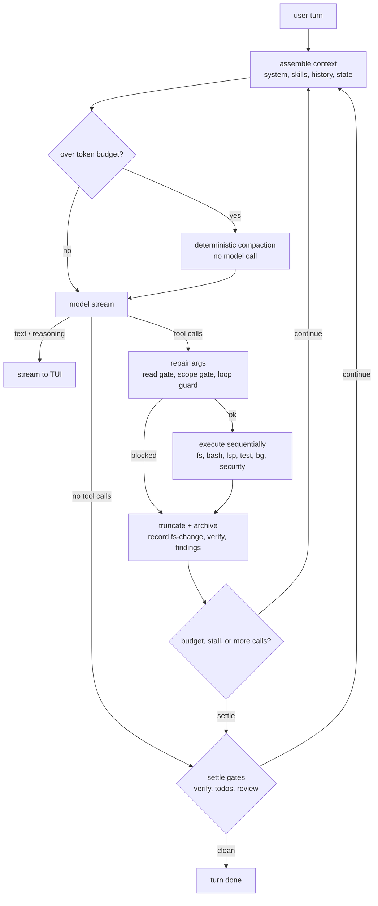

# LocalHarness — Architecture and Implementation Specification

Status: implementation-ready specification, v1.0
Target: Linux first, Rust, local models in the 27B dense to 35B MoE class
Audience: the implementer and contributors; no prior Pi context required

---

## 0. What this is

LocalHarness is a standalone, local-first agent harness for coding and security
work. It talks to any local inference engine that exposes an OpenAI-compatible
chat-completions endpoint. It owns its own agent loop, tools, context
management, session tree, and TUI. It does not depend on Pi, Node, or any
TypeScript runtime.

Pi is a behavioral reference. The `pi/` checkout and the extensions in
`extensions/` describe what the mechanisms should do; they are not dependencies
and their session format is not a compatibility target.

The product stance is simple: **anything the model is unreliable at is enforced
by code, not requested by prompt.** Every failure names the next action. The
harness supplies facts, measures progress, and stops loops; the model does the
work.

## Contents

- [0. What this is](#0-what-this-is)
- [1. Goals and non-goals](#1-goals-and-non-goals)
- [2. Runtime contract](#2-runtime-contract)
- [3. Agent loop](#3-agent-loop)
- [4. Context and compaction](#4-context-and-compaction)
- [5. Sessions as a tree](#5-sessions-as-a-tree)
- [6. Tools and packs](#6-tools-and-packs)
- [7. Extensibility](#7-extensibility)
- [8. Security model](#8-security-model)
- [9. TUI](#9-tui)
- [10. Configuration and storage](#10-configuration-and-storage)
- [11. Module layout and dependencies](#11-module-layout-and-dependencies)
- [12. Testing and verification](#12-testing-and-verification)
- [13. Milestones](#13-milestones)
- [14. Decision log](#14-decision-log)
- [15. Open items](#15-open-items)

---

## 1. Goals and non-goals

### Goals

- One static binary with a polished TUI and a headless mode.
- Any OpenAI-compatible local endpoint: llama.cpp, Ollama, vLLM, LM Studio,
  and future engines. No engine-specific client code.
- Coding and security as equal first-class packs, both active in the default
  profile.
- A small, static built-in tool surface. No codemode, no tool search, no
  deferred tools.
- Deterministic context management: no model-written summaries.
- Session trees with `/tree`, checkout, and fork. Branch-aware state.
- Extensibility through profiles, skills, workflows, and external tools in any
  language. No plugin ABI and no embedded scripting in v1.
- A local trust posture suitable for sensitive security work: no telemetry,
  localhost default, explicit trust for project-local executable config.
- Community-friendly model handling: model quirks live in TOML profiles, not
  code paths for specific model names.

### Non-goals for v1

- Cloud providers, OAuth, subscription auth, or a hosted model catalog.
- Downloading GGUFs, choosing quantizations, or launching inference servers.
- Subagents or multi-agent orchestration.
- codemode, tool search, deferred tool loading.
- Windows support.
- Pi extension or session compatibility.
- A VM or container runtime. `--sandbox` provides OS-level isolation for
  `bash` and `bg` (bubblewrap, with a Landlock fallback); stronger isolation
  remains the user's responsibility and is documented separately.
- Lua, Rhai, WASM, or any runtime scripting for loop hooks.
- Model training or fine-tuning.

---

## 2. Runtime contract

### 2.1 Provider

One provider: `OpenAiCompatProvider`.

- `POST {base_url}/v1/chat/completions`, `stream: true`.
- Standard OpenAI request body: `model`, `messages`, `stream`, `temperature`,
  `top_p`, `max_tokens`, `stop`, `tools`, `tool_choice`,
  `stream_options: { include_usage: true }`.
- Optional `extra_body` from the model profile for server-specific fields such
  as `chat_template_kwargs`.
- `Authorization: Bearer <key>` only when a key is configured.
- No engine-specific request shapes. If an engine is not OpenAI-compatible, it
  is out of scope for v1.

Streaming:

- SSE frames: `data: {...}`, `data: [DONE]`, comments, CRLF, multi-line data,
  frames split across chunks, multiple frames per chunk.
- Accumulate tool calls by `index`: `id`, `function.name`, and
  `function.arguments` fragments. Handle providers that emit a complete call in
  one frame.
- Parse `usage` from the final chunk when present.
- Parse `reasoning_content` and `reasoning` fields. A model profile decides
  whether reasoning is shown, kept in context, or stripped after the turn.
- `finish_reason`: `stop`, `length`, `tool_calls`, `content_filter`.

### 2.2 Optional probes

Probes improve accuracy but are never required.

| Probe | Engine | Use |
|---|---|---|
| `GET /v1/models` | all | model list, auto-select when exactly one; `/login` validation |
| `GET /props` | llama.cpp | `n_ctx`, chat template, slots |
| `POST /tokenize` | llama.cpp, vLLM | exact token counts |
| `GET /api/show` | Ollama | context length, model metadata |

A missing endpoint or model never blocks the TUI. Startup probes with a short
timeout; if no model resolves, the core is built in a logged-out state, the
session records a warning, and `/login` later validates and applies the
connection. Headless `--print` rejects the logged-out state. When a model is
already selected, `[model] start_command` runs in the background: the TUI opens
first and a turn waits on a startup gate for the endpoint, so a slow `ssh` or a
failed command cannot hold the launch. A command that exits non-zero is
reported at once instead of waiting out the 30-second retry window.

Fallbacks: `context_window` from config (default 32768), and a calibrated
characters-per-token ratio. Calibration is corrected from `usage.prompt_tokens`
after each request.

### 2.3 Capabilities

Capabilities are detected and cached per `(base_url, model)`:

- `models`, `props`, `tokenize`, `usage`
- `reasoning`
- `native_tools`
- `constrained_tools` (`response_format` JSON schema, GBNF grammar, or guided
  decoding)

A missing capability degrades behavior, never fails the turn. Two compatibility
fallbacks are explicit:

- If the server rejects `stream_options`, retry once without it and estimate
  usage from the stream.
- If the server rejects `tools`, fail the turn with a prescriptive message
  naming the engine flag to enable tool calling (`--jinja` on llama.cpp,
  `--enable-auto-tool-choice` and a tool-call parser on vLLM, or the equivalent).
  The harness does not silently drop tools and become a chat client.

### 2.4 Model profiles

Model quirks are TOML, not Rust branches.

```toml
[model_profile.qwen3]
match = ["qwen3", "qwen3.5"]
context_window = 65536
strip_reasoning = true
reasoning_field = "reasoning_content"
tool_mode = "native"              # native | repair | auto
parallel_tool_calls = false
stop = ["<|im_end|>"]
extra_body = { chat_template_kwargs = { enable_thinking = true } }

[model_profile.gemma3]
context_window = 32768
strip_reasoning = true
tool_mode = "repair"
```

`model_profile = "auto"` matches by model-name prefix if a profile declares
`match = ["qwen3", "qwen3.5"]`; otherwise the `default` profile is used.

### 2.5 Errors and timeouts

- Connect timeout 5 s; first token 120 s; stream idle 120 s; total request
  timeout 15 min, all configurable.
- One retry on connection failure before any tokens. No retry after tokens
  have streamed.
- Error classes: `connection`, `auth`, `model_not_found`, `context_too_small`,
  `bad_request`, `server`, `cancelled`, `parse`.
- Errors shown to the model and the user are prescriptive: what failed, what
  the harness tried, and the next action. No stack traces in tool results.

---

## 3. Agent loop

### 3.1 State machine



States: `Idle`, `AssembleContext`, `Compact`, `StreamModel`, `ToolBatch`,
`PostTool`, `SettleGates`, `Done`, `Cancelled`, `Error`.

### 3.2 Turn flow

1. Append the user entry to the session branch.
2. Assemble context from the active branch, including the cached repository
   brief in the system prompt.
3. If the prompt budget is exceeded, write a compaction entry and rebuild.
4. Send the model request with the profile's tool list.
5. Stream text, reasoning, and tool calls. Emit UI events.
6. If there are no tool calls, run settle gates.
7. For each tool call, in order:
   - parse and repair arguments;
   - run guards;
   - execute with a timeout;
   - cap, archive, and append the result;
   - update budgets, stall, and verify state.
8. If the budget allows and the model asked for tools, go to 2.
9. Settle gates may inject a synthetic message and continue. Caps apply.
10. Mark the turn done; flush and fsync the session.

A guard block appends an `is_error` tool result with the guard code rather than
skipping the call. Every tool call in a batch gets a result, so the provider
context stays valid.

### 3.3 Tool argument repair

Repair runs before JSON Schema validation. It is deliberately boring and
observable.

- Parse `function.arguments` as JSON; if it is a JSON string containing an
  object, parse twice.
- Drop `null` values; a null optional means "not provided".
- Coerce stringified numbers and booleans, whole floats to integers, and
  scalars to strings where the schema expects a string.
- Recover arrays sent as a JSON-encoded string or a bulleted/numbered list.
- Unwrap single-element arrays where the schema expects a scalar.
- Map alias keys per tool, from the names other harnesses train models on:
  `file_path`/`file`/`filepath` to `path`, `cmd` to `command`,
  `old_string`/`oldText` to `edit.old` or `patch.anchor`, `new_string`/`newText`
  to `edit.new` or `patch.replacement`, `query`/`regex` to `grep.pattern`, and
  similar. An alias applies only when the tool declares the canonical key, and
  never overwrites a canonical key the model also sent.
- Fold enum values: case, surrounding space, and `_` vs `-` are ignored, and a
  few synonyms are accepted (`complete` for `todo` `done`, `kill` for `bg`
  `stop`).
- Infer an omitted `action` only when unambiguous (`todo` with `tasks` is
  `plan`, `bg` with `command` is `start`).
- Apply defaults: `bash.timeout`, `grep.max_matches`, `recall` range. `read`
  applies its own page size so an explicit `end` is never clipped.
- Drop undeclared keys and say so: the result carries
  `note: ignored unknown argument(s) ...; <tool> accepts ...`, and a
  `missing_argument` error names the dropped keys that likely caused it.
- Generate a synthetic `call_<n>` id when the provider omits one.
- Reject no-op edits and interactive-only commands with the exact call shape to
  use instead.
- Resolve tool names before any gate runs: strip `functions.` / `default_api:`
  prefixes and case drift, and route unambiguous foreign names (`read_file`,
  `str_replace`, `shell`, `run_command`, ...) to the active tool with a note
  naming the canonical tool. Gates see the canonical name, so routing never
  bypasses the read or scope gates.
- Reject any other unknown tool with
  `unknown tool "<name>"; did you mean <nearest>? active tools: ...`.
- On failure, return `is_error: true` with a prescriptive message, never a
  schema dump.

### 3.4 Guards

| Guard | Behavior |
|---|---|
| Read-before-edit | `edit`/`patch` on an existing file require a prior `read` with a matching stat stamp (`mtime`, size). `write` also requires full-line coverage of the existing file, or an explicit `overwrite: true`; a result capped by the result or batch limit marks coverage incomplete. A changed file requires a re-read. Creation is allowed. A successful `edit`/`patch`/`write` re-stamps only the file it wrote, so consecutive edits need no re-read while any outside change still does. |
| Scope gate | Security-sensitive commands are checked against the user-set engagement scope. No scope blocks with `SEC_SCOPE` and the `/sec scope add` call. Best-effort, not a sandbox. |
| Sandbox | When `--sandbox` is set, `bash` and `bg` run in a bubblewrap namespace (or the Landlock fallback): read-only root, hidden `$HOME`, private `/tmp`, no network, and `.git` read-only in `workspace-write`. Startup fails closed when no backend exists; a per-command wrap failure returns `SANDBOX_UNAVAILABLE`. Commands never fall back to an unsandboxed run. |
| Loop guard | Signature is tool name plus canonical arguments. Four identical calls in a row, or an exact 2-4 call cycle repeated four times, blocks the call and ends the turn with a recovery instruction. A file change or a passing verification clears the history, so long multi-step work does not trip it. No automatic session replacement in v1. |
| Interactive command guard | Blocks `vim`, `less`, `top`, `htop`, `watch`, `nano`, `ssh` without a command, and similar TTY-only invocations. |
| Budget | Caps tool calls, model calls, and wall clock. At 80% of the cap, inject a wrap-up instruction. |
| Stall | Twelve consecutive calls with no new result fingerprint, no file change, and no successful verify. Ends the turn with the last known state. |
| Todo gate | After two mutations or edits touching two files, the run is multi-step and requires a plan. The final task requires a fresh passing verify when verification is configured. |
| Verify gate | Successful mutations newer than the last passing verify are unverified. Continue up to two times with a verify instruction, then record the unverified state and allow settle. |
| Review nudge | One continuation per run after mutations, asking for `review`. Never fights verify or todo gates. |

Guards are inert when their required tool is absent from the active profile.

### 3.5 Execution and cancellation

- Tools execute sequentially. Parallel read-only tools are a later optimization
  only if measurements justify it.
- Every tool has a timeout. Background-shell processes are supervised in
  process groups; cancellation sends SIGTERM, then SIGKILL after 2 s.
- If a turn is cancelled mid-batch, the harness appends an `is_error` tool
  result with code `cancelled` for every unresolved call. The branch remains a
  valid provider context instead of ending on an assistant message with
  unanswered tool calls.
- Ctrl+C cancels the model request and the running tool, appends a cancellable
  error entry if useful, and returns the TUI to idle. The session remains
  consistent and resumable.
- The model loop has a hard cap (`max_model_calls`, default 40) to prevent an
  infinite tool loop.

### 3.6 Settlement

`SettleGates` returns one of:

- `Done`: the turn ends.
- `Continue { message }`: inject a synthetic user/system message and run again.
- `Block { reason }`: append an error entry and end the turn.

At most two settle continuations per turn, shared by verify and todo gates.
The review nudge is one-shot and does not count against the verify cap.

### 3.7 Output recovery

Local servers often lack a reasoning or tool parser, and small models loop.
`agent/output.rs` repairs what can be repaired deterministically; anything
else becomes a harness message (`[localharness] <kind>: ...`) and the loop
continues. Nudges are capped at three per turn.

| Symptom | Handling |
|---|---|
| `<think>` / `<thinking>` in content | Split out while streaming (tags may straddle deltas) and stored as reasoning; text before a lone `</think>` too. |
| Tool calls written as text | With `tool_mode` `repair` or `auto`, parsed into native calls before gates run (formats in `docs/model-setup.md`). Fenced/bare JSON must name an active tool and end the reply. |
| Exact repetition | The stream is checked as it grows; a tail of one unit repeated at least 5 times and 600 bytes stops generation, keeps one copy, and nudges. Repeated loops end the turn as `stalled`. |
| `finish_reason = length` | A cut tool call (arguments not valid JSON) does not run; the model is told to send smaller calls. Cut prose is continued. A reply that spent the budget thinking is told to act. |
| Empty reply | One nudge to call a tool or answer. |
| Silent prompt truncation | A usage report under 1 token per 6 characters on a prompt of 12,000+ characters means the server dropped part of the prompt. Calibration skips the sample, the budget shrinks to the observed window for the rest of the session, the reply is discarded, and the call is retried once after compaction. |

---

## 4. Context and compaction

### 4.1 Budget

```
usable_prompt = context_window - max_output_tokens - safety_margin
```

- `max_output_tokens` defaults to 4096.
- `safety_margin` is 5% of the context window, minimum 512 tokens.
- Tool schemas, system prompt, skills index, and state blocks count toward the
  prompt.
- Compaction triggers at 80% of `usable_prompt`, or when the provider returns a
  context-length error.

### 4.2 Token accounting

- If `/tokenize` is available, use it to calibrate a characters-per-token ratio
  on a representative sample, and periodically re-calibrate.
- After each model call, use `usage.prompt_tokens` to correct the estimate.
- If no usage is available, estimate from characters with the calibrated ratio.
- Every entry stores an optional `tokens` estimate for the tree view and budget
  accounting.

### 4.3 Tool result caps and archive

- A tool result is capped at 2500 characters by default; batch total is capped
  at 8000 characters.
- Larger output is written to an artifact under the session's artifact
  directory. The tool result contains a short preview plus `[out-N]` and the
  artifact size.
- `recall` reads an artifact range, capped at 4000 characters per call.
- Artifacts are user-readable files with `0700` directories. Retention is
  configurable; default is 30 days.

### 4.4 Deterministic compaction

No model call. The summary is built from session entries.

Sections, omitted when empty:

```
[localharness] deterministic compaction

## Active thread T{n} - {title}
objective: ...
constraints: a; b
files: a, b
done: ...
open: ...
facts: ...

## Repo
changed: path, path
verify: passed|failed|not run (n entries ago)

## Findings
3 open (1 high, 2 medium)

## Last instruction (verbatim)
... (max 600 chars)

## Last actions
bash(cargo test) -> 12 passed
edit(src/parser.rs) -> +18 -4
```

Budget target: 4500 characters. Trim in this order until under budget:

1. last actions;
2. facts;
3. done/open lists (keep the first three);
4. last instruction to 300 characters.

Never trim the active objective or title.

A compaction entry is a node on the branch. Context assembly starts after the
latest compaction on the path. The compaction entry itself is not a message;
its summary becomes the first system message.

### 4.5 Threads

`thread split` closes the current thread, records a brief, and at settle writes
a compaction entry with `reason: "thread_split"`, then appends a user entry with
the kickoff text. This gives the model a fresh context without a new session,
new process, or second model. It is not a subagent.

The kickoff names the thread, objective, constraints, files, and the first open
step. The old branch remains in the tree and on disk.

### 4.6 State block

After a compaction, inject one short state block: changed files, last verify,
active thread, open findings count, and the current budget. This prevents the
model from re-reading half the repository.

---

## 5. Sessions as a tree

### 5.1 File format

One JSONL file per session tree. Append-only. Every line is one entry.

```json
{"v":1,"seq":0,"id":"s0","parent":null,"ts":"2026-11-07T20:00:00Z","type":"session","data":{"cwd":"/home/user/src/app","endpoint":"http://127.0.0.1:8080","model":"local-model","profile":"full","app":"0.1.0"}}
{"v":1,"seq":1,"id":"e1","parent":null,"ts":"...","type":"user","data":{"content":"Fix the parser bug"}}
{"v":1,"seq":2,"id":"e2","parent":"e1","ts":"...","type":"assistant","data":{"content":"I will inspect it.","tool_calls":[{"id":"call_1","name":"read","arguments":{"path":"src/parser.rs"}}],"usage":{"prompt_tokens":512,"completion_tokens":18}}}
{"v":1,"seq":3,"id":"e3","parent":"e2","ts":"...","type":"tool_result","data":{"call_id":"call_1","content":"...","is_error":false}}
{"v":1,"seq":4,"id":"e4","parent":"e3","ts":"...","type":"assistant","data":{"content":"The bug is ..."}}
{"v":1,"seq":5,"id":"c1","parent":null,"ts":"...","type":"checkout","data":{"target":"e3","reason":"fork"}}
{"v":1,"seq":6,"id":"e5","parent":"e3","ts":"...","type":"user","data":{"content":"Try another approach"}}
{"v":1,"seq":7,"id":"e6","parent":"e5","ts":"...","type":"assistant","data":{"content":"I will check the lexer ..."}}
```

Entry fields:

- `v`: format version.
- `seq`: monotonic integer within the file.
- `id`: `e<seq>` for entries, `c<seq>` for checkouts, `s0` for the header.
- `parent`: entry id, or `null` for the first user entry.
- `ts`: RFC 3339 UTC.
- `type` and `data`.

### 5.2 Entry types

| Type | Data |
|---|---|
| `session` | cwd, endpoint, model, profile, app version |
| `user` | content |
| `assistant` | content, reasoning?, tool_calls?, usage?, stop_reason? |
| `tool_result` | call_id, content, is_error, details?, artifact? |
| `compaction` | summary, tokens_before, reason, thread_id? |
| `checkout` | target, reason (`tree`, `fork`, `resume`) |
| `custom` | kind plus payload (`fs-change`, `verify-config`, `verify-result`, `todo-state`, `finding`, `thread-state`, `guard-trip`, `profile-change`, `model-change`) |
| `error` | code, message, recoverable |

An assistant entry with `tool_calls` is a batch. The tool results that answer it
are its children, appended in call order; the first result's `parent` is the
assistant entry, and each later result is parented to the previous result.
Context assembly emits the assistant message with all of its `tool_calls`
followed by the matching `tool` messages. A batch is a unit: checkout
resolution never stops between an assistant entry with tool calls and its last
result.

`checkout` entries are markers, not branch nodes: `parent` is always `null`.
They are excluded from context and from the tree structure.

### 5.3 Active leaf and context path

- `active_leaf` is the last `checkout.target` if the last entry is a checkout,
  otherwise the id of the last non-checkout entry.
- Context path: walk `parent` from `active_leaf` to the root, reverse, then take
  entries after the latest `compaction` on that path.
- `checkout` never changes history. It selects a point. The next user message
  becomes a child of that point, creating a new branch.
- Branch-aware state (todos, verify freshness, thread ledger, guard strikes) is
  recomputed from the path after every checkout.
- Findings are engagement-global, not branch-aware. A finding records the
  session and entry that produced it.

Checkout resolution:

- A checkout target must be a completed step boundary: a user entry, the last
  `tool_result` of a batch, an assistant entry without tool calls, a
  compaction, or a custom entry.
- Selecting an assistant entry with tool calls, or an earlier result in its
  batch, resolves to the last completed `tool_result` in that batch. The UI
  moves the selection there rather than starting a branch mid-batch, because an
  assistant message with unresolved tool calls is not a valid provider context.
- A batch missing one or more results is incomplete. It is not a checkout
  target; the UI reports `step incomplete; choose the last completed result`.

### 5.4 Tree UI

`/tree` opens a modal with a flattened depth-first tree:

```
e1  U  Fix the parser bug                          20:10
`- e2  A  I will inspect it. [read]                20:11
   `- e3  R  read src/parser.rs: 142 lines         20:12
      |- e4  A  Found it. The bug is ...           20:13
      `- e5  U  Try another approach               20:20
         `- e6  A  I will check the lexer ...      20:21  *
```

- `*` marks the active leaf; vertical and corner glyphs mark branch points.
- Role icons: `U` user, `A` assistant, `R` tool result, `C` compaction, `E`
  error. A branch point is drawn from the tree structure, not a role.
- Selecting an assistant row that carries tool calls moves the checkout to the
  last result of that batch.
- Each row shows a one-line preview, timestamp, and token estimate.
- Keys: `j`/`k` move, `PgUp`/`PgDn` page, `Enter` checkout, `f` fork from the
  selected entry, `n` new branch from the selected entry, `Esc` close.
- `f` and `n` both checkout the selected entry and focus the input. `f` is the
  muscle-memory name; `n` is the explicit "new branch" name.
- Checkout is non-destructive and needs no confirmation. The old branch remains
  in the file and in the tree.
- The footer names the keys and the current branch point.

`/fork` without a tree selection checkouts the most recent assistant entry,
resolving through its tool batch to the last result. `/tree` is a view; it never
deletes entries.

### 5.5 Storage

```
~/.local/share/localharness/
  sessions/
    <project-id>/
      <session-id>.jsonl
      <session-id>.jsonl.lock
      artifacts/
        <session-id>/
          out-1.txt
  engagements/
    <engagement>/
      scope.toml
      findings.jsonl
      evidence.jsonl
      evidence/
        e1.txt
      surface.json
```

- Evidence artifacts are append-only and `0600`; each ledger entry carries the
  SHA-256 of the artifact. The surface inventory is rewritten atomically after
  each command that produces observations.

- `project-id` is the first 12 hex characters of SHA-256 over the canonical
  working directory.
- `session-id` is `YYYYMMDD-HHMMSS-<pid>` or a short random suffix.
- One advisory lock per session file. A second process refuses to write and
  names the lock holder.
- Flush each entry to the file. `fsync` at turn end and after compaction.
- On load, ignore a malformed final line, drop orphan entries with a warning,
  and validate that every `parent` exists.
- Export: `/export [path]` writes Markdown for the active branch. Findings have
  their own report.

### 5.6 Resume and switching

- `lh --continue` loads the most recent session for the project.
- `lh --resume <session-id>` loads a specific session.
- `/sessions` lists sessions with first-user-message previews and lets the user
  switch. Switching replaces the in-memory app state; it does not merge.
- On resume, show the active branch, model, endpoint, and profile. If the
  current endpoint or model differs from the header, warn but allow.
- `--no-session` disables persistence entirely (no file, no artifacts).

---

## 6. Tools and packs

### 6.1 Built-in tool surface

Twenty-three tools. Static per model call. The default `coding` profile includes
core and coding; `full` adds the security pack.

| Pack | Tool | Purpose |
|---|---|---|
| Core | `read` | Read a file with line numbers |
| Core | `write` | Create or replace a file |
| Core | `edit` | Exact-text replacement |
| Core | `patch` | Anchor/range edit with recovery diagnostics |
| Core | `undo` | Revert the last harness change to a file, one step per call |
| Core | `bash` | Non-interactive command with timeout |
| Core | `grep` | Regex search with context, gitignore-aware (hidden paths only when named) |
| Core | `glob` | File discovery |
| Core | `todo` | Plan and task state, verify-gated |
| Core | `verify` | Run project verification steps |
| Core | `recall` | Read archived tool output |
| Core | `thread` | Split, note, close, status |
| Core | `bg` | Background process start/status/logs/stop |
| Coding | `lsp` | outline, definition, references, diagnostics, hover |
| Coding | `repo_map` | Cached file and symbol outline |
| Coding | `test` | One file or one test; first failure only |
| Coding | `review` | Working-tree stats, risks, hunks |
| Security | `surface` | Read hosts, ports, services, URLs, technologies |
| Security | `evidence` | List, show, verify the evidence chain |
| Security | `detect` | Validate/run Sigma-subset rules, map hits to findings |
| Security | `attack_path` | Ranked graph paths, choke points, node detail |
| Security | `finding` | Engagement findings ledger, report, and PoC replay |
| Security | `iocs` | Extract and defang indicators |

Tool descriptions stay under roughly 200 characters. Schemas are flat objects
with the minimum required fields. Every error is a recovery instruction with a
code and, where useful, the exact call shape.

### 6.2 Tool contracts

- Internal result: `{ content, is_error, details }`.
- `content` is text, capped. `details` is structured but never sent to the
  model unless summarized.
- `read` returns line numbers and caps at 150 lines by default, 800 maximum.
  Binary files are detected and refused with a message.
- `write` and `edit` are atomic (temp file plus rename) and record `fs-change`.
- `edit` preflight handles: multiple matches (list line numbers), whitespace-
  only match (show the verbatim excerpt), and no match (show the closest
  window). It never blocks an edit that would succeed. When the exact text is
  absent, `edit` and `patch` try lossless fallbacks in order: LF text against a
  CRLF file, a `read` line-number gutter copied into the text, and trailing
  whitespace drift on whole lines when exactly one window fits. The result says
  which fallback matched. Indentation is never normalized.
- `grep` searches an invalid regex as literal text and says so, instead of
  failing the call.
- `undo` reverts the harness's own changes without git. Before `edit`,
  `patch`, or `write` change a file, its previous text goes to the session
  artifact store; the change's `fs-change` entry records the snapshot id (or
  `created` for a new file) and a SHA-256 of what was written. Undo walks the
  active branch's `fs-change` entries, skipping ones an earlier undo reverted,
  so it follows `/tree` and survives resume. It restores the snapshot (or
  deletes a file the change created) only when the file's current hash equals
  the recorded one, so edits by the user, a formatter, or `bash` are never
  discarded; content hashing, unlike stat stamps, keeps chained undos working.
  Undo records its own `fs-change`, so verify and review gates see it. Previous
  files over 4 MB or not UTF-8 are not snapshotted and undo says why. Changes
  made through `bash` are not tracked.
- `bash` uses `bash -lc`, captures stdout/stderr separately, caps output, and
  kills the process group on timeout. Interactive-only commands are blocked.
- `bg` starts a process in its own group, captures output to an artifact, and
  exposes `status`, `logs`, and `stop`. At most four live processes per session.
- `todo` uses an adaptive gate: free for two mutations or two files, then a plan
  is required. `plan` auto-starts task 1. `done` accepts a note or harness-
  derived evidence. The final task requires a fresh passing `verify` when
  verification is configured.
- `verify` runs configured steps sequentially without a shell, caps combined
  output at 1 MiB, and returns a compact pass/fail summary. It records
  `verify-result`.
- `recall` reads an archived artifact range and names the artifact in the
  result.
- `thread` has `split`, `note`, `close`, `status`; `split` requires a title or
  objective and ends the turn after the compaction.
- `lsp` starts the relevant language server over stdio JSON-RPC. One client per
  `(server, root)`. Initialize waits 15 s; a cold rust-analyzer that is still
  indexing returns "retry" rather than a kill. Diagnostics wait for the first
  `publishDiagnostics` after `didOpen`/`didChange`, or 2.5 s. Clients are
  disposed after 10 minutes idle or on session shutdown.
- `repo_map` walks the tree with gitignore rules, caches per-file symbols by
  mtime and size, and returns a character-budgeted map. It skips binary files,
  files above 256 KB, and build/vendor directories. A compact map is injected
  into the system prompt at startup.
- `write`, `edit`, and `patch` request post-edit diagnostics through the shared
  LSP service when the file belongs to a project with a server marker. Only
  errors and warnings are appended, capped at 8 entries; an unavailable or cold
  server leaves the mutation result untouched.
- `test` detects vitest, jest, go, cargo, pytest, or an npm test script. It runs
  one file or one test and returns only the first failure, capped at 2500
  characters. Parsers strip ANSI and progress noise.
- `review` reads `git status --porcelain=v1 -z`, numstat, and the diff. It scans
  added lines for secrets, debug statements, TODOs, lockfiles, config files,
  deletion-heavy changes, binary files, and source changes without tests. The
  diff is capped and truncation names the follow-up call.
- `finding` supports `add`, `update`, `list`, `report`, `verify`. Severities:
  critical, high, medium, low, info. Statuses: open, fixed, accepted,
  false-positive. `add` requires title, severity, target, and evidence.
  Evidence can reference a session entry, an artifact, inline text, or an
  engagement evidence id. `add` auto-links the last tool's evidence entry when
  one exists. `add`, `update`, and `verify` accept `poc_steps` and a model
  `confidence`; the stored confidence is raised to the evidence floor (0.6
  with steps, 0.8 with a verifiable assertion). Caps: 50 findings, 2000 chars
  of evidence, 1000 chars of impact/remediation.
- `finding verify` replays a step graph locally. Actions are `shell` (`bash -c`
  in an isolated run directory), `http` (redirects disabled; host must be in
  engagement scope), and `note`. Assertions are `exit-zero`, `http-status`,
  `body-contains`, `body-matches`, and `file-exists`. A run is `reproduced`
  only when every assertion passes. `not_reproduced` is a rejection but does not
  change the finding status; `error` and `skipped` are inconclusive and never
  suppress. Steps run with a cleared environment, a per-step timeout, a
  process-group kill, and one evidence entry per executed step. `minimize:true`
  applies ddmin over steps, bounded by `max_oracle_calls`; exploit/verify steps
  and steps with a non-`exit-zero` assertion are anchors and are kept.
- `evidence` lists, shows, and verifies engagement evidence entries. Each entry
  stores tool, target, command, start/finish time, duration, exit code, error
  flags, artifact path, byte count, and SHA-256. Verification recomputes the
  hash from the artifact.
- `surface` is read-only. `bash`, `bg`, and external tool output is parsed after
  each run; nmap XML/grepable/normal output, URLs, HTTP headers, and TLS
  fingerprints merge into one engagement inventory. Assets outside a configured
  scope are not stored; identities and credentials are references, with
  credentials hashed.
- `detect` validates and runs a Sigma subset: mapping/list selections, field
  modifiers `contains`, `startswith`, `endswith`, `re`, `exists`, `all`,
  `cased`, and conditions with `and`, `or`, `not`, parentheses, and quantified
  `of` selectors. JSONL records and plain-text lines are supported. Hits create
  findings by default and always append a detection evidence entry.
- `attack_path` builds a directed graph (`identity`/`credential` -> `asset` ->
  `service` -> `technology`) from the surface, findings, and evidence. It
  returns summaries, ranked simple paths, betweenness choke points, and node
  views, never a raw graph dump.
- `iocs` extracts URLs, domains, IPv4/IPv6, SHA-256/SHA-1/MD5, emails, and CVEs.
  Output is defanged by default. File scans cap at 2,000,000 characters.

### 6.3 Hard limits

| Item | Limit |
|---|---|
| `read` | 4 MB file, 800 lines per call |
| `write` | 256 KB content |
| `edit` / `patch` | 256 KB file, 200 diff lines returned |
| `undo` | 4 MB snapshot; snapshots live as long as session artifacts |
| `bash` | 600 s maximum, 1 MiB captured, 64 KB preview |
| `grep` | 200 matches, 5 lines of context |
| `glob` | 200 paths |
| `bg` | 4 live processes, 16 MB log per process |
| `verify` | 1 MiB combined output, 1400-char failure excerpt |
| `recall` | 4000 chars per call |
| `lsp` | 200 outline symbols, 20 references, 5 definitions, 40 diagnostics, 25 hover lines |
| `repo_map` | 5000 files, 24 symbols per file, 8000 chars per call |
| post-edit diagnostics | 8 entries, 1200 chars |
| `test` | 600 s maximum, 2500-char result |
| `review` | 400 diff lines default, 12 findings |
| `finding` | 50 per engagement, 2000-char evidence, 50 PoC steps |
| `evidence` | 20,000 entries, 4 MiB per artifact |
| `surface` | 10,000 assets |
| `detect` | 300 rule files, 500 files / 250k lines per run, 500 hits |
| `attack_path` | 400 nodes for full betweenness; 5000 simple paths |
| `iocs` | 100 per category, 2,000,000 input chars |
| tool result | 2500 chars per result, 8000 chars per batch |
| compaction | 4500 chars |

Limits are constants or config values, not model-controlled.

### 6.4 Packs and profiles

```toml
[profile.full]
packs = ["core", "coding", "security"]
model_profile = "auto"

[profile.coding]
packs = ["core", "coding"]

[profile.security]
packs = ["core", "security"]

[profile.minimal]
tools = ["read", "bash", "verify"]
```

- `coding` is the default; `full` adds security. Coding and security are equal
  capabilities, not primary/plugin: the default keeps shell/file use broad while
  security tooling, posture, and skills stay opt-in.
- A profile may list packs, explicit tools, or both. Explicit tools are added
  to the pack result.
- External tools are attached to a profile or workflow. They never auto-join
  the default schema.
- Tool lists are static for a model call. The set may change between calls only
  when a profile changes or an external workflow starts; `todo` stays visible
  in `full` and `coding` and its gate blocks edits rather than hiding the tool.
- The active tool list is sent to the model and shown in `/tools`.

### 6.5 Tool result presentation

```
[tool] bash - cargo test
PASS  cargo  42 passed (3.1s)
...
(truncated; recall out-3 1-120)
```

Every result starts with one header line. Success is plain; failure is an error
with a code and next action. The TUI renders the header as a card and the body
as styled text.

---

## 7. Extensibility

The rule: users add **tools and workflows**, not loop behavior. Loop behavior is
changed by forking the crate.

### 7.1 Profiles

TOML files in `~/.config/localharness/profiles/` or `.harness/profiles/`
(project profiles require `--trust`). A profile selects packs/tools, a model
profile, budgets, prompt additions, and UI defaults.

### 7.2 Skills

Markdown with YAML frontmatter:

```markdown
---
name: security-red
description: Authorized offensive security workflow
when: engagement scope is set and the task is active testing
---

... instructions ...
```

- Global skills live in `~/.config/localharness/skills/<name>/SKILL.md`.
- Project skills live in `.harness/skills/` and require trust.
- The harness injects a compact index (name, one line, when) into the system
  prompt. Full text loads on `/skill <name>` or when a workflow names it.
- Skills are instructions, not executable code. They cannot change scope, tool
  lists, or gates.

### 7.3 Workflows

A workflow is a playbook plus a profile and tool allowlist. No step scripting.

```toml
name = "recon"
description = "Passive and active reconnaissance with scope checks"
profile = "security"
prompt = "prompts/recon.md"
skills = ["security-red"]
tools = ["read", "grep", "glob", "bash", "bg", "finding", "iocs"]
```

`/workflow recon` starts a new branch with the workflow prompt as the first user
message and the profile applied. The model follows the playbook; code still
enforces the gates.

### 7.4 External tools

Any language, one manifest, one JSON request, one JSON response.

```toml
name = "semgrep"
description = "Run semgrep and return JSON findings"
command = "semgrep"
args = ["--json", "--config", "auto", "{target}"]
input_schema = "semgrep.schema.json"
timeout_secs = 120
shell = false
scope_gate = false

[env]
SEMGREP_SEND_METRICS = "off"
```

- Placeholders in `args` are substituted from validated arguments. No shell
  unless `shell = true` is explicit.
- The harness sends one JSON object on stdin:
  `{"tool": "...", "args": {...}, "cwd": "...", "session_id": "..."}`.
- The tool writes one JSON object on stdout:
  `{"content": "...", "is_error": false, "details": {...}}`.
- If stdout is not JSON, it is treated as text content and the exit code
  decides `is_error`.
- Stderr is captured for the error message. Timeout kills the process group.
- Streaming is not supported; long-running tools use `bg`.
- Global tool manifests are trusted. Project manifests require `--trust`.
- External tools are attached to profiles/workflows; they do not auto-join the
  default tool list.

### 7.5 Themes

Theme files are TOML with semantic tokens. Users can add themes to
`~/.config/localharness/themes/`. See section 9.

### 7.6 Rust library

The crate has a `lib.rs` and exposes `Harness`, `Provider`, `Tool`, `Stage`, and
`SessionStore` for embedding and forking. No API stability promise before 1.0.
Feature flags: `coding`, `security`, `lsp`. The binary is a thin wrapper.

### 7.7 Explicitly not extensible at runtime

- No plugin ABI.
- No Lua/Rhai/WASM hooks.
- No dynamic tool loading outside the manifest protocol.
- No model-driven tool activation or tool search.

These are deliberate. The external-tool protocol and workflows cover the common
"hack it for myself" cases without a second API to maintain.

---

## 8. Security model

Security is a first-class pack and a first-class posture.

### 8.1 Threat model

- The user runs the harness locally with their own privileges.
- The model is untrusted. Repository content, tool output, and external tool
  output can contain prompt injection.
- Project-local configuration and manifests can be malicious if cloned from an
  untrusted repository.
- Session logs and artifacts can contain sensitive client data.
- The inference endpoint may be local or remote; localhost is the default.

### 8.2 Authorization

- The security pack is for authorized testing, labs, CTFs, and defensive work.
- Scope is set only by the user through `/sec scope add|remove|clear`. There is
  no model tool for scope. Project files cannot grant scope.
- The bundled red/blue skills state the authorization boundary. The harness
  does not provide exploit payloads, persistence, credential dumping, evasion,
  or denial-of-service tooling.
- The scope gate is a speed bump, not a sandbox. Target extraction is
  best-effort; unlisted tools and obfuscation can bypass it. The rules of
  engagement remain the real control. `--sandbox` (8.12) is the process
  boundary for `bash` and `bg`.

### 8.3 Scope gate

- Applies to `bash`, `bg`, and external tools with `scope_gate = true`.
- Tool list includes nmap, masscan, sqlmap, nikto, nuclei, ffuf, gobuster,
  feroxbuster, dirb, dirsearch, hydra, medusa, msfconsole, msfvenom,
  meterpreter, responder, impacket-*, crackmapexec, netexec, bloodhound,
  certipy, rubeus, chisel, ligolo, and pangolin.
- No scope blocks with `SEC_SCOPE` and the exact `/sec scope` call to make.
- All extracted targets in scope allows; any target out of scope blocks and
  names the target.
- `--help` and `--version` are allowed.

### 8.4 Findings, evidence, and reports

- Findings live in `engagements/<name>/findings.jsonl`. A finding records id,
  title, severity, status, target, evidence, impact, remediation, created/updated
  time, session id, entry id, an optional evidence reference, optional
  `poc_steps`, the latest `verification`, and a confidence value.
- `finding verify` runs the step graph in `engagements/<name>/poc/` and stores a
  `Verification`: status (`reproduced`, `not_reproduced`, `error`, `skipped`),
  verdict (`confirmed`, `rejected`, `inconclusive`), per-command argv/exit/
  duration/excerpts, assertions, and evidence ids. The run directory is removed
  after the evidence entries are written. Verification never changes lifecycle
  status; a rejected replay is not an automatic false positive.
- `/sec report` writes Markdown grouped by severity, with evidence, impact, and
  remediation. `/sec` shows scope, finding counts, evidence count, and surface
  size. Engagement directories are `0700`; files are `0600`.
- `bash`, `bg`, and external tool runs append an immutable evidence entry when
  an engagement is active. Entries are stored in
  `engagements/<name>/evidence.jsonl`; output goes to
  `engagements/<name>/evidence/eN.txt`.
- An entry records id, tool, session/entry ids, target, command, start/finish
  time, duration, exit code, timeout/cancel flags, error flag, artifact path,
  byte count, and SHA-256. `evidence verify` recomputes the digest.
- The output is the tool result content (already capped by the tool), not a
  second copy of a model-facing preview rule.
- `finding add` auto-links the last tool result's evidence entry when available;
  `evidence_id=eN` links explicitly after checking the id exists. Reports render
  the evidence id, artifact, session, and entry.
- A missing or failed evidence write never fails the command, but it is logged.

### 8.5 Attack-surface map

- `bash`, `bg`, and external tool output is parsed after each run. Supported
  inputs: nmap XML, grepable, and normal output; URLs; HTTP `Server`/
  `X-Powered-By`/`X-Generator` headers; TLS version/cipher fingerprints; and
  conservative identity/credential markers.
- The inventory is one `surface.json` per engagement. It merges hosts, aliases,
  ports, protocols, services, products, versions, TLS flags, URLs, technologies,
  identities, hashed credential references, and evidence ids.
- With a configured scope, assets outside scope are dropped. Without a scope,
  observations are stored but marked out of scope. `surface` is read-only and
  can list or show entries.
- Credentials are stored as `cred:<sha256 prefix>`; URL userinfo is stripped
  before a URL is stored.

### 8.6 Detection-as-code

- `detect` implements a deterministic Sigma subset. Supported selections are
  mappings (all fields match), lists of mappings (any mapping matches), keyword
  lists, and single strings. Field modifiers: `contains`, `startswith`,
  `endswith`, `re`, `exists`, `all`, `cased`.
- Conditions support `and`, `or`, `not`, parentheses, `1 of pattern*`,
  `all of pattern*`, `any of pattern*`, and `them`. Unsupported syntax is
  reported by `detect validate`, never guessed.
- Targets are JSONL records or plain-text lines. A plain line is matched as
  `{"message": line}` plus the raw line for keyword selections.
- Hits create findings by default (`finding=false` disables) and always append
  a detection evidence entry. Findings dedupe by title and target.

### 8.7 Attack-path graph

- Nodes: assets, services, technologies, identities, and hashed credentials.
  Edges: identity/credential -> asset, asset -> service, service -> technology.
- Findings add risk to the matching asset and, when a port is present or
  implied by an HTTP(S) URL, the service. Evidence targets add asset nodes.
- `attack_path` exposes summary, ranked simple paths, betweenness choke points,
  and node views. It never returns the raw graph.
- Paths are ranked by summed node risk, then hop count. Betweenness is computed
  in code over the undirected projection; above 400 nodes it falls back to
  degree ranking.

### 8.8 IOC extraction

`iocs` extracts and defangs indicators. Limits: 100 per category, 2,000,000
input characters. Missing input and unreadable files return prescriptive errors.

### 8.9 Trust model

- Global config (`~/.config/localharness/`) is trusted because the user wrote it.
- Project `.harness/` config, profiles, skills, workflows, tools, and verify
  steps are ignored unless `--trust` is set or the TUI `/trust` confirmation is
  accepted. Trust is per session and shown in the status bar.
- `AGENTS.md` is read as untrusted project instructions. It cannot change
  scope, tools, gates, or the endpoint.
- A trusted project still cannot grant security scope.
- Model input from repository files and tool output is delimited and labeled as
  untrusted data in the system prompt. This reduces, but does not eliminate,
  prompt injection.

### 8.10 Data handling

- No telemetry, no analytics, no phone-home.
- Endpoint defaults to `http://127.0.0.1:8080`. A non-local endpoint is allowed
  only when explicitly configured, with a warning.
- Session logs and artifacts are plaintext. This is documented. `--no-session`
  disables both for sensitive engagements. It does not delete or disable an
  engagement file the user explicitly created; findings are separate,
  user-owned data.
- Diagnostic logs are metadata only: timings, tool names, token counts, error
  codes. Prompts and tool output are not logged unless `LH_DEBUG_CONTENT=1` is
  set, which prints a warning.
- API keys are read from config or `LH_API_KEY`, never logged, and redacted in
  error messages.
- Artifact retention defaults to 30 days; `--keep-artifacts` and
  `--clean-artifacts` control it.
- `--sandbox` restricts `bash` and `bg` at the OS level. Bubblewrap gives each
  command a read-only root, hidden `$HOME`, private `/tmp`, no network, and a
  read-only `.git` in `workspace-write`; the Landlock fallback has fewer
  guarantees. It fails closed; `--no-sandbox` is the explicit opt-out.
  `--path-jail` restricts only the file tools.

### 8.11 Supply chain

- `Cargo.lock` is committed. Release builds use `--locked`.
- CI runs `cargo audit` and `cargo deny` (or equivalent) and fails on new
  advisories.
- No install-time scripts in the Rust binary. Packaging instructions do not
  pipe remote scripts into a shell.
- The external tool protocol does not auto-install anything.

### 8.12 Sandbox

- `Config` carries a runtime-only `SandboxMode` (`off`, `read-only`,
  `workspace-write`) and a `sandbox_explicit` flag. `--sandbox[=MODE]` selects
  a mode; `--no-sandbox` maps to `off`. Neither value is read from TOML.
- `src/sandbox.rs` owns the engine. `Sandbox::new` resolves the workspace and
  picks a backend: bubblewrap when `bwrap` (or `LH_BWRAP`) is executable,
  otherwise Landlock. If neither is usable the constructor returns a
  fail-closed error, and `detect` exposes the same check to the CLI.
- Bubblewrap wraps `bash -lc` with `--unshare-all`, `--cap-drop ALL`, a
  read-only `/`, private tmpfs mounts for `/tmp`, `/home`, and `/root`, the
  workspace re-bound read-only or writable, `.git` re-bound read-only in
  `workspace-write`, `--clearenv` plus an allowlisted environment,
  `HOME=/nonexistent`, `TMPDIR=/tmp`, and a classic-BPF seccomp filter passed
  through `--seccomp`. The filter returns `EPERM` for mount, namespace, module,
  keyring, BPF, perf, ptrace, and `process_vm_*` syscalls.
- The Landlock fallback builds a ruleset with read/execute on `/`, write rights
  under the workspace (`workspace-write`) and `TMPDIR`, and TCP bind/connect
  handled with no allow rule. It is applied in `pre_exec` under
  `no_new_privs`. ABI 4 or newer is required for the network deny; older
  kernels fail closed. Landlock cannot hide `$HOME`, cannot protect `.git`, and
  does not cover UDP or the host `TMPDIR` being a real directory.
- `shell_command(command, cwd, sandbox)` in `src/tools/bash.rs` is the single
  command builder for `bash` and `bg`. A wrap failure returns
  `SANDBOX_UNAVAILABLE`; there is no unsandboxed fallback. Process-group and
  timeout behavior is unchanged because `wrap` sets `process_group(0)`.
- The workspace is canonicalized at construction, and a tool `cwd` outside it
  is rejected. A workspace equal to `/` is rejected in `workspace-write`
  because re-binding it would expose the whole filesystem.

---

## 9. TUI

### 9.1 Layout

```
+ LocalHarness  ~/src/app (main*)  full  qwen3.5-35b-a3b  12.4k/64k [###---] 19%  24 tok/s +
|                                                                                        |
|  You  20:14                                                                            |
|  Fix the parser bug                                                                    |
|                                                                                        |
|  Assistant                                                                             |
|  The bug is in the tokenizer. I will patch it.                                         |
|  + bash - cargo test - running - 0.8s ------------------------------------------------+ |
|  | ...                                                                                | |
|  +------------------------------------------------------------------------------------+ |
|                                                                                        |
+----------------------------------------------------------------------------------------+
| > type a message...                                                     Enter send     |
+----------------------------------------------------------------------------------------+
```

- Header: working directory, git branch and dirty marker, profile, model,
  context gauge, throughput.
- Transcript: user, assistant, reasoning, tool cards, errors, compaction
  notices.
- Input: multiline text area with history and slash-command completion.
- Footer: key hints, active status (streaming, cancelling, trusted/untrusted),
  and transient notifications.

### 9.2 Themes

Semantic tokens, TOML, user-overridable:

```toml
name = "default"

[colors]
bg = "#1b1b1f"
fg = "#e4e4e7"
muted = "#71717a"
border = "#3f3f46"
accent = "#7aa2f7"
accent_dim = "#3d59a1"
success = "#9ece6a"
warning = "#e0af68"
error = "#f7768e"
tool = "#bb9af7"
tool_running = "#7aa2f7"
tool_ok = "#9ece6a"
tool_error = "#f7768e"
reasoning = "#565f89"
code = "#c0caf5"
code_bg = "#24283b"
diff_add = "#9ece6a"
diff_del = "#f7768e"
diff_hunk = "#7aa2f7"
user = "#7aa2f7"
assistant = "#e4e4e7"
system = "#71717a"
selection = "#283457"
cursor = "#c0caf5"
```

- Bundled themes: `default`, `catppuccin-mocha`, `gruvbox-dark`,
  `high-contrast`, `light`. `omarchy` is an alias for `default`.
- Color values: `#rgb`, `#rrggbb`, ANSI names (`red`, `bright_blue`, ...),
  `indexed:0..255`, and `default`.
- `color_mode = "auto" | "truecolor" | "256" | "16"`. Auto detects
  `COLORTERM`/`TERM`; `NO_COLOR` disables color.
- `/theme` lists; `/theme <name>` applies for the session; `/theme save`
  persists the default. Unknown theme names return the available list.
- Status is never conveyed by color alone: labels and glyphs accompany every
  color.

### 9.3 Response rendering

- Markdown via `pulldown-cmark`, rendered to styled `ratatui` lines.
- Headings: bold, accent. Inline code: code color and background. Bold, italic,
  strikethrough, links (text plus URL when different), lists, nested lists,
  blockquotes, horizontal rules, tables.
- Fenced code blocks: bordered block, language label, lightweight syntax
  highlighting for Rust, Python, JavaScript/TypeScript, Shell, JSON, TOML, C,
  and Go. Unknown languages use the code color. Highlighting is advisory and
  must never panic on incomplete input.
- Diff fences and diff-like tool output: added lines green, removed red, hunk
  headers accent, context muted.
- Reasoning: muted block, collapsed by default, token count shown.
  `Ctrl+R` toggles.
- Tool cards: border by status, tool name, one-line argument summary, duration,
  output preview, expand key.
- Errors: red card with code, message, and next action.
- Streaming: re-render accumulated Markdown at most once per 30 ms. Incomplete
  fences and lists render as plain text until closed.
- Wrapping: pre-wrap styled spans to the viewport width and cache per width so
  scrolling is line-accurate. Long words are broken, not clipped.
- Scroll: `PgUp`/`PgDn`, `Home`/`End`; auto-follow while streaming unless the
  user has scrolled up. A "new output" indicator appears when detached.

### 9.4 Header and status

- Working directory: home replaced with `~`, middle-truncated to fit.
- Git branch: `git rev-parse --abbrev-ref HEAD`; dirty marker from
  `git status --porcelain`; detached HEAD shown as `(detached)`. Refreshed
  every 2 seconds in a background task. Outside a repo: `no git`.
- Profile and model: profile name, model id.
- Context: `used/window` and a gauge. `used` is the estimated prompt tokens of
  the next request; during streaming, completion tokens are shown separately.
  Thresholds: normal, warning at 70%, error at 85%.
- Throughput: rolling tokens/second over the last few seconds.
- Session: short id and trusted/untrusted marker.
- At narrow widths, drop throughput, then session id, then profile; never drop
  cwd, context, or model. With no model selected, the model slot reads
  `not logged in` and the footer says the same.

### 9.5 Input and commands

- `ratatui-textarea` for multiline input, undo, word movement.
- `Enter` sends. `Ctrl+J` inserts a newline. `Esc` cancels the current stream.
- `Up`/`Down` recall history when the input is empty; otherwise they move the
  cursor within the textarea.
- `Ctrl+C` cancels the current run; a second `Ctrl+C` quits.
- `Ctrl+D` quits when the input is empty.
- Slash commands: `/help`, `/quit`, `/login`, `/model`, `/profile`, `/theme`,
  `/tree`, `/fork`, `/sessions`, `/compact`, `/tools`, `/skill`, `/workflow`,
  `/sec`, `/trust`, `/export`, `/clear`, `/debug`. `/login` validates and saves
  the endpoint/model/key; `/model` lists endpoint models and switches the
  session.
- Slash completion shows a filtered popup with descriptions. `Tab` completes
  the token at the cursor (`ui/complete.rs`): command names, command
  arguments (themes, profiles, skills, workflows, sessions, probed models,
  `/sec` subcommands), and filesystem paths for `@path`, `./`, `~/`, or
  `/`-containing tokens. A unique match is accepted; an ambiguous one first
  extends to the shared prefix, then shows a popup that `Tab` accepts from and
  `Shift+Tab`/`Up`/`Down` move through. Paths are listed only on `Tab`, never
  while typing. Prompt history persists per project in
  `prompt_history.jsonl` beside the sessions (not with `--no-session`).
- `@path` mentions (`agent/mentions.rs`) attach file snapshots to the user
  entry (`UserData.attachments`), read through the `read` tool so the jail,
  caps, and read stamp apply. The model sees them after the prompt; the
  transcript shows the prompt only. At most eight files, within a quarter of
  the usable prompt.
- Paste is bracketed and inserted literally. Large pastes are accepted; the
  model sees them as user content.

### 9.6 TUI architecture

- `AgentHandle` runs in a Tokio task and communicates over an `mpsc` channel of
  `AgentEvent`.
- The UI loop uses `tokio::select!` over crossterm events, agent events, a
  100 ms tick for spinner/throughput, and a git refresh task.
- The TUI never blocks on provider or tool I/O.
- Terminal restoration is guaranteed on normal exit, panic, and signal. A panic
  hook restores the terminal before printing the panic.
- On quit, cancel the agent, kill running tools, flush the session, restore the
  terminal.

### 9.7 Headless mode

`lh --print "<prompt>"` runs one turn without the TUI, streams to stdout, and
exits with the turn status. `--json` emits newline-delimited events for
scripting. The same core and session code is used. This is not a second
implementation.

---

## 10. Configuration and storage

### 10.1 Paths

| Purpose | Path |
|---|---|
| Global config | `~/.config/localharness/config.toml` |
| Global profiles | `~/.config/localharness/profiles/` |
| Global skills | `~/.config/localharness/skills/` |
| Global workflows | `~/.config/localharness/workflows/` |
| Global tools | `~/.config/localharness/tools/` |
| Themes | `~/.config/localharness/themes/` |
| Data | `~/.local/share/localharness/` |
| Sessions | `~/.local/share/localharness/sessions/` |
| Engagements | `~/.local/share/localharness/engagements/` |
| Project config | `<cwd>/.harness/` |

### 10.2 Precedence

CLI flags > project config (if trusted) > global config > built-in defaults.

Model resolution is layered:

- The selected profile names a `model_profile` (or `auto`).
- The model profile supplies context window, tool mode, reasoning handling,
  stop sequences, and `extra_body`.
- An explicit `[model] context_window` is used only when the model profile does
  not set one.
- `--model`, `--endpoint`, and `LH_MODEL`/`LH_ENDPOINT` choose the endpoint and
  model name; they do not change the model profile unless `--model-profile` is
  passed. `/login` writes `endpoint`, `model`, and `api_key` to the global
  config; a trusted project config still overrides them on the next start.

Environment variables: `LH_ENDPOINT`, `LH_MODEL`, `LH_API_KEY`, `LH_PROFILE`,
`LH_MODEL_PROFILE`, `LH_THEME`, `LH_NO_SESSION`, `LH_TRUST`.

### 10.3 Example config

```toml
default_profile = "coding"      # overridden by --profile / LH_PROFILE

[model]
endpoint = "http://127.0.0.1:8080"
model = ""                      # auto-select if /v1/models has one entry
api_key = ""
context_window = 32768
temperature = 0.2
top_p = 0.95
max_output_tokens = 4096
request_timeout_secs = 900
connect_timeout_secs = 5
first_token_timeout_secs = 120

[ui]
theme = "default"
color_mode = "auto"
show_reasoning = false
show_token_counts = true

[session]
dir = ""                        # default data dir
no_session = false

[budgets]
max_tool_calls = 120
max_model_calls = 40
max_wall_minutes = 30
stall_calls = 12
verify_attempts = 2
wrap_up_at = 0.8

[prompt]
identity = ""                  # replaces the built-in one-line identity
instructions = ""              # appended after the built-in operating rules
file = ""                      # or a Markdown file

[profile.coding]               # the built-in default
packs = ["core", "coding"]
model_profile = "auto"

[profile.full]
packs = ["core", "coding", "security"]
model_profile = "auto"

[model_profile.default]
context_window = 32768
tool_mode = "repair"
strip_reasoning = true
```

### 10.4 Project layout

```
<repo>/.harness/           # ignored unless --trust
  config.toml
  verify.toml
  profiles/
  skills/
  workflows/
  tools/
  prompts/
```

`AGENTS.md` at the repository root is read as untrusted project instructions. It
is data, not executable, and it cannot change scope, tools, gates, or the
endpoint.

### 10.5 Permissions and secrets

- Config and data directories are created with `0700`.
- Session, artifact, and engagement files are `0600`.
- API keys are never written to session logs. Error rendering redacts
  `Authorization` and any configured key.
- `--no-session` writes no session or artifact files. An explicitly created
  engagement file under `engagements/` is independent and remains.

---

## 11. Module layout and dependencies

The crate lives at the root of this workspace. `pi/` and `extensions/` are
reference material, not part of the crate; they are ignored by the new project's
git history. The harness gets its own repository and release history.

One crate for v1. Split only when compile time or reuse demands it.

```
src/
  main.rs                 thin CLI entry
  lib.rs                  library surface for embedding and tests
  cli.rs                  clap definitions
  config.rs               config load, merge, validation
  paths.rs                config/data/project paths, project id
  git.rs                  branch and dirty status
  provider/
    mod.rs                Provider trait and error types
    openai.rs             OpenAI-compatible client
    sse.rs                SSE framing and parsing
    types.rs              request/response/stream types
    probe.rs              optional capability probes
  agent/
    mod.rs                AgentHandle, events
    run.rs                turn state machine
    repair.rs             tool argument repair
    gates.rs              settle gates and guard orchestration
    limits.rs             run budgets and stall detection
  session/
    mod.rs                SessionStore
    entry.rs              entry types and validation
    tree.rs               parent/child index, path, active leaf
    store.rs              JSONL append/load/lock
    artifact.rs           artifact write/read/retention
  context/
    mod.rs                context assembly
    budget.rs             token accounting and calibration
    compact.rs            deterministic compaction
    archive.rs            tool result caps and recall handles
  tools/
    mod.rs                registry, schema, result types
    read.rs write.rs edit.rs patch.rs bash.rs grep.rs glob.rs
    todo.rs verify.rs recall.rs thread.rs bg.rs
    lsp.rs repo_map.rs test.rs review.rs
    surface.rs evidence.rs detect.rs attack_path.rs
    finding.rs iocs.rs
  external/
    mod.rs                manifest discovery and trust
    manifest.rs           TOML schema
    runner.rs             stdin/stdout protocol, timeout, process group
  security/
    mod.rs                security state and scope gate
    scope.rs              target extraction and CIDR/wildcard match
    findings.rs           findings ledger and reducers
    evidence.rs           evidence ledger and SHA-256 artifacts
    surface.rs            nmap/HTTP/TLS inventory and parsers
    detect.rs             Sigma-subset rules and matcher
    graph.rs              attack-path graph and queries
    report.rs             Markdown report
  ui/
    mod.rs                app state and run loop
    theme.rs              token parsing, bundled themes
    markdown.rs           Markdown to styled lines
    highlight.rs          lightweight code highlighter
    tree.rs               /tree modal
    widgets.rs            header, tool card, diff, input
    render.rs             layout and drawing
    input.rs              key handling, history, completion
    tui.rs                terminal setup/restore, event loop
  skills/                 bundled red/blue skill text (embedded)
```

Dependencies, with reasons:

- `tokio`: async runtime, processes, signals, channels.
- `reqwest` with `rustls`: HTTP/SSE without OpenSSL.
- `serde`, `serde_json`, `toml`: config, wire types, sessions.
- `clap`: CLI.
- `anyhow`, `thiserror`: application and typed errors.
- `ratatui`, `crossterm`, `ratatui-textarea`: TUI.
- `pulldown-cmark`: Markdown.
- `textwrap`, `unicode-width`: wrapping and alignment.
- `chrono`: timestamps.
- `sha2`: project id.
- `dirs`: platform config/data paths.
- `futures-util`, `bytes`, `tokio-util`: streaming and cancellation.
- `regex`, `ignore`, `globset`, `similar`: search, globbing, and diff
  rendering for the M1 tool pack.
- `nix`, `fs2`: process groups and signals, and the advisory session lock.
- `tracing`, `tracing-subscriber`: diagnostics, written to a log file, never
  telemetry.
- Dev: `tempfile`, `axum` (scripted SSE server), `insta` optional for snapshots.

Later: `lsp-types` for the coding pack.

Build:

- Edition 2024, MSRV 1.88 (ratatui 0.30).
- Release profile: LTO, codegen-units 1, strip symbols.
- Linux x86_64 and aarch64. Static musl builds are a packaging goal, not a v1
  requirement.
- License: MIT OR Apache-2.0.

---

## 12. Testing and verification

### 12.1 Unit tests

- SSE framing: split frames, multiple frames per chunk, CRLF, comments,
  `[DONE]`, invalid UTF-8 boundaries.
- Tool call accumulation: fragmented arguments, multiple calls, missing ids.
- Token calibration and budget thresholds.
- Tool argument repair and alias mapping.
- Edit preflight and patch anchor resolution.
- Budget/stall state machines.
- Compaction summary formatting and trim order.
- Session tree: parent/child index, active leaf, checkout, branch path,
  orphan handling, malformed final line.
- Config precedence and trust.
- Scope matching: CIDR, wildcard, target extraction.
- IOC extraction and defanging.
- Test output parsers: pytest, jest/vitest, go, cargo, ANSI, garbage.
- Repository map: declaration extraction per language, scope narrowing, cache
  invalidation, budget truncation.
- Post-edit diagnostics: compact error/warning rendering, clean batches, and a
  fake stdio language server that publishes diagnostics for an edit.
- Security: evidence hash/verify, surface parsers, Sigma conditions, graph
  paths/chokes, evidence auto-linking, and automatic surface ingestion from a
  bash result.
- Review risk scan and truncation.
- Theme parser: hex, names, indexed, invalid values.
- Markdown renderer: headings, lists, code fences, diffs, incomplete input.
- Context meter and git status parsing.

### 12.2 Integration tests

- A scripted fake OpenAI server (axum) emitting SSE fixtures. Scenarios:
  plain text, reasoning, one tool call, fragmented tool call, malformed
  arguments, usage, context-length error, cancellation mid-stream.
- Temp repository fixtures with files and a git repo.
- End-to-end turns: user -> tool call -> result -> final answer.
- Gate scenarios: unverified mutation, todo escalation, loop detection, scope
  block, read-before-edit block.
- Session tree: fork, checkout, resume, branch-aware todo/verify state.
- `--print` output and exit status.
- External tool fixture written in Python or shell: success, error, timeout,
  non-JSON stdout, hostile manifest.

### 12.3 TUI tests

- `ratatui::backend::TestBackend` at 80x24, 120x40, and 40x12.
- Assert header contains cwd, git branch, model, context; context gauge changes
  color at thresholds; `/tree` shows both branches and the active marker;
  theme switch changes cell styles; narrow layout drops fields in the specified
  order.
- Tool card and diff rendering assertions, not full-screen byte snapshots.
- No test may require a real model or network.

### 12.4 Manual acceptance

- Run against llama.cpp, Ollama, and vLLM with a 27B dense model and a 35B MoE
  model, thinking on and off.
- Context probe reports the real window; the meter matches usage within 5%.
- Streaming, cancel, resume, `/tree` checkout/fork, `/theme`, `/compact`.
- A long security scan runs in `bg`; logs are paged; findings cite evidence.
- A large tool result is archived and recalled by range.
- Endpoint down: prescriptive error, no panic, terminal restored.
- `NO_COLOR` and `--no-color` produce readable output.

### 12.5 CI

- `cargo fmt --check`
- `cargo clippy --all-targets -- -D warnings`
- `cargo test`
- `cargo audit` and `cargo deny` (advisory)
- Build on Linux x86_64 and aarch64.
- No cloud credentials or network-dependent tests.

---

## 13. Milestones

### M0 - Foundation

- Cargo crate, config, paths, CLI.
- OpenAI-compatible provider with streaming, reasoning, usage, probes.
- TUI shell: theme system, Markdown rendering, header/status with cwd, git
  branch, context meter, model/profile, input, transcript, cancellation.
- Session tree model, JSONL storage, `/tree` modal, checkout/fork.
- `--print` headless mode.
- Unit and TUI tests for the above.

Acceptance: a user can point `lh` at a local endpoint, chat, switch themes, see
the context meter and git branch, open `/tree`, checkout an earlier entry, send
a new message, and resume the session.

### M1 - Tool loop

- Tool registry and schemas for `read`, `write`, `edit`, `bash`, `grep`,
  `glob`.
- Streaming tool-call accumulation, argument repair, sequential execution.
- Tool cards, diff rendering, result caps.
- Cancellation and process-group cleanup.
- Integration tests with the fake provider.

### M2 - Harness mechanisms

- Read-before-edit gate, post-edit checks, verify tool and steps.
- Budgets, stall detection, loop guard, settle gates.
- Context archive, `recall`, token calibration, deterministic compaction,
  threads.
- Todo gate and branch-aware state.
- Session lock and artifact retention.

### M3 - Packs

- Coding: `repo_map`, `lsp`, `test`, `review`.
- Security: `surface`, `evidence`, `detect`, `attack_path`, `finding`, `iocs`,
  scope gate, evidence capture, report export, bundled red/blue skills.
- Background shell.
- End-to-end pack workflows.

### M4 - Extensibility

- Profiles, skills, workflows, external tool manifests, trust model.
- Model profiles, thinking handling, constrained tool decoding.
- Theme and status polish; `/tools`, `/debug`, `/export`.
- Documentation for external tools, themes, security, and model setup.

### M5 - Hardening and release

- Performance pass: render cache, context assembly, large sessions.
- Packaging: static binary, install instructions, shell completions.
- Security review, dependency audit, release checklist.
- Optional: multiple concurrent sessions, macOS builds.

---

## 14. Decision log

| Decision | Choice | Reason |
|---|---|---|
| Language | Rust, one static binary | Own the loop, distribution, process control, tests |
| Pi relationship | Reference only | No Node/TS runtime; no compatibility burden |
| Provider | OpenAI-compatible endpoint only | Any local engine works; no server management |
| Cloud | Not in v1 | Local-first posture; no auth/catalog scope |
| Packs | Coding and security equal; `coding` default, `full` opt-in | General use is coding; security stays one profile away |
| Tool surface | 23 static built-ins; no tool search | Small-model reliability and debuggability |
| Extensibility | Profiles, skills, workflows, external tools | Users add tools/workflows, not loop behavior |
| Scripting | None in v1 | Avoid a second API and loop complexity |
| Sessions | Tree in one JSONL file | `/tree`, fork, branch-aware state, easy resume |
| Context | Deterministic compaction | No model-written summaries; exact facts |
| TUI | Ratatui, semantic themes, Markdown colors | Required product surface |
| Platform | Linux first; macOS best-effort; no Windows | Focus and process/TUI simplicity |
| Security | First-class pack plus trust posture | Local models are adopted for sensitive work |
| Models | Profile-driven, no pinned names | Community support across 27B/35B class |
| Session format | Own, versioned | Pi compatibility is not a goal |
| License | MIT OR Apache-2.0 | Standard Rust ecosystem licensing |

---

## 15. Open items

These do not block implementation; defaults are specified.

- **Community model matrix.** No models are pinned. The project ships model
  profiles and a `lh probe` diagnostic. Contributors add profiles as they test
  engines and models.
- **Constrained decoding.** Native JSON-schema/GBNF support varies by engine.
  `tool_mode = auto` tries native and falls back to repair. The fallback is
  always tested.
- **`/tree` polish.** v1 is a flattened, selectable tree. A graphical branch
  graph or side-by-side diff of branches is not required.
- **Packaging.** Static musl, AUR, Nix, and a shell installer are release
  tasks, not architecture.
- **macOS.** The code avoids Linux-only APIs except process groups, git, and
  the `--sandbox` backends; on non-Linux hosts the sandbox reports that no
  backend is available and `--no-sandbox` is required. A best-effort build is
  acceptable after Linux is stable.
- **Multiple live sessions.** One active session per process in v1. Tabs or
  multiple windows are later.
- **Redaction.** Session logs are plaintext and documented. Automatic secret
  redaction is a possible later feature, not a promise.
