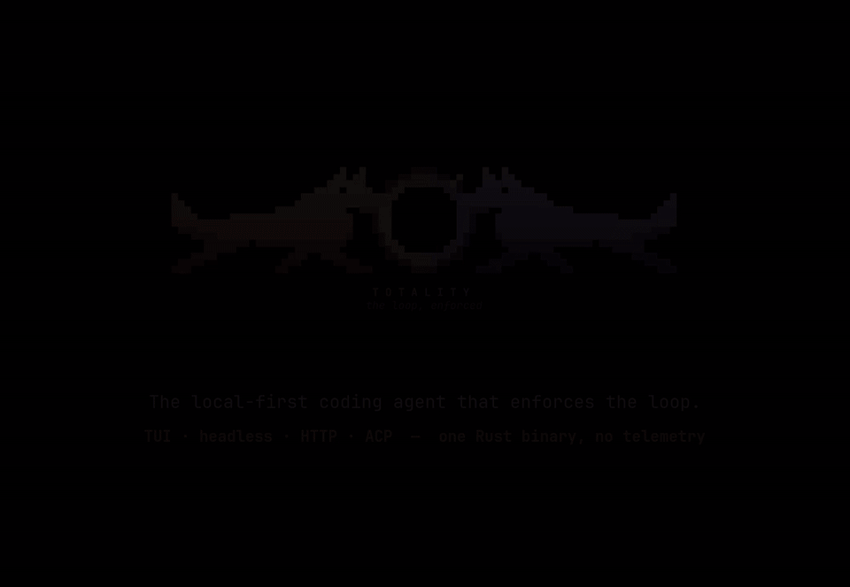

<p align="center">
  
</p>

<h1 align="center">Totality</h1>

<p align="center">
  <strong>A local-first coding agent that enforces the loop.</strong><br>
  One Rust binary. Any OpenAI-compatible model. A polished TUI and a scriptable headless mode.
</p>

<p align="center">
  <a href="https://github.com/GotinhaAzul/LocalHarness/actions/workflows/ci.yml"></a>
  <a href="https://github.com/GotinhaAzul/LocalHarness/blob/main/LICENSE-MIT"></a>
  
  
  
  
</p>

<p align="center">
  <code>27 built-in tools</code> · <code>3 packs</code> · <code>1 binary</code> · <code>0 telemetry</code>
</p>

---

**Totality owns the agent loop, the tools, the context budget, the session tree, and the interface.** Point it at any engine that speaks the OpenAI chat-completions API — llama.cpp, Ollama, vLLM, LM Studio, LiteLLM — and get the same enforced behavior. It does not ship a model, phone home, or require a Node runtime.

Built for people running local or self-hosted models who want an agent they can inspect, script, and shape. The product stance is simple: **anything the model is unreliable at is enforced by code, not requested by prompt.** The harness supplies facts, measures progress, and stops loops. The model does the work.

## The harness is the difference

Most coding agents are a prompt, a tool loop, and a lot of trust. Totality moves the trust into code.

| The failure mode | What Totality does instead |
|---|---|
| An edit before the file was read | `edit`, `write`, and `patch` refuse until the file has been read in this session. |
| “I ran the tests” | `verify` executes the configured steps and records the result before the turn can settle. |
| The same tool call, forever | Loop and stall guards stop a run that repeats. Budget checkpoints renew while the work is still producing new results, so long tasks are not cut short. |
| A context window that quietly dies | Budgeted compaction, archived tool output, and `recall` for exact excerpts. |
| A finding that sounds convincing | Evidence entries with hashes; declared PoC steps are replayed and confirmed or rejected. |
| A shell with your whole home directory | `--sandbox` and `--path-jail` narrow the process and file boundaries. |

**Local by default.** No telemetry, analytics, or phone-home. The endpoint is localhost unless you point it elsewhere, and `--no-session` writes nothing at all. The opt-in `fetch` tool is the only built-in tool that reads arbitrary URLs: it is in no profile by default (enable it in a profile's `tools` or with `--tools +fetch`), `GET`s a single public http(s) URL with no credentials or cookies (2 MB and 20 s caps), and asks in the default mode with the full URL as the approval subject, so `[permissions]` rules such as `command = "^fetch https://docs\\.rs/"` can allow a host. Loopback, private, link-local, CGNAT, and metadata addresses are refused unless `[fetch] allow_private` names the host. It runs in the harness process, not in the `bash` sandbox, so `--sandbox` does not apply to it, and it fetches only that URL, not a page's subresources or analytics.

Every tool error names the next action. Every guard is a code path, not a polite sentence in a system prompt.

## Install

Prebuilt static binaries for Linux x86_64 and aarch64 are attached to every
release with SHA-256 checksums. The installer needs no Rust toolchain, no sudo,
and installs into `~/.local/bin`:

```sh
curl -fsSLO https://github.com/GotinhaAzul/LocalHarness/releases/latest/download/install.sh
less install.sh          # read it before running
sh install.sh
tot --version
```

Download and read `install.sh` instead of piping it into a shell. It detects the
architecture, downloads the matching static binary, verifies it against the
release `SHA256SUMS`, and refuses to install anything on a checksum mismatch.
Set `TOT_VERSION=0.2.0` to pin a release and `TOT_INSTALL_DIR` to change the
prefix. Bash, zsh, and fish completions and the `tot.1` man page are installed
under `$XDG_DATA_HOME` (default `~/.local/share`).

| Channel | Install |
|---|---|
| AUR (binary) | `totality-bin` recipe in `packaging/aur/` (publish pending) |
| AUR (source) | `totality` recipe in `packaging/aur/` (publish pending) |
| Nix | `nix profile install github:GotinhaAzul/LocalHarness` |
| Docker | `docker build -f packaging/docker/Dockerfile -t totality .` then `docker run --rm -it -v "$PWD:/workspace" totality` |
| Homebrew | Best-effort formula in `packaging/homebrew/`; not in a tap yet |

The Docker image is distroless, runs as a non-root user, and has no shell or
package manager. See [docs/packaging.md](docs/packaging.md) for checksums,
release assets, and package maintenance.

From source (Rust 1.88 or newer, Linux x86_64 or aarch64):

```sh
git clone https://github.com/GotinhaAzul/LocalHarness
cd Totality
cargo install --path . --locked
tot --version
```

Or build in place:

```sh
cargo build --release
./target/release/tot --help
```

Dependencies are pinned in `Cargo.lock`.

## Quick start

Start any OpenAI-compatible server, then run `tot`. If the endpoint exposes exactly one model, it is selected automatically.

```sh
# llama.cpp (tool calling requires --jinja)
llama-server -m Qwen3.5-35B-A3B-Q4_K_M.gguf --ctx-size 65536 --jinja --port 8080
tot

# Ollama
ollama serve
ollama pull qwen3
tot --endpoint http://127.0.0.1:11434 --model qwen3

# vLLM
vllm serve Qwen/Qwen3-35B-A3B --enable-auto-tool-choice --tool-call-parser hermes
tot --endpoint http://127.0.0.1:8000 --model Qwen/Qwen3-35B-A3B
```

`tot` also starts with no reachable endpoint or model. The TUI opens with `not logged in` and turns stay disabled until you sign in:

```text
/login http://127.0.0.1:8080             auto-select the endpoint's only model
/login http://127.0.0.1:8080 qwen3       choose a model
/login http://host:8000 model sk-...     remote endpoint with a bearer token
```

`/login` validates `GET /v1/models` and saves `endpoint`, `model`, and `api_key` to the global config with `0600` permissions. `/model` opens a filterable picker over every model the endpoint exposes, including gateways such as LiteLLM or OpenRouter. Headless `--print` requires a selected model.

Point at another endpoint with `--endpoint` or `TOT_ENDPOINT` (default `http://127.0.0.1:8080`). Both `http://host:8080` and `http://host:8080/v1` work, so you can paste the base URL an engine prints. A non-local endpoint is allowed but warned about; see [docs/model-setup.md](docs/model-setup.md) for a tailnet example.

Facts come from optional endpoints (`/v1/models`, `/props`, `/tokenize`, `/api/show`). Missing probes only degrade estimates; they never fail a turn. The harness does not launch servers on its own, but `[model] start_command` can start one once when the endpoint is unreachable.

## 01 · The loop is enforced, not requested

A model can forget to read a file, claim a test passed, or repeat the same failing call until the context is gone. Totality makes those states visible and stoppable.

```text
[tool] edit src/parser.rs
[error] read src/parser.rs first

[tool] verify cargo test
PASS  cargo  42 passed (3.1 s)

✓ read-before-edit   ✓ plan gate   ✓ verify gate   ✓ review gate
```

- **Read before edit.** `edit`, `write`, and `patch` require a prior read of the same file. A changed file must be read again.
- **Plan before the third mutation.** `todo` is free for two edits or two files, then a plan is required.
- **Verify before settle.** After changes, configured steps run; a real failure blocks the turn.
- **Review after verify.** The `review` pass checks the diff for secrets, debug statements, lockfiles, deletion-heavy changes, and source changes without tests.
- **Stop the loop, not the work.** Loop and stall guards end a repeating run with a status, not a silent bill. Budget checkpoints renew while the run is still producing new results.
- **Name the next action.** Every error tells the model what to do instead of leaving it to guess.

## 02 · Tools that know the codebase

Twenty-four built-ins in three packs. `coding` (core + coding) is the default; `full` adds the security pack. `security` and `minimal` narrow it further; `strict` and `shell` are weak-model presets (see [configuration](docs/configuration.md#weak-model-profiles)).

| Pack | Tools |
|---|---|
| Core | `read` `write` `edit` `patch` `undo` `bash` `grep` `glob` `todo` `skill` `verify` `recall` `thread` `bg` |
| Coding | `repo_map` `lsp` `test` `review` |
| Security | `surface` `evidence` `detect` `attack_path` `finding` `iocs` |

- **`repo_map`** returns a cached, budget-capped outline of files and top-level symbols; a compact version ships in the system prompt.
- **`lsp`** adds language-server diagnostics after edits when a supported server is installed and the file belongs to a real project. A missing or cold server never fails an edit.
- **`test`** detects vitest, jest, go, cargo, pytest, or an npm test script and returns only the first failure.
- **`review`** reads the working tree and checks the diff before the session settles.
- **`undo`** reverts the last `edit`, `patch`, or `write` from session snapshots, and refuses when the file changed after the harness wrote it. Changes made through `bash` are not tracked.
- **Hunk review.** `review = "multi_file"` (the default) pauses before a turn's second file mutation, shows the proposed hunks in the TUI, and writes only what you accept. Rejected hunks are reported back to the model with their ranges, accepted hunks land atomically, and `undo` still steps back over them. `always` reviews every mutation; `off` restores immediate writes. Headless `--print` has no reviewer, so it auto-accepts and never blocks.
- **`read`/`grep`/`glob`** respect ignore files and keep results small; oversized output is archived and available through `recall`.
- **Hash edits (opt-in)** — `edit_mode = "hash"` makes `read` print content hashes and lets `patch` apply `PUT`/`CUT`/`REM`/`MV` line anchors from `path#snapshot`; stale anchors write nothing and return fresh ones. Exact-text `edit` remains the default. See [configuration](docs/configuration.md#hash-anchored-edits).

Tool results are capped, archived, and retrievable. The model never has to guess where an excerpt came from.

## 03 · Sessions are a tree, not a log

One append-only JSONL file per session tree under `~/.local/share/totality/sessions/<project-id>/`. Branches, checkouts, and forks are non-destructive.

```text
/tree       show branches and switch
/rewind     restore files and the conversation to an earlier turn
/fork       branch from the current leaf
/new        start a fresh session
/resume     pick a previous session by prefix or suffix
/sessions   list every session for this project
/export     write a Markdown transcript
```

`/rewind [turns]` restores every file the harness wrote after the target to its
snapshot there, then moves the leaf; the old branch stays in `/tree`. An edit
made outside the harness refuses the rewind and is named; `/rewind 1 force`
backs such files up before restoring them. `tot --rewind <session>:<entry>`
does the same headlessly.

```sh
tot --rewind last:e42          # latest session, before entry e42
tot --rewind 20261107-…:e9 --force
```

Compaction is deterministic, not model-written. Tool output is archived with an id, and `recall` reads an exact range. The request prefix is cache-stable: tool order and schema key order do not drift, volatile session facts sit at the end of the system block, and a compaction logs how much of the prefix the engine can keep. `--no-session` writes nothing: no session file, no artifacts. Session files, artifacts, evidence, and reports are redacted on disk by default; `--no-redact` is the explicit opt-out and is recorded in the session header. Redaction applies only to what is written to disk: in a live session the model sees the real tool output, so it has no placeholder to copy into a file. A resumed session replays the saved, redacted form with a note, and `write`/`edit`/`patch`/`undo` refuse content that adds a `[REDACTED:...]` placeholder the file does not already hold.

`AGENTS.md` is read hierarchically: the chain from the git repository root to the working directory, nearest last, each with a source-path header. Files are capped at 12 KiB each and 32 KiB total, with deterministic truncation and a warning; a symlink that resolves outside the repository is refused. `tot context --show` prints the manifest (path, bytes, SHA-256, loaded/skipped/truncated), and `tot context --json` emits the same data for scripts. `--no-agents-md` or `TOT_AGENTS_MD=0` skips the chain. The files are advisory: they cannot add a tool, relax a gate, or change the profile.

## 04 · One binary, two front ends

### The TUI

The terminal interface is the default. It speaks in two voices: the model in Skoll's amber, the harness in Hati's silver-blue (the `sun` and `moon` theme tokens). Tool calls render as compact rows grouped with the thoughts between them, diffs and streamed Markdown are styled, and the context gauge stays visible. The terminal title shows whether a turn is running, waiting for approval, or done. When the engine reports a prefix-cache hit, the header also shows `cache <cached>/<prompt>` tokens; `--json` usage events carry the same counts.

| Key | Action |
|---|---|
| `Enter` | send |
| `Ctrl+J` | newline |
| `Esc` | cancel the current stream |
| `Ctrl+C` | cancel; again to quit |
| `Ctrl+D` | quit when the input is empty |
| `Up`/`Down` | history when input is empty; otherwise cursor |
| `PgUp`/`PgDn`, `Home`/`End` | scroll transcript |
| `Ctrl+R` | toggle reasoning |
| `Ctrl+L` | redraw the whole screen |
| `/` | slash-command completion |
| `Tab` / `Shift+Tab` | complete commands, arguments, and paths; move back through choices |
| Review: `a` / `r` / `e` | accept, reject, or edit the selected hunk (`A`/`R` all, `Enter` apply, `Esc` reject all) |

Tab completes the token at the cursor: commands, arguments (themes, profiles, skills, workflows, session ids, models, `/login` endpoints, `/help` topics, `/sec` subcommands), and file paths. Ambiguous matches first extend to their shared prefix, then open a picker. Every command that chooses from a list — `/model`, `/profile`, `/theme` (with live preview), `/skill`, `/workflow`, `/sec`, `/resume` — opens a filterable menu when run without an argument: type to filter, arrows to move, Enter to pick. Model and profile switches load in the background, so the TUI stays responsive while the server swaps models.

Write `@path` in a prompt to attach a file: `fix the panic in @src/parser.rs`. The file is read through the same path as the `read` tool and appended to your message, so the model can edit it without another read. Up to eight files per prompt, within a quarter of the usable context. `@shot.png` attaches a screenshot: a model with vision input sees the image, and a text-only model can get a description from a local vision model; the `read` tool opens images too. Images are checked by content, stripped of EXIF, and sent only to local endpoints unless you opt in. See [docs/images.md](docs/images.md).

Slash commands: `/help /quit /login /model /profile /theme /tree /rewind /fork /new /resume /sessions /compact /tools /mcp /skill /workflow /sec /trust /commit /pr /plan /export /clear /debug`.

Every tool call passes a permission policy first. The default mode `ask` runs read-only calls and asks before edits and commands, showing the exact command or path and a diff; `y` approves exactly that call for the session. `/plan` switches to plan mode: mutating tools are removed and refused at dispatch until `/plan approve`. Modes, rules, and `--yolo` are in [docs/configuration.md](docs/configuration.md#permissions).

### Headless

```sh
tot --mode accept-edits --print "Fix the failing parser test"
tot --print "Summarize this repo" --json
tot --plan --print "Plan the parser refactor"   # read-only; prints the plan
tot --continue                  # most recent session
tot --resume 20261107-201500-1234
```

`--print` streams text to stdout, diagnostics to stderr, and exits with the turn status: `0` done, `1` error/blocked, `2` budget/stalled, `130` cancelled. `--json` emits newline-delimited events for scripts and CI. A headless run cannot answer a permission prompt, so calls that would ask are denied: pass `--mode accept-edits`, add allow rules, or use `--yolo` (explicit, recorded in the session).

### Local HTTP API

`tot serve` exposes sessions, turns, a Server-Sent Events stream, and cancel on loopback, for cron jobs, CI, dashboards, and scripts:

```sh
tot serve                       # prints {"listening":"http://127.0.0.1:PORT","token_file":"…"}
curl -H "Authorization: Bearer $(cat <token_file>)" -X POST http://127.0.0.1:PORT/v1/sessions -d '{}'
```

The bearer token is written to a `0600` file. Only its path is printed. SSE event names are the `--json` event names. A session runs one turn at a time, and a second turn gets a typed `409`. A non-loopback bind needs `--allow-non-loopback`. HTTP sessions cannot answer a permission prompt, so commands and edits are denied unless the session is created with `"permission_mode": "accept-edits"`, or with `"yolo"` on a server started with `--allow-yolo`. Sessions stay resumable after the server stops. See [docs/serve.md](docs/serve.md).

### Editors

`tot acp` speaks the Agent Client Protocol v1 over stdio, so Zed (and other ACP editors) can host a Totality thread:

```json
{
  "agent_servers": {
    "totality": {
      "type": "custom",
      "command": "tot",
      "args": ["--endpoint", "http://127.0.0.1:8080", "--model", "qwen3", "acp"],
      "env": {}
    }
  }
}
```

The session root is the `cwd` the editor declares, and the path jail is always on for file tools. Every tool that can change files or run processes asks the editor first; a denial leaves no side effect, and an approval never widens a harness gate. `bash` and `bg` are processes, so their boundary is the permission prompt plus `--sandbox`. Terminal access is not advertised and a terminal request gets a typed refusal. See [docs/acp.md](docs/acp.md).

## 05 · Security, when you ask for it

Security is opt-in. The default `coding` profile has no security tools or posture. `--profile security` adds core plus security; `--profile full` adds coding plus security. `/profile` switches during a session.

Security work is for authorized labs, CTFs, and engagements only. Scope is set by the user with `/sec scope add|remove|clear`; there is no model tool for it. The scope gate blocks a known set of active-testing tools when no scope is set or when an extracted target is outside it. It is a speed bump; `--sandbox` is the process boundary.

Repository files and tool output are tagged with their source. A cheap detector warns when untrusted content contains instruction-shaped phrases, and the next sensitive action needs `/approve`. Untrusted content cannot enable a tool, change scope, change the endpoint, or change permissions; that is enforced at dispatch, not in the prompt.

- **Evidence.** `bash`, `bg`, and external tool runs append an evidence entry with target, command, timestamps, exit status, output artifact, and SHA-256. Secret values are redacted before session, artifact, evidence, finding, and report writes (never in what the model reads); `--no-redact` is the explicit, recorded opt-out.
- **Surface.** `surface` parses nmap/HTTP/TLS output into one inventory; `attack_path` queries the graph derived from surface, findings, and evidence.
- **Findings.** `finding add` auto-links the last evidence entry. A finding can carry bounded `poc_steps`; `finding verify` replays them locally and stores `reproduced`/`confirmed`, `not_reproduced`/`rejected`, or `error|skipped`/`inconclusive`.
- **Detection.** `detect` validates and runs a Sigma subset against local JSONL logs or plain-text samples.
- **Boundaries.** `--sandbox` runs `bash` and `bg` in an OS sandbox with bubblewrap or Landlock. `--path-jail` restricts file tools to the working directory. `--no-sandbox` is the explicit opt-out. `[permissions]` rules allow, ask, or deny calls by tool, path, command, or network before they run.

Read [docs/security.md](docs/security.md) before using it on client work.

## 06 · Shape it without forking

Everything at the edge is configurable; the loop itself stays small and auditable.

- **Profiles** select packs and tools. Built-ins are `coding` (default), `full`, `security`, `minimal`, `strict` (six tools, one call per message for weak models), and experimental `shell` (bash only); add your own in `profiles/*.toml` or `.harness/profiles/`.
- **Prompt** customization lives in `[prompt]`: replace the one-line identity, append inline instructions, point at a Markdown file, or disable the hierarchical `AGENTS.md` chain with `agents_md = false`. Per-profile prompts still apply on top.
- **Skills** are Markdown instructions in the Agent Skills format (`SKILL.md`). The model loads a matching skill with the `skill` tool, or you load one with `/skill <name>`. Bundled security skills advertise only when the security pack is active and remain loadable by name; eight bundled coding skills advertise with the coding pack. `.claude/skills`, `.agents/skills`, and `~/.claude/skills` load alongside the native directories, with native precedence. Install and pin a library with `tot skill add|update|remove|list`, validate it with `tot skill lint`, and test its triggers with `tot skill eval --fixtures`.
- **Workflows** are playbooks plus a profile and tool allowlist. Optional `[[step]]` tables add conditions, bounded retries, approval gates, declared artifacts, and resume; `tot workflow run <name>` executes them. The bundled set covers coding, review, general assistance, and security.
- **External tools** are any executable speaking one JSON object in, one JSON object out. No plugin ABI, no second runtime.
- **Lifecycle hooks** run your command at `session_start`, `user_prompt`, `pre_tool`, `post_tool`, `pre_compact`, and `stop`. They can add context or block; a missing hook is visible and `pre_tool` fails closed. `tot hooks test <name>` exercises one.
- **MCP servers** plug in over stdio or Streamable HTTP with one `[mcp.<name>]` table. Their tools join the profile as `<server>__<tool>`; `tot mcp list` and `/mcp` show what connected.
- **Themes** are TOML files of semantic color tokens. `default` is bundled with four alternatives; `omarchy` is an alias for existing configs.

```toml
default_profile = "coding"

[ui]
theme = "default"

[prompt]
identity = ""                 # replace the built-in identity
instructions = ""             # append your own rules
file = ""                     # or point at a Markdown file
```

Loop behavior is not scriptable. Fork the crate.

## Design principles

- **Local by default.** No telemetry, no hosted state, no phone-home. The model can be remote; the harness is yours.
- **Enforced, not prompted.** Guards are code paths because prompts are advice.
- **Facts over guesses.** Probe the engine, measure the context, record the result.
- **Plain text, no lock-in.** JSONL sessions, TOML config, Markdown skills, and ordinary executables.
- **Extensible at the edges.** Profiles, skills, workflows, tools, and themes; the loop stays small.

## Configuration

Global config: `~/.config/totality/config.toml`. A trusted project `.harness/` overrides it. Precedence: CLI flags > trusted project config > global config > built-in defaults.

| Environment | Meaning |
|---|---|
| `TOT_ENDPOINT`, `TOT_MODEL` | Endpoint base URL and model id |
| `TOT_API_KEY` | Bearer token |
| `TOT_PROFILE`, `TOT_MODEL_PROFILE` | Tool profile and model profile |
| `TOT_THEME` | Theme name |
| `TOT_NO_SESSION`, `TOT_TRUST` | Disable persistence; trust project config |
| `TOT_AGENTS_MD` | Set to `0` to skip the AGENTS.md chain |
| `TOT_CONFIG_DIR`, `TOT_DATA_DIR` | Override config and data roots |
| `TOT_SKIP_TOOL_PROBE` | Skip the one-shot tool-call conformance probe |

`model_profile = "auto"` matches by model-name prefix; the `default` model profile is the fallback. `[model] context_window` is used only when the model profile does not set one. See [docs/configuration.md](docs/configuration.md) for every key and [docs/model-setup.md](docs/model-setup.md) for engine-specific tuning.

## Documentation

| Guide | What it covers |
|---|---|
| [Configuration](docs/configuration.md) | Every config key, precedence, verify steps, environment |
| [Model setup](docs/model-setup.md) | llama.cpp, Ollama, vLLM, profiles, context accounting, `tot doctor` |
| [Skills and workflows](docs/skills-workflows.md) | Skill format, references, bundled playbooks, tool allowlists |
| [Security](docs/security.md) | Authorization, scope, evidence, findings, PoC replay, sandbox |
| [Lifecycle hooks](docs/hooks.md) | `session_start` through `stop`, JSON protocol, fail-closed guards, `tot hooks test` |
| [External tools](docs/external-tools.md) | Manifest format, protocol, schemas, scope gating |
| [MCP servers](docs/mcp.md) | stdio and HTTP servers, tool naming, profiles, `tot mcp` |
| [Editor integration](docs/acp.md) | `tot acp`, Zed setup, permissions, roots, stop reasons, limitations |
| [Local HTTP API](docs/serve.md) | `tot serve`, endpoints, SSE events, token, permission modes, shutdown |
| [Images](docs/images.md) | `@image` attachments, vision models, the describer fallback, EXIF and remote rules |
| [Themes](docs/themes.md) | Semantic tokens, color modes, user themes |
| [Packaging and releases](docs/packaging.md) | Release artifacts, installer, AUR, Nix, Homebrew, Docker, completions |
| [Architecture](ARCHITECTURE.md) | Implementation specification and design decisions |

## Development

```sh
cargo fmt --check
cargo clippy --all-targets -- -D warnings
cargo test
cargo audit && cargo deny check   # advisories
```

No test requires a real model or network. [ARCHITECTURE.md](ARCHITECTURE.md) is the implementation specification.

## Contributing

Read [CONTRIBUTING.md](CONTRIBUTING.md) before opening a PR. The short version: run the checks above, bring a test for anything that changes the loop, a gate, or the tool protocol, and settle the issue before writing the patch. Report vulnerabilities through [SECURITY.md](SECURITY.md), never in a public issue.

## License

MIT OR Apache-2.0. See [LICENSE-MIT](LICENSE-MIT) and [LICENSE-APACHE](LICENSE-APACHE).

<p align="center">
  <sub>Local-first by default. Enforced by code. Shaped by you.</sub>
</p>
