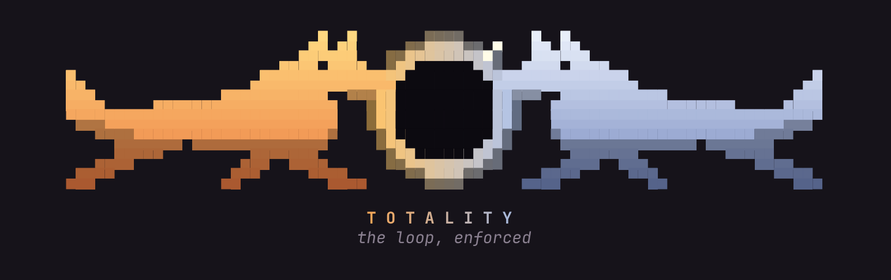
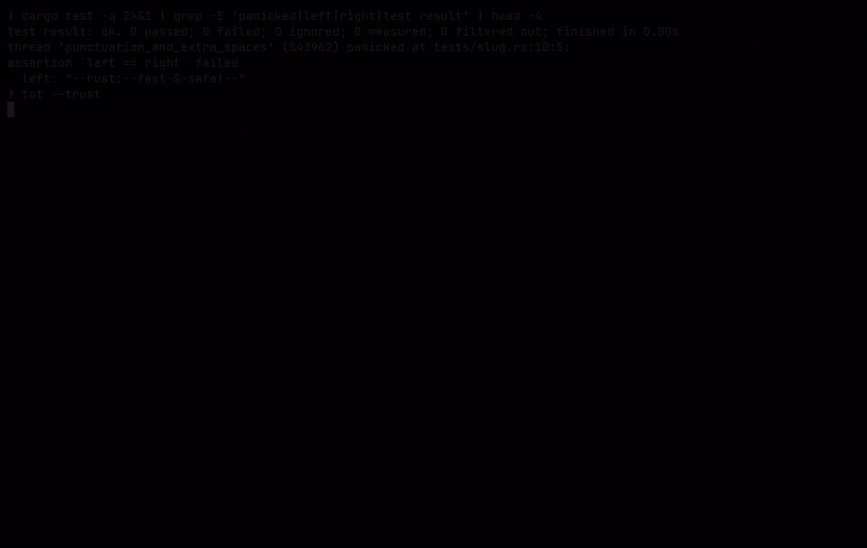

<p align="center">
  
</p>

<p align="center">
  <strong>The local-first coding agent that enforces the loop.</strong><br>
  One Rust binary. Any OpenAI-compatible model. Nothing phones home.
</p>

<p align="center">
  <a href="https://github.com/GotinhaAzul/Totality/actions/workflows/ci.yml"></a>
  <a href="https://github.com/GotinhaAzul/Totality/releases/latest"></a>
  <a href="LICENSE-MIT"></a>
  
</p>

<p align="center">
  <a href="#install">Install</a> ·
  <a href="#quick-start">Quick start</a> ·
  <a href="#features">Features</a> ·
  <a href="docs/usage.md">Usage guide</a> ·
  <a href="#documentation">Docs</a> ·
  <a href="CONTRIBUTING.md">Contributing</a>
</p>

<p align="center">
  
</p>

<p align="center">
  <a href="docs/assets/demo.mp4">Watch the full 60-second demo</a>
</p>

---

Totality is a terminal coding agent for people who run their own models. Point
it at llama.cpp, Ollama, vLLM, LM Studio, or any OpenAI-compatible gateway, and
it does the rest of the job a hosted agent does: reads your code, plans, edits,
runs your tests, and keeps a session you can rewind.

What makes it different is where the trust lives. **Anything a model is
unreliable at is enforced by code, not requested in a prompt.** Totality will not
let an edit land on a file the model never read, will not let a turn end on "I
ran the tests" without running them, and stops a run that is going in circles.
A smaller local model, kept honest, gets real work done.

## Install

```sh
curl -fsSLO https://github.com/GotinhaAzul/Totality/releases/latest/download/install.sh
less install.sh   # read it first
sh install.sh     # static binary into ~/.local/bin, checksum-verified, no sudo
```

<details>
<summary>Other ways to install</summary>

| Channel | Command |
|---|---|
| From source | `cargo install --git https://github.com/GotinhaAzul/Totality --locked` (Rust 1.88+) |
| Nix | `nix profile install github:GotinhaAzul/Totality` |
| Docker | `docker build -f packaging/docker/Dockerfile -t totality .` then `docker run --rm -it -v "$PWD:/workspace" totality` |
| AUR | `totality` and `totality-bin` recipes in [`packaging/aur/`](packaging/aur/) (publish pending) |
| Homebrew | Best-effort formula in [`packaging/homebrew/`](packaging/homebrew/) (not in a tap yet) |

The installer verifies the release `SHA256SUMS` and refuses to install on a
mismatch. `TOT_VERSION` pins a release and `TOT_INSTALL_DIR` changes the prefix;
completions and the man page go under `$XDG_DATA_HOME`. Prebuilt binaries cover
Linux x86_64 and aarch64. See [packaging](docs/packaging.md).

</details>

## Quick start

```sh
# 1. Serve a model with tool calling (llama.cpp shown; Ollama and vLLM work too)
llama-server -m Qwen3.5-35B-A3B-Q4_K_M.gguf --ctx-size 65536 --jinja --port 8080

# 2. Open Totality in your project
cd your-project
tot
```

That's it: with one model on the endpoint, Totality picks it. Elsewhere, use
`tot --endpoint http://host:11434 --model qwen3`, or type `/login` inside the
app. Then ask for something:

```text
› fix the failing parser test in @src/parser.rs
```

Typing `@` opens a live file picker; `/` lists every command. Per-engine setup
is in [model setup](docs/model-setup.md).

## Features

**An enforced loop.** Read before edit, plan before the third change, verify
before the turn ends, review the diff after. Loop and stall guards stop
repetition without cutting off work that is still making progress. Every error
names the next action, so a model is never left guessing.

**Tools that know the codebase.** `edit` and `undo` with snapshots, plus a
hash-anchored `patch` when enabled; grep, glob, and a cached repo map;
language-server diagnostics after edits; `verify` with a target that runs one
test and returns the first failure, not ten thousand lines. Oversized output
is archived and recalled by exact range.

**Hunk review.** Before a multi-file change lands, Totality shows you the hunks.
Accept, reject, or edit each one; only what you accept is written.

**Sessions are a tree.** Fork, rewind files and conversation to any earlier
turn, resume tomorrow. Compaction is deterministic and the request prefix stays
cache-stable, so local engines keep their prompt cache.

**Built for local models.** Probes the engine for its real context window and
tool-call format, repairs malformed tool calls, and ships weak-model profiles
that narrow the toolset to what a small model can drive.

**Everywhere you work.** A TUI with live `@` mentions, a headless mode for
scripts and CI (`tot --print … --json`), a local HTTP API with server-sent
events (`tot serve`), and the Agent Client Protocol for Zed and other editors
(`tot acp`).

**Shape it without forking.** Profiles, Agent Skills (`SKILL.md`, including
`.claude/skills`), workflows with steps and approval gates, MCP servers,
lifecycle hooks, external tools as plain executables, and TOML themes.

**Security work, when you ask for it.** An opt-in profile with scope gates,
hashed evidence for every command, findings whose proof-of-concept steps are
replayed and confirmed, Sigma detection, and an OS sandbox. For authorized
work only; read [security](docs/security.md) first.

**Private by design.** No telemetry and no hosted state. Sessions and evidence
are redacted on disk, `--no-session` writes nothing, and `--sandbox` and
`--path-jail` narrow what the agent can touch.

## Why "enforced"

| What a model does | What Totality does instead |
|---|---|
| Edits a file it never read | `edit`, `write`, and `patch` refuse until the file is read this session |
| Says "I ran the tests" | `verify` runs the configured steps; a failure blocks the turn |
| Repeats the same call forever | Loop and stall guards end the run with a status |
| Fills the context and dies | Budgeted compaction, archived output, and `recall` for exact excerpts |
| Writes a convincing finding | Evidence entries carry hashes; declared PoC steps are replayed |
| Runs with your whole home directory | `--sandbox` and `--path-jail` narrow processes and files |

## The look

The interface speaks in two voices. Skoll, the sun, is the model: its replies
and thinking glow amber. Hati, the moon, is the harness: tool rows, gates, and
turn summaries are silver-blue. The default theme is dusk; `/theme` previews the
others live (`hati` for night, `skoll` for daylight terminals, `catppuccin-mocha`,
`gruvbox-dark`, `high-contrast`, and more), and your own palettes are plain
TOML. See [themes](docs/themes.md).

## Documentation

| | |
|---|---|
| [Usage guide](docs/usage.md) | The TUI, keys, commands, sessions, headless mode, tools |
| [Configuration](docs/configuration.md) | Every key, precedence, permissions, environment variables |
| [Model setup](docs/model-setup.md) | llama.cpp, Ollama, vLLM, model profiles, `tot doctor` |
| [Skills and workflows](docs/skills-workflows.md) | Skill format, bundled playbooks, workflow steps |
| [MCP servers](docs/mcp.md) · [Hooks](docs/hooks.md) · [External tools](docs/external-tools.md) | Extending Totality |
| [Editors (ACP)](docs/acp.md) · [HTTP API](docs/serve.md) | Running it from other programs |
| [Security](docs/security.md) · [Images](docs/images.md) · [Themes](docs/themes.md) | Everything else |
| [Architecture](ARCHITECTURE.md) | Implementation specification and design decisions |

Upgrading from LocalHarness? The binary is now `tot`, environment variables use
`TOT_` (the `LH_` names still work), and your existing config and sessions are
picked up where they are; the legacy `localharness` directories stay in use
until you move them. See
[configuration](docs/configuration.md#data-and-config-directories).

## Contributing

Issues and pull requests are welcome; read [CONTRIBUTING.md](CONTRIBUTING.md)
first. The checks are the usual three, and no test needs a model or the network:

```sh
cargo fmt --check && cargo clippy --all-targets -- -D warnings && cargo test
```

Report vulnerabilities through [SECURITY.md](SECURITY.md), never in a public
issue.

## License

MIT OR Apache-2.0, at your option. See [LICENSE-MIT](LICENSE-MIT) and
[LICENSE-APACHE](LICENSE-APACHE).

<p align="center">
  <sub>In the old story, two wolves chase the sun and the moon across the sky until they catch them. Totality is the moment they do.</sub>
</p>
