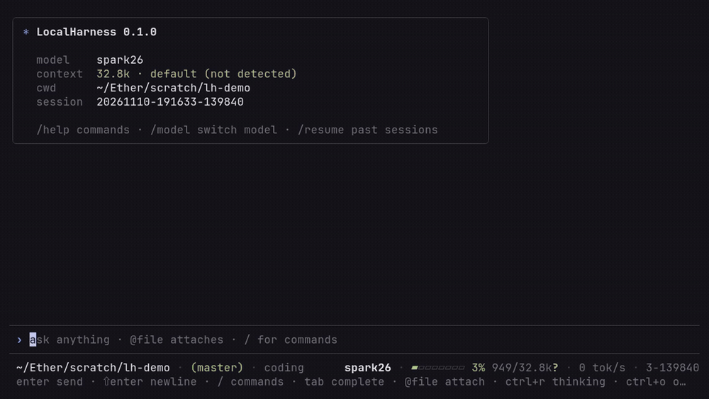

<p align="center">
  
</p>

<h1 align="center">LocalHarness</h1>

<p align="center">
  <strong>A local-first coding agent that enforces the loop.</strong><br>
  One Rust binary. Any OpenAI-compatible model. A polished TUI and a scriptable headless mode.
</p>

<p align="center">
  <a href="https://github.com/GotinhaAzul/LocalHarness/actions/workflows/ci.yml"></a>
  <a href="https://github.com/GotinhaAzul/LocalHarness/blob/main/LICENSE-MIT"></a>
  
  
  
  
</p>

<p align="center">
  <code>24 built-in tools</code> · <code>3 packs</code> · <code>1 binary</code> · <code>0 telemetry</code>
</p>

---

**LocalHarness owns the agent loop, the tools, the context budget, the session tree, and the interface.** Point it at any engine that speaks the OpenAI chat-completions API — llama.cpp, Ollama, vLLM, LM Studio, LiteLLM — and get the same enforced behavior. It does not ship a model, phone home, or require a Node runtime.

Built for people running local or self-hosted models who want an agent they can inspect, script, and shape. The product stance is simple: **anything the model is unreliable at is enforced by code, not requested by prompt.** The harness supplies facts, measures progress, and stops loops. The model does the work.

## The harness is the difference

Most coding agents are a prompt, a tool loop, and a lot of trust. LocalHarness moves the trust into code.

| The failure mode | What LocalHarness does instead |
|---|---|
| An edit before the file was read | `edit`, `write`, and `patch` refuse until the file has been read in this session. |
| “I ran the tests” | `verify` executes the configured steps and records the result before the turn can settle. |
| The same tool call, forever | Loop, stall, tool-call, and wall-clock budgets stop the turn and report why. |
| A context window that quietly dies | Budgeted compaction, archived tool output, and `recall` for exact excerpts. |
| A finding that sounds convincing | Evidence entries with hashes; declared PoC steps are replayed and confirmed or rejected. |
| A shell with your whole home directory | `--sandbox` and `--path-jail` narrow the process and file boundaries. |

**Local by default.** No telemetry, analytics, or phone-home. The endpoint is localhost unless you point it elsewhere, and `--no-session` writes nothing at all.

Every tool error names the next action. Every guard is a code path, not a polite sentence in a system prompt.

## Install

```sh
git clone https://github.com/GotinhaAzul/LocalHarness
cd LocalHarness
cargo install --path . --locked
lh --version
```

Or build in place:

```sh
cargo build --release
./target/release/lh --help
```

Requires Rust 1.88 or newer and Linux x86_64 or aarch64. Dependencies are pinned in `Cargo.lock`.

## Quick start

Start any OpenAI-compatible server, then run `lh`. If the endpoint exposes exactly one model, it is selected automatically.

```sh
# llama.cpp (tool calling requires --jinja)
llama-server -m Qwen3.5-35B-A3B-Q4_K_M.gguf --ctx-size 65536 --jinja --port 8080
lh

# Ollama
ollama serve
ollama pull qwen3
lh --endpoint http://127.0.0.1:11434 --model qwen3

# vLLM
vllm serve Qwen/Qwen3-35B-A3B --enable-auto-tool-choice --tool-call-parser hermes
lh --endpoint http://127.0.0.1:8000 --model Qwen/Qwen3-35B-A3B
```

`lh` also starts with no reachable endpoint or model. The TUI opens with `not logged in` and turns stay disabled until you sign in:

```text
/login http://127.0.0.1:8080             auto-select the endpoint's only model
/login http://127.0.0.1:8080 qwen3       choose a model
/login http://host:8000 model sk-...     remote endpoint with a bearer token
```

`/login` validates `GET /v1/models` and saves `endpoint`, `model`, and `api_key` to the global config with `0600` permissions. `/model` opens a filterable picker over every model the endpoint exposes, including gateways such as LiteLLM or OpenRouter. Headless `--print` requires a selected model.

Point at another endpoint with `--endpoint` or `LH_ENDPOINT` (default `http://127.0.0.1:8080`). Both `http://host:8080` and `http://host:8080/v1` work, so you can paste the base URL an engine prints. A non-local endpoint is allowed but warned about; see [docs/model-setup.md](docs/model-setup.md) for a tailnet example.

Facts come from optional endpoints (`/v1/models`, `/props`, `/tokenize`, `/api/show`). Missing probes only degrade estimates; they never fail a turn. The harness does not launch servers on its own, but `[model] start_command` can start one once when the endpoint is unreachable.

## 01 · The loop is enforced, not requested

A model can forget to read a file, claim a test passed, or repeat the same failing call until the context is gone. LocalHarness makes those states visible and stoppable.

```text
[tool] edit src/parser.rs
[error] read src/parser.rs first

[tool] verify cargo test
PASS  cargo  42 passed (3.1 s)

✓ read-before-edit   ✓ plan gate   ✓ verify gate   ✓ review gate
```

- **Read before edit.** `edit`, `write`, and `patch` require a prior read of the same file. A changed file must be read again.
- **Plan before the third mutation.** `todo` is free for two edits or two files, then a plan is required.
- **Verify before settle.** After changes, configured steps run; a real failure blocks the turn.
- **Review after verify.** The `review` pass checks the diff for secrets, debug statements, lockfiles, deletion-heavy changes, and source changes without tests.
- **Stop the loop.** Repeat, stall, tool, and wall-clock budgets end a runaway turn with a status, not a silent bill.
- **Name the next action.** Every error tells the model what to do instead of leaving it to guess.

## 02 · Tools that know the codebase

Twenty-four built-ins in three packs. `coding` (core + coding) is the default; `full` adds the security pack. `security` and `minimal` narrow it further; `strict` and `shell` are weak-model presets (see [configuration](docs/configuration.md#weak-model-profiles)).

| Pack | Tools |
|---|---|
| Core | `read` `write` `edit` `patch` `undo` `bash` `grep` `glob` `todo` `skill` `verify` `recall` `thread` `bg` |
| Coding | `repo_map` `lsp` `test` `review` |
| Security | `surface` `evidence` `detect` `attack_path` `finding` `iocs` |

- **`repo_map`** returns a cached, budget-capped outline of files and top-level symbols; a compact version ships in the system prompt.
- **`lsp`** adds language-server diagnostics after edits when a supported server is installed and the file belongs to a real project. A missing or cold server never fails an edit.
- **`test`** detects vitest, jest, go, cargo, pytest, or an npm test script and returns only the first failure.
- **`review`** reads the working tree and checks the diff before the session settles.
- **`undo`** reverts the last `edit`, `patch`, or `write` from session snapshots, and refuses when the file changed after the harness wrote it. Changes made through `bash` are not tracked.
- **`read`/`grep`/`glob`** respect ignore files and keep results small; oversized output is archived and available through `recall`.

Tool results are capped, archived, and retrievable. The model never has to guess where an excerpt came from.

## 03 · Sessions are a tree, not a log

One append-only JSONL file per session tree under `~/.local/share/localharness/sessions/<project-id>/`. Branches, checkouts, and forks are non-destructive.

```text
/tree       show branches and switch
/fork       branch from the current leaf
/new        start a fresh session
/resume     pick a previous session by prefix or suffix
/sessions   list every session for this project
/export     write a Markdown transcript
```

Compaction is deterministic, not model-written. Tool output is archived with an id, and `recall` reads an exact range. `--no-session` writes nothing: no session file, no artifacts. Persisted session entries, artifacts, evidence, and reports redact secret-shaped values by default; `--no-redact` is the explicit opt-out and is recorded in the session header.

## 04 · One binary, two front ends

### The TUI

The terminal interface is the default. Tool calls render as cards, diffs and streamed Markdown are styled, and the context gauge stays visible.

| Key | Action |
|---|---|
| `Enter` | send |
| `Ctrl+J` | newline |
| `Esc` | cancel the current stream |
| `Ctrl+C` | cancel; again to quit |
| `Ctrl+D` | quit when the input is empty |
| `Up`/`Down` | history when input is empty; otherwise cursor |
| `PgUp`/`PgDn`, `Home`/`End` | scroll transcript |
| `Ctrl+R` | toggle reasoning |
| `/` | slash-command completion |
| `Tab` / `Shift+Tab` | complete commands, arguments, and paths; move back through choices |

Tab completes the token at the cursor: commands, arguments (themes, profiles, skills, workflows, session ids, models, `/sec` subcommands), and file paths. Ambiguous matches first extend to their shared prefix, then open a picker.

Write `@path` in a prompt to attach a file: `fix the panic in @src/parser.rs`. The file is read through the same path as the `read` tool and appended to your message, so the model can edit it without another read. Up to eight files per prompt, within a quarter of the usable context.

Slash commands: `/help /quit /login /model /profile /theme /tree /fork /new /resume /sessions /compact /tools /mcp /skill /workflow /sec /trust /export /clear /debug`.

### Headless

```sh
lh --print "Fix the failing parser test"
lh --print "Summarize this repo" --json
lh --continue                  # most recent session
lh --resume 20261107-201500-1234
```

`--print` streams text to stdout, diagnostics to stderr, and exits with the turn status: `0` done, `1` error/blocked, `2` budget/stalled, `130` cancelled. `--json` emits newline-delimited events for scripts and CI.

## 05 · Security, when you ask for it

Security is opt-in. The default `coding` profile has no security tools or posture. `--profile security` adds core plus security; `--profile full` adds coding plus security. `/profile` switches during a session.

Security work is for authorized labs, CTFs, and engagements only. Scope is set by the user with `/sec scope add|remove|clear`; there is no model tool for it. The scope gate blocks a known set of active-testing tools when no scope is set or when an extracted target is outside it. It is a speed bump; `--sandbox` is the process boundary.

- **Evidence.** `bash`, `bg`, and external tool runs append an evidence entry with target, command, timestamps, exit status, output artifact, and SHA-256. Secret values are redacted before session, artifact, evidence, and report writes; `--no-redact` is the explicit, recorded opt-out.
- **Surface.** `surface` parses nmap/HTTP/TLS output into one inventory; `attack_path` queries the graph derived from surface, findings, and evidence.
- **Findings.** `finding add` auto-links the last evidence entry. A finding can carry bounded `poc_steps`; `finding verify` replays them locally and stores `reproduced`/`confirmed`, `not_reproduced`/`rejected`, or `error|skipped`/`inconclusive`.
- **Detection.** `detect` validates and runs a Sigma subset against local JSONL logs or plain-text samples.
- **Boundaries.** `--sandbox` runs `bash` and `bg` in an OS sandbox with bubblewrap or Landlock. `--path-jail` restricts file tools to the working directory. `--no-sandbox` is the explicit opt-out.

Read [docs/security.md](docs/security.md) before using it on client work.

## 06 · Shape it without forking

Everything at the edge is configurable; the loop itself stays small and auditable.

- **Profiles** select packs and tools. Built-ins are `coding` (default), `full`, `security`, `minimal`, `strict` (six tools, one call per message for weak models), and experimental `shell` (bash only); add your own in `profiles/*.toml` or `.harness/profiles/`.
- **Prompt** customization lives in `[prompt]`: replace the one-line identity, append inline instructions, or point at a Markdown file. Per-profile prompts still apply on top.
- **Skills** are Markdown instructions. The model loads a matching skill with the `skill` tool, or you load one with `/skill <name>`. Bundled security skills advertise only when the security pack is active and remain loadable by name.
- **Workflows** are playbooks plus a profile and tool allowlist. The bundled set covers coding, review, general assistance, and security.
- **External tools** are any executable speaking one JSON object in, one JSON object out. No plugin ABI, no second runtime.
- **MCP servers** plug in over stdio or Streamable HTTP with one `[mcp.<name>]` table. Their tools join the profile as `<server>__<tool>`; `lh mcp list` and `/mcp` show what connected.
- **Themes** are TOML files of semantic color tokens. `default` is bundled with four alternatives; `omarchy` is an alias for existing configs.

```toml
default_profile = "coding"

[ui]
theme = "default"

[prompt]
identity = ""                 # replace the built-in identity
instructions = ""             # append your own rules
file = ""                     # or point at a Markdown file
```

Loop behavior is not scriptable. Fork the crate.

## Design principles

- **Local by default.** No telemetry, no hosted state, no phone-home. The model can be remote; the harness is yours.
- **Enforced, not prompted.** Guards are code paths because prompts are advice.
- **Facts over guesses.** Probe the engine, measure the context, record the result.
- **Plain text, no lock-in.** JSONL sessions, TOML config, Markdown skills, and ordinary executables.
- **Extensible at the edges.** Profiles, skills, workflows, tools, and themes; the loop stays small.

## Configuration

Global config: `~/.config/localharness/config.toml`. A trusted project `.harness/` overrides it. Precedence: CLI flags > trusted project config > global config > built-in defaults.

| Environment | Meaning |
|---|---|
| `LH_ENDPOINT`, `LH_MODEL` | Endpoint base URL and model id |
| `LH_API_KEY` | Bearer token |
| `LH_PROFILE`, `LH_MODEL_PROFILE` | Tool profile and model profile |
| `LH_THEME` | Theme name |
| `LH_NO_SESSION`, `LH_TRUST` | Disable persistence; trust project config |
| `LH_CONFIG_DIR`, `LH_DATA_DIR` | Override config and data roots |
| `LH_SKIP_TOOL_PROBE` | Skip the one-shot tool-call conformance probe |

`model_profile = "auto"` matches by model-name prefix; the `default` model profile is the fallback. `[model] context_window` is used only when the model profile does not set one. See [docs/configuration.md](docs/configuration.md) for every key and [docs/model-setup.md](docs/model-setup.md) for engine-specific tuning.

## Documentation

| Guide | What it covers |
|---|---|
| [Configuration](docs/configuration.md) | Every config key, precedence, verify steps, environment |
| [Model setup](docs/model-setup.md) | llama.cpp, Ollama, vLLM, profiles, context accounting, `lh doctor` |
| [Skills and workflows](docs/skills-workflows.md) | Skill format, references, bundled playbooks, tool allowlists |
| [Security](docs/security.md) | Authorization, scope, evidence, findings, PoC replay, sandbox |
| [External tools](docs/external-tools.md) | Manifest format, protocol, schemas, scope gating |
| [MCP servers](docs/mcp.md) | stdio and HTTP servers, tool naming, profiles, `lh mcp` |
| [Themes](docs/themes.md) | Semantic tokens, color modes, user themes |
| [Architecture](ARCHITECTURE.md) | Implementation specification and design decisions |

## Development

```sh
cargo fmt --check
cargo clippy --all-targets -- -D warnings
cargo test
cargo audit && cargo deny check   # advisories
```

No test requires a real model or network. [ARCHITECTURE.md](ARCHITECTURE.md) is the implementation specification.

## Contributing

Issues and pull requests are welcome. Run the checks above before opening a PR. Changes to the loop, a gate, or the tool protocol should come with a test that fails without the change; read [ARCHITECTURE.md](ARCHITECTURE.md) first.

## License

MIT OR Apache-2.0. See [LICENSE-MIT](LICENSE-MIT) and [LICENSE-APACHE](LICENSE-APACHE).

<p align="center">
  <sub>Local-first by default. Enforced by code. Shaped by you.</sub>
</p>
